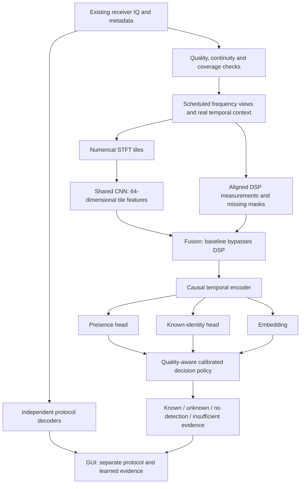
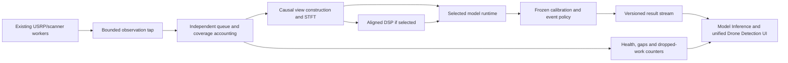

# Drone RF model training and inference: complete implementation plan

Date: 2 November 2026  
Status: **Plan only. No training, deployment or application changes are authorized by this document itself.**

This is the consolidated plan for the next model generation. It incorporates the existing application, previous model shortcomings, the unified decoder integration and the latest real-IQ replay. It supersedes older model plans as the proposed sequence of work; older reports remain evidence of what was actually implemented and measured. Proposed choices below are experiments, not claims of optimality.

## 1. Objective and non-negotiable boundaries

Build a versioned model and inference engine that consume the application's existing receiver data, detect supported drone-system RF activity, identify known model classes when justified, reject unsupported identities and expose uncertainty. Reduce false alarms without silently hiding missed detections.

- The classifier is essential to the unified drone service. Decoder failure must never prevent valid RF observations from reaching it.
- Preserve existing receiver, scanning, security, cyclostationary, decoder and GUI functionality. New model execution is isolated and bounded.
- Reuse acquired IQ. Do not start another radio owner or change tuning, gain or sample rate behind existing workers.
- Keep dataset originals read-only and all derivatives in a new workspace experiment directory.
- Do not train on reserved final-test data, fit preprocessing on it, or repeatedly inspect it to make design choices.
- No automatic replacement of existing checkpoints or enabling of identity acceptance.
- Account for every dataset, but admit only records with an appropriate format, provenance, label scope and permitted use.
- Do not promise detection of every drone. Results apply to measured bands, observation time, signal conditions and supported representations.

The initial detection target is **drone-system RF activity**, not proof that an aircraft is airborne. Controller-only traffic must retain its role where known. Exact aircraft model, link family, protocol claim and physical transmitter identity are different outputs.

## 2. Starting point: facts and remaining gaps

| Item | Verified status | Consequence |
|---|---|---|
| Broad IQ replay | 27 recording/member/band cases, 22 dataset model-context labels, 21.6 sample-seconds | Coverage smoke test; not 22 validated live identities |
| Current first-prefix path | No CRC-valid packet in the tested first prefixes; later replay recovered one | First 160 ms is not sufficient evidence of whole-capture coverage |
| Frequency coverage diagnostic | Five previously successful packet controls: 3/5 recovered as-is, 5/5 with overlapping frequency views | Motivates better channel coverage; selected controls cannot measure population recall |
| O4 evidence | Candidate windows in Avata 2 and Mini 4 Pro contexts | Structure candidates are not exact-model truth or generic drone-presence labels |
| Prepared research inputs | 198 frequency views; 5,564 valid 8 ms tiles; 80–256 ms available context | Input compatibility checked; labels unset and training eligibility disabled |
| New hybrid model | Untrained, 261,975 parameters with 21 identity classes | No recognition or probability-calibration claim |
| Existing identity models | Remain available and unchanged; live false positives and Mini 2 confusion reported | Reference baselines, not qualified presence detectors |
| Known-class calibration | Three declared classes: Air 2, Air 2S, Mini 4 Pro; independence still needs review | Other 18 training-context classes lack independent known-class calibration in the inherited split |
| Unknown development | Mini 3 Pro is withheld for unknown calibration | Keep out of training; one unknown class cannot establish broad unknown-drone performance |
| Verified no-drone evaluation | None in the reviewed corpus | Cannot yet measure or substantiate the required false-alarm rate |
| Native processing | 388.23 s worker time for the first 20.6 s of RF in offline replay | Current exhaustive diagnostic is not qualified for real-time operation |

Twenty relevant tests and all 198 random-weight forward checks passed. These establish software behavior and numerical compatibility, not model accuracy. See the [replay report](docs/DRONE_IQ_REPLAY_AND_MODEL_INPUTS_2026-11-02.md) and [readiness register](docs/DRONE_ML_PRETRAINING_READINESS_2026-10-29.md).

## 3. Output contract: define the problem before training

| State | Required evidence | UI interpretation |
|---|---|---|
| No drone RF activity detected | Valid observation within a qualified operating domain; presence policy below its negative criterion | No drone activity detected in the stated observed band/time; never a claim about unobserved space |
| Known drone-system candidate | Presence accepted, class eligible for acceptance, identity/rejection criteria passed | Model name with evidence level and separate presence/identity scores |
| Unknown drone system | Presence accepted, all eligible known identities rejected | Drone activity supported; model unresolved |
| Unclassified RF / insufficient evidence | Ambiguous presence, incompatible evidence, unqualified class or out-of-domain input | Do not force either no-drone or unknown-drone |
| No usable observation | Gaps, invalid input, unsupported representation, stale data or worker failure | Coverage unavailable; show reason |

Presence and identity acceptance are separate decisions. The highest identity softmax is initially a **candidate score**, not a probability that a drone exists. Calibrated scores may be called probabilities only after calibration and evaluation within a stated domain. An unfamiliar Wi-Fi signal is not an unknown drone just because identity rejection occurs.

Retain decoded evidence independently. CRC-valid packets support packet integrity; they do not cryptographically authenticate the transmitter. If decoder evidence and ML disagree, expose the conflict and provenance rather than manufacturing a single confident identity. Do not infer one physical aircraft from overlapping frequency views or matching product names.

## 4. Data inventory, integrity and label scope

Create one versioned corpus ledger before extracting the next training corpus. Each admitted unit must identify:

- Dataset/version, source path, exact archive member and dataset key where applicable; checksum and checksum scope.
- Numeric IQ type, byte order, scale, actual sample rate, center frequency, valid sample extent and continuity evidence.
- Physical aircraft/controller identifiers where known, collection session/day/location, receiver, antenna, gain and operating state.
- Dataset model context, transmitting role if known, confidence and the evidence supporting each label.
- Conservative parent group, frozen partition, permitted task and licensing/attribution status.
- Quality exclusions, duplicate relationships and all derived view/time offsets.

Use explicit label scopes:

| Label scope | Permitted supervision |
|---|---|
| Adjudicated drone region | Presence; identity only when the emitter/model association is supported |
| Reviewed positive recording bag | Weak presence/identity supervision at the supported bag level; never automatic per-tile truth |
| Verified negative interval/session | Presence-negative supervision within the documented scene/band/time scope |
| Known drone with unknown model | Presence-positive; no known identity target, provided its partition permits training |
| Controller-only | Drone-system activity/role under the chosen target definition; not automatically aircraft-transmitter presence |
| Ambiguous source, mixture or unresolved format | Unlabelled research or separate robustness evaluation; no invented truth |

Positive bags require evidence that their actual selected content contains the target. A drone elsewhere in a long recording does not label a 256 ms crop, and a drone in one subband does not label every subband. For weak labels spanning several views, preserve the whole supported bag and its grouping rather than promoting each view into a positive example.

Do not label negative examples from failed decoding, low O4 correlation, an identity model's rejection, zero padding, or synthetic silence. DSP/model predictions can prioritize review; they cannot independently establish their own evaluation truth.

Quarantine unresolved FPV encoding/valid-length records. Excluding them is acceptable and must be recorded. Preserve archive-member integrity in scoped exports. Record license obligations before selecting sources for the intended product use; older provenance reports are not a substitute for resolving an applicable use restriction.

### Fresh labelled sessions using the existing recorder

Prepare a capture manifest and session checklist before acquisition. Hardware operation remains a separately scheduled task; this plan does not start recordings.

| Session type | Examples and required notes | Purpose |
|---|---|---|
| Controlled background | Quiet scene, router idle/load, phone hotspot/uploads, mixed Wi-Fi; documented exclusion of target drone systems within the scene | Train/evaluate presence negatives and difficult false alarms |
| Mini 2/controller states | Both off, controller only, connected system idle, supported active states when testing is available | Resolve role ambiguity and the observed live Mini 2 failures |
| Drone plus interference | Repeat supported positive states with Wi-Fi congestion and different strengths/orientations | Evaluate weak-target and mixed-emitter behavior |
| Independent repeats | Different days, locations, receiver/gain configurations and physical units when available | Separate memorization from generalization |

Capture original IQ and actual receiver metadata, drop/overflow counters, tuning changes, timestamps and state transitions. Mark transition/settling regions uncertain. Keep scene notes separate from model inputs. “My Mini 2 was off” proves only that target state unless wider scene evidence supports a negative label.

Initial collection budget: several sessions per condition across at least three days and two environments where practical, with independent training and evaluation sessions. This is a collection starting point, not a sufficient sample-size guarantee. Evaluation duration must be sized to the chosen false-alarm target. Under a simple stationary Poisson assumption, zero false events over T hours gives an approximate one-sided 95% upper rate of 3/T per hour; correlated/nonstationary scenes require stronger session-level analysis. Minutes of quiet data cannot certify a low hourly false-alarm rate.

Live Mini 2 tests may remain deferred. Corpus audits, input contracts and negative-session preparation can proceed; Mini 2 deployment qualification cannot be marked complete meanwhile.

## 5. Partitioning and leakage prevention

Split parent groups before windowing, augmentation, channel selection or tensor generation. Keep all overlapping crops, archive derivatives and repeated captures of unresolved units together conservatively.

Define four roles: training, grouped development for model selection, calibration for the final decision policy, and locked final evaluation. Where the existing corpus cannot support all four independently, report the reduced independence explicitly; do not rename reused calibration data as a fresh test. A new partition revision must preserve the already locked final sets and document every permitted reassignment.

- Check exact duplicates and credible near-duplicate relationships across partitions.
- Publish class × physical-unit × session × receiver × band coverage, including unknown fields.
- Fit any learned normalization, sampling weights and identity prototypes on training data only.
- Use whole held-out model classes for unknown development and different whole classes for final unknown evaluation.
- Keep Mini 3 Pro unknown calibration out of model fitting, including self-supervised pretraining.
- Keep classes without independent evidence experimental; do not imply that 21 output logits create 21 qualified identities.
- Record every development comparison to make repeated tuning visible.

## 6. Signal representation and temporal context

### Freeze a numerical preprocessing contract

Begin with the implemented research representation, independently versioned from old live checkpoints:

| Parameter | Starting contract |
|---|---|
| Receiver input | Contiguous complex IQ plus acquisition metadata |
| Model frequency view | 20 MSps, causal anti-aliased downconversion/decimation |
| Coverage | Overlapping guarded views; existing diagnostic uses seven at 100/120 MSps and eleven at 200 MSps |
| Warm-up | Real pre-roll, retained FIR delay, no invented samples |
| STFT tile | 8 ms, 160,000 complex samples at the view rate |
| FFT | 256-point, periodic Hann, two-sided FFT-shifted |
| Hop | 256 samples; 12.8 microseconds |
| Bin spacing | 78.125 kHz; not a guarantee of practical spectral resolving power |
| Tensor | Numerical log-power, 1 × 256 × 625; no colormap, screenshot, text or image resizing |
| Conditioning | Versioned mean removal/unit-RMS/log floor; record exact implementation and any later training-only normalization |
| Temporal context | Start at 32 tiles/256 ms where genuine contiguous data exists |
| Boundaries | Reset on retune, gap, source/configuration change or invalid observation |

The present extractor accepts integer-multiple input rates from 20 to 200 MSps. This is its current software contract, not a proposed radio/NIC cap. Extend rate handling only with validated resampling and parity tests. Greater transport bandwidth does not remove preprocessing or scheduling costs.

**8 ms is a tile duration, not a packet duration or the model's full history.** The FFT support and hop are 12.8 microseconds in this representation. No single packet length applies across the target links. Energy regions are not necessarily packets; infer packet boundaries only where protocol evidence supports them.

Compare genuine continuous contexts of 64, 128, 256, 512 and 1,024 ms on records that support them. Use an initial small comparison, then expand only when evidence justifies it. Never concatenate separate Leuven members to fabricate longer history. Report context-specific support and latency. Test shorter/truncated observations explicitly rather than hiding them with padding.

If needed, compare a second resolution on the same physical interval—such as 512-point FFT with 256-sample hop—and version its different tensor shape. Architecture/input changes require new training and parity checks. Do not assume a larger FFT or longer context is better.

Magnitude STFT loses complex phase. A literal Zadoff–Chu sequence detector needs a separate complex-IQ correlation path with justified hypotheses and synchronization, tested against nonmatching signals. It is not a universal drone feature and is not implemented merely by adding a feature column. Generic averaged FFT displays are insufficient substitutes for this input. Receiver-provided FFTs are usable only if their window, timing, scaling, bin order, conditioning and metadata match a validated contract; keep IQ for phase-sensitive branches.

### Coverage policy

Maintain scheduled coverage of guarded frequency views and contiguous time, with optional burst/local views to improve localization. Energy proposals prioritize work but never become a drone gate. Keep weak-signal and non-peak fallback coverage. Admit uncertain geometry as uncertain rather than discarding it silently.

Measure missed bands, unprocessed time, capture-prefix omissions and queue loss. The offline grid is expensive and excludes source edges; it is not yet a live scheduler. Separate coverage gains from model gains in every experiment.

## 7. Architecture selection

Preferred candidate: a **shared spectro-temporal encoder with separate presence and identity heads**, followed by an explicitly calibrated rejection policy. This computes identity evidence alongside presence rather than discarding observations at an irreversible binary front gate. The final presence decision still controls whether an identity may be presented as accepted.

### Models to compare

| Candidate | Purpose | Main caveat |
|---|---|---|
| A: shared STFT CNN + causal temporal encoder | Primary simpler baseline | May learn dataset/receiver texture instead of drone activity |
| B: A plus five aligned DSP features and masks | Test whether signal structure improves robustness | O4-specific bias and missingness/source shortcuts |
| C: separate presence model followed by identity model | Explicit two-model cascade comparison if A/B warrant it | Presence misses are unrecoverable; compounded errors and extra maintenance |
| Existing compact/residual identity models | Historical reference on compatible inputs | Closed-set scores cannot establish drone presence or unknown rejection |

Do not train every architecture/context combination immediately. First validate A, compare B under the same split and input budget, then consider C or a larger backbone only for a measured weakness. All candidates must be judged end-to-end, including presence misses and false alarms.

### Existing hybrid candidate layers

| Stage | Layers/output |
|---|---|
| Tile encoder | Conv2D 1→16, kernel 5, stride 2; then 16→32→64→96, kernel 3, stride 2; GroupNorm and SiLU |
| Tile embedding | Adaptive 4×4 pooling, flatten, linear 1536→64, SiLU |
| DSP encoder | Nine numeric slots plus nine availability masks: linear 18→32→32, SiLU |
| Fusion | Concatenate 64+32, linear 96→64, SiLU |
| Temporal encoder | Six causal residual Conv1D blocks, 64 channels, kernel 3, dilations 1/2/4/8/16/32; per-time channel normalization |
| Presence | Linear 64→2 logits |
| Identity | Linear 64→K logits for the frozen known-class map |
| Rejection representation | Normalized 64-dimensional temporal embedding |

With K=21 this implementation has 261,975 parameters. Its theoretical receptive field is 127 tiles/1.016 s; maximum accepted context is currently 128 tiles/1.024 s, with batch×time bounded at 128. Shorter inputs provide shorter real history. The inference implementation must preserve causal behavior and gap resets.

Baseline DSP policy permits only the five implemented same-view correlation/prominence features. A completed 16 ms feature attaches to its ending tile only. ADC clipping remains quality metadata because its trustworthy availability differs by source encoding; ZC/bandwidth/duty remain unavailable. Do not supply zeros while falsely marking an unmeasured feature available. Compare DSP dropout and STFT-only results; do not claim fusion helps before measurement.

## 8. Training procedure

### Stage A: readiness and small execution check

Freeze corpus/split/preprocessing/architecture manifests and run leakage, label-scope, finite-value, causal-alignment and parent-group checks. Exercise a small reviewed training subset to verify loss routing, gradient flow, checkpoint/resume behavior and deterministic evaluation. This is an execution check, not an accuracy result.

Do not start the intended presence experiment until verified training negatives and independently reserved negative evaluation sessions exist. A deliberately limited exploratory run would need a separately recorded scope and could not claim to solve false alarms.

### Stage B: supervised baseline A

- Sample across classes, parent groups, sessions and sources; cap repeated windows from one long recording.
- Use per-region presence loss only for reviewed region labels. Apply identity loss only on supported known-drone regions.
- Use a separately tested weak-bag objective for supported positive bags; never convert bag identity into every tile's target.
- Verified negative bags supervise absence only within their documented scope. Unlabelled regions contribute no fabricated supervised target.
- Unknown-model training examples, if genuinely admitted to training, may supervise presence without a known-class identity target. They must not be the held-out unknown evaluation classes.
- Start with presence and identity cross-entropy and an explicit identity loss weight. Investigate conflicting gradients and presence regressions before adding loss complexity.

Proposed initial recipe, to freeze after a memory/throughput pilot: AdamW, learning rate 3e-4, weight decay 1e-4, gradient norm clip 1.0, short warm-up and cosine decay, maximum 50 epochs, early stopping patience 8 on a predeclared grouped development criterion. These are starting settings, not established optima. Use masks and normalization already in the contract. Fit additional normalizers only on training data.

Start at no more than 128 tiles per batch, for example four 32-tile sequences, reducing microbatch size as needed. Gradient accumulation may increase effective batch size without changing sample/group quotas. Use three fixed seeds for the shortlisted recipe; do not perform an uncontrolled search over seeds or thresholds.

Use an available compatible NVIDIA GPU for training after checking the installed runtime, memory and numerical behavior. Mixed precision is conditional on finite-loss and parity checks. CPU fallback must report its actual expected cost; do not launch duplicate jobs or silently interrupt an existing experiment. Save optimizer/scheduler/scaler/RNG state, epoch/step and manifest hashes for exact resume.

Augmentation must preserve supported labels: bounded receiver-like CFO, amplitude/noise/channel variation where justified, and physically valid crops inside labelled scope. Evaluate augmentations by source/class. Avoid image rotations, arbitrary time/frequency warps, silent padding or synthetic mixtures whose label semantics are unknown. Unit-RMS preprocessing removes simple amplitude scaling, so check whether an augmentation actually changes model input.

### Stage C: hybrid comparison and failure analysis

Train B with the same data, group quotas, contexts, seeds and evaluation policy as A. Compare DSP-present, DSP-missing and STFT-only conditions. Inspect background false alarms, unknown presence misses, source-held-out degradation and non-DJI behavior. A small overall gain cannot justify a major regression on these outcomes.

Mine difficult errors only from permitted development/training pools. Manually or independently establish new labels before adding reviewed hard negatives to a versioned training corpus. Preserve calibration/test separation. Never relabel final-test failures for the same evaluation cycle.

Consider self-supervised pretraining or a larger model only if learning curves and label-independent diagnostics justify it. Fit pretraining exclusively on permitted training sources. More network capacity cannot create absent negative truth or missing independent aircraft.

## 9. Calibration, unknown rejection and temporal decisions

Freeze the selected model before policy calibration. Separate presence calibration from conditional identity calibration. Compare a small predeclared set of rejection approaches: calibrated identity score/margin, training-prototype distance, and their simple combination. Use held-out unknown classes and verified backgrounds in development. Do not assume softmax thresholding or any one distance method is sufficient.

Use a presence uncertainty interval rather than forcing a binary answer everywhere. Evaluate persistence/hysteresis and event grouping explicitly: they can reduce alerts but also miss brief activity and delay detection. Reset at discontinuities. Overlapping tiles/views are correlated; repeated votes are not independent evidence.

Choose the operating point before final testing. Record the intended maximum false drone events/hour, required event recall by signal condition and acceptable alert delay. No numerical target has yet been agreed; do not invent one and declare success. Publish the tradeoff curve so the final choice is reviewable.

Class-level identity acceptance requires independent supporting evidence. An unqualified class may remain a visible experimental candidate; it cannot become validated because its training score is high. If presence itself is unqualified, remain diagnostic rather than displaying confident no-drone/unknown-drone conclusions.

## 10. Evaluation and final-test protocol

Evaluate complete observations, including invalid or omitted coverage, rather than selecting only crops where the energy detector or decoder succeeded.

| Area | Required measurements |
|---|---|
| Presence | Event recall, false events per valid monitored hour, precision at stated prevalence, false-positive duration and detection delay |
| Identity | Per-class confusion, macro/group-balanced accuracy, accepted-identity precision, correct identification including upstream misses |
| Unknowns | Unknown-drone presence recall, unknown false acceptance into known classes, known rejection and background incorrectly called unknown drone |
| Temporal aggregation | Window, recording/bag and event metrics separately; delay and brief-event misses |
| Generalization | By physical unit/group, session, receiver, dataset, band, operating state and supported signal-quality strata |
| Runtime | Stage timings, end-to-end p50/p95/p99, sustained throughput, memory, queue age, dropped samples, analyzed coverage and UI impact |

Give denominators and uncertainty intervals; bootstrap by independent sessions/groups when supported, not overlapping tiles. Report uncertainty where independent sample counts are too small. Stratify by measured SNR only when its estimation/reference is defensible; otherwise label signal-quality proxies accurately.

Before opening final partitions, freeze model/preprocessor hashes, class map, operating policy, event definition and evaluation script. Run one final evaluation for that frozen candidate. If it fails, record failure; any reused test becomes development evidence and requires a genuinely new final holdout for subsequent claims. Do not quietly tune on the failed final set.

Include prospective live background and Mini 2 tests when available. Public-dataset success alone cannot resolve receiver/domain shift in this application.

## 11. Inference engine and application integration

### Input and output interfaces

IQ input metadata must include observation/session ID, continuity epoch, sample index/timestamp, actual rate, center frequency, format/scale, gain/configuration version, dropped samples and validity. FFT input additionally needs the complete validated preprocessing contract. Reject incompatible inputs explicitly.

Each inference result should include:

- Schema/model/preprocessor/policy/class-map hashes and class qualification status.
- Observation interval, frequency extent, continuity epoch, measured coverage, latency and quality/abstention reason.
- Decision state, separate presence and identity scores, top candidates and rejection reason.
- Whether scores are calibrated within the applicable domain; no unconditional probability label.
- DSP availability and decoder references as separate evidence, not hidden inputs containing claimed model names.
- Event association identifier with its limited meaning; no unsupported unique-aircraft count.

### Runtime and isolation

Keep initial deployment in a separate model process using the existing worker transport. Model failure must not stop capture or decoders; the unified service must show incomplete/degraded because its mandatory classifier is unavailable. Do not quietly revert to an old model and preserve a qualified badge.

Benchmark the Python reference, then evaluate a supported C++-friendly export/runtime such as ONNX Runtime or TorchScript against the actual installed toolchain. Export is not assumed to work: the present dynamic masking/segmentation code needs an explicit exportability review. A fixed-shape masked wrapper or redesigned state API may be needed. Pin runtime versions and require output/state parity before selecting the deployment format.

Compare reference versus deployed outputs on real replay fixtures, gaps, retunes, missing DSP, invalid tiles, batch changes and startup/warm-up. Verify logits, embeddings and final decisions within recorded tolerances. Test streaming against full-context reference without future leakage. Cache tile embeddings/temporal state only after correct reset and overlap behavior are proven.

Use bounded asynchronous queues and timestamped backpressure. On overload, expose skipped work and invalidate continuity where required. Profile copying, channelization, STFT, DSP, model and decision aggregation separately. Batch only when it does not hide excessive delay; do not combine unrelated streams into one temporal history. The 10 Gb NIC does not establish compute sufficiency.

The full frequency grid is an offline diagnostic, not the deployment requirement. Select a measurable coverage schedule that balances broad fallback, weak signals and local proposals. If real-time targets are not met, report reduced coverage or degraded service rather than claiming real time from forward-pass timing alone.

### GUI requirements

Keep the existing Model Inference tab and unified Drone Detection subtab consistent. Show Start/Stop Inference, model/version/qualification, decision state, score semantics, candidates, observed band/time, live numerical-STFT visualization, history and runtime health. Display the actual analyzed view and its timestamp; a stale image must not look live.

Use distinct presentation for decoded protocol claims, DSP candidates and ML decisions. Preserve current worker ownership rules: stopping a service stops only workers it started. No blocking processing on the GUI thread. A disabled or crashed classifier makes full-service status incomplete even if decoders continue.

Package model weights, preprocessing, class eligibility, calibration/rejection policy, schema, dependency/runtime manifest, checksums, validation report and a small lawful parity fixture set together. Keep the prior package available for explicit rollback. Promotion requires a reviewable qualification report and explicit deployment decision.

## 12. Milestones and exit gates

| Milestone | Work and artifacts | Exit gate |
|---|---|---|
| M0 — Consolidated contract | This plan, state semantics, operating envelope and metrics | Requirements reviewed; unresolved targets listed |
| M1 — Corpus and splits | Immutable ledger, archive-member binding, class/group matrix, label-scope audit | No known leakage; reserved sets intact; exclusions documented |
| M2 — Presence evidence | Reviewed positive bags/regions and controlled background sessions | Independent scoped negatives available; no decoder-derived absence labels |
| M3 — Input pipeline | Frozen representation, causal alignment, multi-view sampling, parity fixtures | Shapes/units/continuity verified; feature source shortcuts assessed |
| M4 — Training readiness | Dataset statistics, class eligibility, recipe, memory pilot and caveat report | Every blocking issue closed or explicitly excluded from the claimed experiment |
| M5 — Baseline A | Reproducible training, checkpoints, grouped development report | Finite/resumable run; end-to-end metrics and failures reported |
| M6 — Compare B and context | Controlled DSP/context ablations; C only if justified | Select by presence/identity/unknown/runtime tradeoffs, not training accuracy |
| M7 — Calibration | Frozen model, rejection/persistence policy and calibration report | Predeclared operating target supported on independent development evidence |
| M8 — Locked evaluation | Final per-class/group/background/unknown report | No hidden tuning; supported claims and remaining gaps explicit |
| M9 — Inference engine | Versioned package, C++ transport/runtime parity, sustained replay benchmark | Correct boundaries/resets; bounded queues; measured resource and coverage limits |
| M10 — Live qualification | Controlled background and Mini 2 sessions; app regression/latency checks | Prospective evidence supports intended operating envelope |
| M11 — Release decision | Model card, GUI labels, rollback and promotion record | Explicitly accepted deployment; unsupported identities remain disabled |

Current position: M0 documented; portions of M1/M3 implemented and checked. M2 is unresolved. The existing architecture and 198 unlabelled views do not mean M4–M11 are complete. Do not assign calendar dates before data availability and measured training/runtime throughput are known.

## 13. Caveats to review before any training launch

| Risk | Why it matters | Required response |
|---|---|---|
| No independent negative truth | False-alarm reduction cannot be demonstrated | Obtain scoped background sessions before the intended presence run |
| Weak positive crops | Learns Wi-Fi, silence or receiver artifacts as drones | Audit actual bag/region scope; retain unlabelled data |
| Sparse independent aircraft | Memorizes a transmitter/session instead of a model | Conservative groups, qualification limits, more independent collection |
| Shared link hardware | Exact model may be intrinsically ambiguous | Allow family-level evidence and rejected exact identity |
| Controller/aircraft mixtures | Wrong transmitter-role claim | Separate role metadata and report unresolved role |
| Dataset shortcuts | Good offline metrics, poor live USRP behavior | Source-held-out tests, feature ablations, prospective capture |
| O4 feature bias | Misses other links or flags similar non-drone structure | Compare STFT-only and non-O4/non-DJI subsets |
| Rare/novel drones | High closed-set score for a wrong class | Withheld-class evaluation and explicit abstention |
| Missing/short context | Late bursts missed; fake continuity inflates scores | Continuous scheduled coverage, gap masks and duration-specific reporting |
| Overlapping derivatives | Artificially large sample count and confidence | Group-level splits/metrics; count independent sessions |
| Normalization | Removes absolute power and may amplify weak noise patterns | Separate validated quality handling; test background behavior |
| Multi-emitter scenes | Single label may be unsupported | Preserve multiple views/conflicts; evaluate mixtures separately |
| Compute load | Backlogs can miss activity and disturb the app | Profile complete pipeline, bounded work, visible coverage loss |
| Calibration reuse | Optimistic thresholds and repeated-test overfitting | Record reuse; freeze policy and protect final tests |
| Source licensing | Downloaded material may not fit intended use | Retain per-source terms and resolve applicable restrictions |

At M4, publish a short launch report naming every remaining limitation, exact admitted/excluded classes, independent group counts, negative-hours coverage, unknown classes, recipe and expected compute/storage use. If the evidence cannot support no-drone, unknown-drone or exact-model claims, say so before consuming training time.

## 14. Immediate next actions and completion definition

Next: finish the corpus/label-scope audit, prepare controlled background recording manifests, and freeze the preprocessing/split contract. Review the 198 existing views as derivatives of their parents; do not simply switch their training eligibility on. Continue software preparation while live Mini 2 testing is deferred.

This segment is complete only when a reproducible trained model, a versioned inference engine, a calibrated decision policy, independent evaluation and application integration all exist within a documented operating envelope. A checkpoint file or a high closed-set accuracy is not sufficient.

Reference implementation and evidence:

- [Real-IQ replay and model-input report](docs/DRONE_IQ_REPLAY_AND_MODEL_INPUTS_2026-11-02.md)
- [Pretraining readiness and caveats](docs/DRONE_ML_PRETRAINING_READINESS_2026-10-29.md)
- [Current unified integration and limitations](docs/UNIFIED_DRONE_INTEGRATION_2026-11-01.md)
- [Experimental hybrid architecture](tools/drone_ml/hybrid_model.py)
- [Causal temporal architecture](tools/drone_ml/temporal_model.py)
- [Offline input preparation](tools/drone_ml/hybrid_inputs.py)
- [Baseline DSP feature policy](tools/drone_ml/hybrid_feature_policy.py)
- [Machine-readable replay/compatibility summary](data/drone_ml/2026-11-02/verification_summary.json)
