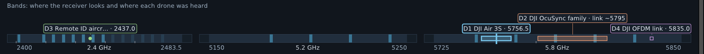
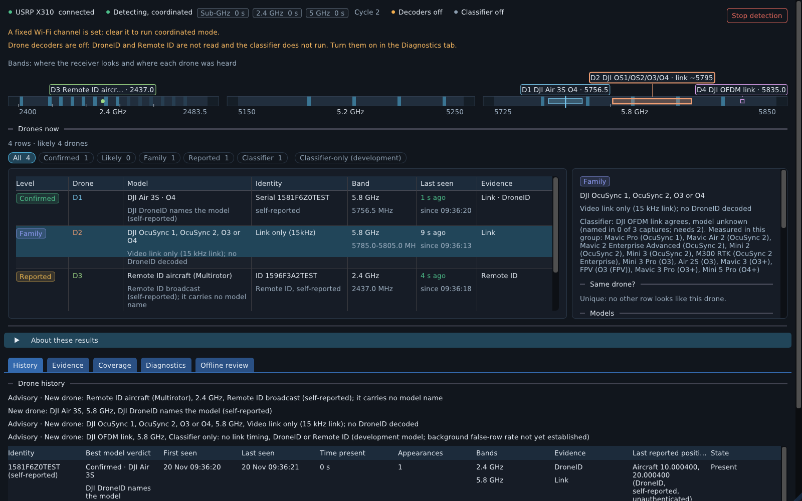
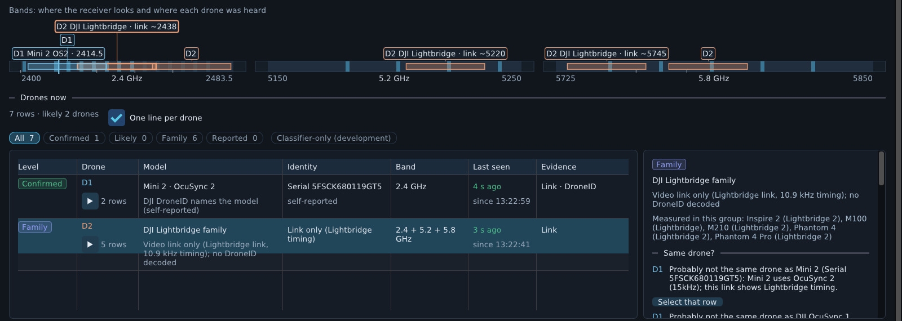

# Drones page redesign (2026-11-19)

This folder is a copy of `~/Documents/newrocktest-cpp` taken on 19 Nov 2026 (commit `ebaefec`
plus that tree's uncommitted work). The original is untouched. Nothing here is committed: the
copy as taken is **staged** (`git diff --cached` = the import), and the redesign is the
**unstaged** diff (`git diff`).

Mockup it follows: `drones_page_mockup.html` in `~/Documents/upgraded_ui/docs/`.

## What changed on the page

The modern workspace's Drones page now has, top to bottom:

1. **Status strip**: receiver and connection, mode (detecting / one band only / stopped), the
   last visit of each band (amber when a band is late), cycle, classifier state, and **one**
   button: Connect receiver, Start detection or Stop detection. Start/Stop is the same
   coordinated start/stop as before (`coordinated::start_detection` / `stop_detection`).
   Schedule conflicts, receiver overflows and log write failures show here as warnings.
2. **Newest alert** from the track list, with Show (selects its row) and Dismiss.
3. **Band bar**: the 2.4, 5.2 and 5.8 GHz drone bands, where the receiver looks in them, and a
   mark and label for each row at the frequency it was heard (see "Band bar" below).
4. **Drones now**: one row per drone, strongest evidence level first: level badge (hover for
   its meaning), model and basis, identity, band and frequency, last seen / since, evidence
   kinds. Filters by level with counts; the classifier-only switch is a chip.
5. **Details panel** for the selected row (beside the table, or below it in a narrow window):
   level, basis and detail, models (classifier scores as bars, measured candidates, hints),
   signal and identity, a sketch of reported positions with their coordinates, the evidence
   behind the row with ages, and Show evidence / Copy details / Open in Model Inference.
6. **About these results**: the standing caveats, folded.
7. **Tabs**: History (track table, height adjustable), Evidence (the combined entries table
   with a per-source filter and the inspector), Coverage (schedule strip, per-band coverage,
   schedule settings), Diagnostics (module health, link-timing drops, DroneID follow-up, all
   decoder sections and their independent controls, Bluetooth Remote ID), Offline review.

Empty states: receiver not connected (Connect receiver), one band only (Start detection),
detecting with nothing seen ("not proof that none is there").

## Drone service on by default (after the first live test)

Live test on the X310: detection had been started from Monitoring setup's mode list, which
only changes the band, so the drone service (DJI DroneID native and older decoder, Wi-Fi
Remote ID, the universal classifier) never started; rows could only say "Link only".
Now `main.cpp` starts the service when the app starts, whichever way detection is started.
The status strip shows "Decoders on/off" and the classifier state (ready / starting /
failed), with a warning when they are off or the classifier failed. Diagnostics has the
on/off switch ("Drone decoders and classifier"). Stop detection leaves the service running.

## Classifier's best guess and why it was not named (display only)

Live test: the classifier typed every capture DJI OFDM but named 0 models, so no model list
ever showed and the page did not say why. Now `UniversalClaim` also carries, for captures it
typed but did not name: the ranked models (mean score), how many missed the score limit or
were too far from the model's training views (distance limit), and the latest numbers. A row
whose readable DroneID names the model keeps the classifier's view separately
(`Detection::classifier_check`) so the two can be compared. The details panel shows these as
"Classifier's best guesses (not named)" / "Classifier check (DroneID decides this row)" with
the reason, and the detection log writes them under `not_named` and `classifier_check`.
None of it reaches a level, verdict, track or alert; naming limits are unchanged.

## Classifier package picker

Diagnostics has a "Classifier package" picker listing every `data/drone_ml/<dir>/universal_package/universal_v<N>.pt`
(newest first; experiment checkpoints are not listed), v3 marked default. Choosing one reloads a
running classifier with it (`main.cpp`: `classifier_package`, `classifier_options`); if the
classifier is off the choice is used when it starts. The choice is not saved: each launch starts
on v3. Classifier rows from the previous package age out (they are keyed by model hash).
Checked in the app: choosing v2 restarted the worker with `universal_v2.pt` and the model hash
changed.

## Same drone? (display only)

Live test: a readable and an unreadable DroneID packet from one Mini 2 (same channel, same
second) showed as two rows. `drones_page::group_rows` now marks rows that probably describe one
aircraft; rows are never merged and levels are unchanged.

- certain: the same serial number (DroneID, or a Remote ID serial matching a DroneID serial);
- likely: DroneID on the same channel (within 1 MHz) within 10 s;
- possible: DroneID within 20 MHz of a measured link, both seen within 45 s (marked "?").

Certain and likely links give the Drone column numbers (D1, D2, ... in table order;
"D1 · 2 rows" when shared). The header reads "N rows · likely M drones (perhaps K)" where K
also counts possible links. The details panel has a "Same drone?" section with the reason for
each related row and a button to select it.

## Training recorder (DroneID-labelled captures)

Live test: the classifier's Mini 2 class came from one aircraft in one lab dataset
(KU Leuven DroneRF), so it does not recognise the user's Mini 2 on the X310. The recorder
collects labelled training data from this receiver: `src/drones/labelled_recorder.hpp`.

- Diagnostics > Training recorder: folder (default
  `/media/sudeep/Storage/drone_universal_classifier/own_x310_labelled`), Start / Stop, and
  counts per model; the status strip shows "Recording labelled captures: N".
- It saves, for every row a readable DroneID names: the captures where that drone's link was
  measured (`evidence: link`) and the capture its packet came from (`evidence: droneid`),
  labelled with the DroneID model and serial. A capture two models claim is skipped.
- While recording, the scanner keeps the last 24 captures in memory (about 2 GB) so they are
  still there when the DroneID packet arrives; the previous retention returns on Stop.
- Output: `labelled-<stamp>/session.json` plus one sc16 file per capture (about 41 MB), the
  `background_rotate.py` layout with extra fields (model, serial, evidence, group, link range,
  capture_seq, tuning). Writing runs on its own thread; at most 6 captures queue.
- Stops itself at 20 GB free on the disk or 60 GB per session, with the reason shown.
- Checked: unit tests (selection, files, scaling, session.json, limits) and a recorder-written
  session replayed by `drone_session_replay` with package v3.

## Carrier offsets (step 1 of grouping one drone's rows: measurement only)

Live test: one Mini 2 made about 28 rows in 50 minutes (its link moves channel and band, and
DroneID comes on seven channels), because rows are named by band and frequency. A drone builds
its 2.4 and 5.8 GHz carriers from one crystal, so its frequency error in **ppm** is the same on
both bands and usually differs between units. Step 1 measures that; nothing groups on it yet.

- **DroneID offset.** The DJI decoder already measured each packet's carrier offset (`cfo_hz`,
  from the cyclic prefix plus the two Zadoff-Chu symbols) but the app dropped it. A packet
  decoded on a documented DroneID channel now keeps it (`Packet::offset_hz`, `channel_hz`,
  `offset_ppm` = Hz / channel); one found by the decoder's own automatic centring keeps the Hz
  but gets no ppm (no nominal carrier). Each row gathers the offsets of its held packets
  (`Detection::droneid_offsets`, both bands for a serial row), summarised by
  `drones/carrier_offset.hpp` (mean, spread, each band, 5 GHz minus 2.4 GHz difference).
- **Link grid.** The link-timing probe already correlated each block at the OFDM useful-symbol
  lag; the phase of that correlation places the link's subcarrier grid modulo its spacing
  (15, 30 or 32.8 kHz). `Probe::measure` can return it (`Phases`), interpolated between the two
  samples around a fractional lag; `measure_blocks` (now shared by the live monitor and offline
  tools) sums it over the blocks that flagged the spacing; `Result::grid` holds the position in
  Hz modulo the spacing and a coherence (1: every block agrees). Not converted to ppm: that
  needs the link's nominal channel grid, still to be checked (see below).
- **Shown** in the details panel under Signal and identity ("DroneID offset", "Link grid", with
  tooltips) and in Copy details. **Logged** per measurement to `data/drone_offsets.jsonl`
  (`rfmon.drone_offset.v1`, kind `droneid` / `link`, bounded at 64 MB plus one `.1`), and in the
  detection log under `droneid.carrier_offset` and `timing.grid_offset`. The detection log's row
  comparison ignores them, so they add no update events.
- Both include this receiver's own crystal error (the same ppm for everything it hears): values
  compare only with others from the same X310.

**Checks**

- Decoder precision, recorded Mini 2 DroneID fixture (10 packets): every added shift from
  -14.5 kHz to +23.5 kHz came back exact to 0.1 Hz; the packets agree within about +-25 Hz
  (0.01 ppm at 2.4 GHz).
- Link grid, synthetic 15 kHz OFDM (`test_symbol_timing`): positions within 10-22 Hz for shifts up
  to several MHz across the capture; coherence 0.998. Link-timing ratios unchanged (parity test
  against the 11 Nov reference captures passes).
- Real Mini 2 link (KU Leuven DroneRF, their X310 at 100 MSps, channelised to 20 MSps at
  2413.5 MHz; 71 recordings of 0.2 s): every capture typed 15 kHz, coherence 0.99-1.00, grid
  position 2727 Hz with a spread of 90 Hz (0.04 ppm). One DroneID packet from that drone
  (serial 3NZCJ4F004DKPT) at +1.18 ppm, which predicts about 2850 Hz if the link's nominal
  subcarriers sit on whole multiples of 15 kHz: within 0.05 ppm of the measured grid. One packet,
  so a hint, not a rule.
- Three DJI drones and a controller from the same dataset (each channelised the same way,
  `/media/sudeep/Storage/carrier_offset_check/kul_*`):

  | Recording | DroneID ppm (packets, spread) | Link grid (captures, spread) | Grid minus F x ppm |
  |---|---|---|---|
  | Mini 2 video, 2413.5 MHz | +1.180 (1) | 2727 Hz (71, 90 Hz) | -120 Hz from 0 |
  | Mavic video, 2410.5 MHz | +0.901 (2, 0.006) | 12347 Hz (70, 35 Hz) | +176 Hz from 10 kHz |
  | Matrice 300 video, 2448.5 MHz | +1.418 (3, 0.005) | 13496 Hz (71, 71 Hz) | +22 Hz from 10 kHz |
  | Mini 2 controller, 2423.5 MHz | none | 7757 Hz (68, 466 Hz) | - |

  The three drones differ by 0.24-0.52 ppm, against packet spreads of about 0.005 ppm. For each,
  the link grid sits within 0.07 ppm of (a multiple of 5 kHz + nominal frequency x its DroneID
  ppm), which fits link channels on a 0.5 MHz or 1 MHz raster. So a link grid alone gives ppm
  with a 5 kHz ambiguity (about 2.1 ppm at 2.4 GHz, 0.9 ppm at 5.8 GHz); a DroneID packet from
  the same row picks the right one. The controller's uplink is also 15 kHz OFDM with its own
  grid (noisier: bursts); one of its 5 kHz candidates is +1.14 ppm, close to the Mini 2's +1.18,
  which would fit a controller that locks its carrier to the aircraft. Not established.
- Tool: `build/drone_carrier_offset_check --session DIR [--droneid] [--json OUT]` runs the same
  measurement on any recorded session (training recorder, `background_rotate.py`, Air 3S
  recorder) and summarises grids by centre and DroneID offsets by serial and band.
- Tests: `test_carrier_offset` (ppm, documented vs automatic channel, gathering across bands,
  detection log fields without update events, the offset log), page text in
  `test_coordinated_panel`, grid in `test_symbol_timing`. 94 of 94 pass.

- After a live run: `tools/drone_offset_summary.py [--minutes M]` summarises
  `data/drone_offsets.jsonl` (per serial: each band, 5 GHz minus 2.4 GHz, drift per minute, each
  channel; link grids per centre and, with one serial heard, their fit to its ppm).

**Live check on the X310 (19 Nov, 15:36-15:40, the user's Mini 2, serial 5FSCK680119GT5;
coordinated sweep, no capture gaps during the flight):**

- DroneID on both bands, 8 readable packets on five channels: 2.4 GHz -0.598 ppm (4),
  5.8 GHz -0.602 ppm (4); **5.8 minus 2.4 GHz -0.004 ppm**. One crystal drives both bands. The
  unreadable packet the page joined to it (same channel, same second) measured -0.628 ppm.
- Drift: -0.63 ppm at 15:36:40 to -0.50 ppm at 15:39:37 (about +0.04 ppm per minute, mostly in
  the last minute). Matching has to compare values close in time or follow the drift.
- Link-only rows: each 15 kHz link capture, resolved to the 5 kHz candidate nearest -0.60 ppm,
  gives the crystal per capture. 5.8 GHz links (5746.5-5766.5 MHz, 11 captures) average
  -0.58 ppm (scatter about 0.07 ppm); 2.4 GHz links (2401-2418.5 MHz, 18 captures) -0.55 ppm
  (scatter about 0.12 ppm). Unrelated signals would land anywhere within +-0.43 (5.8) or +-1.03
  (2.4) ppm of it. So the page's D2 (5.8 GHz link) and D3 (2.4 GHz link) rows were this Mini 2.
  Captures at 5806.5 MHz (two values, -0.25 and -0.91 ppm) and 2473.5 MHz (+0.19) do not fit:
  another transmitter (perhaps the controller; not established).
- Live per-capture scatter is larger than in the KU Leuven recordings (35-90 Hz there,
  200-400 Hz here): lower signal, shorter visits, and possibly the controller's uplink in the
  same channel. Averaging a few captures is needed before deciding.
- Radio: one burst of control timeouts at 15:40:37 (after the flight), handled by the automatic
  reconnect (16.5 s gap). The run before it had long runs of UHD `D` (dropped packets) and
  "x300 fw communication failure" followed by a reconnect loop. The host lost nothing (network
  card missed 0 new, UDP receive-buffer errors 0), so that starts at the X310 or its link.

**Still not known:** how close two units of the same model come on this receiver (only one
drone was flying), and the warm-up curve over a longer flight.

**Not yet known** (needs live Mini 2 data, e.g. a flight with the training recorder on):
whether the 2.4 and 5.8 GHz DroneID ppm agree for one drone; how far it drifts as the drone warms
up; the link's nominal grid on each channel (to turn its grid into ppm); and how close two
different units come.

## Same drone by crystal (step 2, display only)

The "Same drone?" marks now also use the crystal offset (`src/drones/crystal_match.hpp`, used by
`drones_page::group_rows`). Rows are still never merged and levels never change.

- Each row carries its link's current grid measurements (`Detection::link_grids`, from the
  link's captures in the store, coherence 0.8 or more) next to its DroneID offsets.
- Two DroneID rows (for example an unreadable packet and a serial): offsets compared within 90 s
  of each other. Within 0.10 ppm: **probably the same**. 0.30 ppm or more apart: **probably
  not**, which overrides the same-channel rule for that pair.
- A link-only row against a DroneID row, on either band: each 15 kHz link grid is compared with
  the DroneID ppm within 90 s of it, allowing for the 5 kHz ambiguity. Median within 350 Hz over
  3+ captures: **probably the same**; within 600 Hz: **possibly**; 1200 Hz or more over 2+
  captures: **probably not**. The reason text says how often an unrelated link would fit by
  chance (about 1 in 7, or 1 in 4), because a link grid alone cannot tell crystals apart better
  than that.
- "Probably not" relations are listed in the Same drone? section and never join rows.
  30 kHz and 32.8 kHz link grids are not compared (their raster is not known yet); Lightbridge
  rows are compared by their link clock instead (one drone, one line section below).
- Replay of the 19 Nov flight log (`data/drone_offsets.jsonl`, 30 s steps): the Mini 2's own
  2.4 GHz and 5.8 GHz link rows were probably-the-same or possibly-the-same at every step, never
  "probably not"; the unreadable packet matched the serial (0.002 ppm); the 5806.5 MHz signal
  stayed undecided (once possibly, on one capture).
- Tests: `test_carrier_offset` (ppm near a time, residual wrap, link fit, every crystal verdict,
  grids gathered by `detections()`), `test_coordinated_panel` (a 2.4 GHz link and a second
  DroneID row joining a 5.8 GHz serial row; a misfitting link and a same-channel packet with
  another crystal kept apart).

Not yet seen live: the page grouping during a flight (the run on 19 Nov used the step 1 build),
and two drones at once.

## Band bar (display only)



A strip under the status line and alert, one segment per drone band (2400-2483.5, 5150-5250,
5725-5850 MHz, each shown with 5 MHz either side so DroneID 2399.5 MHz is visible). Segments sit
side by side, widths in proportion to their MHz; below 760 px they stack.

- **Where the receiver looks**: every scheduled visit's usable span, faint; the latest visit to
  each centre brighter the more recent it is (fading over 60 s), green while receiving, orange
  when that visit failed. Blank: nothing scheduled there. Dark ends: outside the band. Small
  ticks: the documented DroneID channels.
- **Where each row was heard**, coloured by its drone number (D1, D2, ...):
  a line at the DroneID channel (exact); a dot at the Remote ID channel; a square at a
  classifier-only slot; a box for a link spanning the usable range of the captures it was
  heard in. The link is somewhere inside that box: the timing detector says which capture held
  it, not where in the capture.
- **Labels** ("D1 DJI Air 3S · 5756.5", "D2 DJI OcuSync family · link ~5795") sit above each
  row's most exact mark in each segment, on up to three lines; the label area is as tall as
  the lines used. Labels that do not fit are counted under the bar. Marks fade after 30 s; the
  selected row's mark and label are drawn thicker. Hover a mark or label for its level, model,
  identity, every mark with its age, and the DroneID offset; click to select the row.

Rows, levels and grouping are the page's own (the grouping is now computed once per frame and
shared by the bar and the table). Layout is pure (`src/drones/band_bar.hpp`, tested in
`tests/test_band_bar.cpp`: segments, placement, visited and scheduled spans, marks, anchors,
label stacking); the page test checks the caption and that every example label fits.

Not yet seen live: the bar during a flight, and hovering and clicking (the offscreen test has
no mouse).

## Schedule coverage: no blind spots in the drone bands (acquisition change)

With 20 MSps captures (the X310 on 1 GbE), each visit is trusted over its centre +-7.6 MHz
(12% edge guard each side). The old default visited only the Wi-Fi channels (centre = channel
+ 1.5 MHz) and DroneID 2399.5 MHz, which left:

| Band | Not watched before | Share |
|---|---|---|
| 2.4 GHz, 2400-2483.5 | 2481.1-2483.5 | 3% |
| 5.2 GHz, 5150-5250 | 5150-5173.9, three 4.8 MHz gaps between channels, 5249.1-5250 | 39% |
| 5.8 GHz, 5725-5850 | 5725-5738.9, four 4.8 MHz gaps, 5834.1-5850 | 39% |

Both documented 5.8 GHz DroneID channels (5756.5 and 5776.5 MHz) sat in those gaps, 10 MHz from
the nearest centre; the native worker decodes a channel only within rate x 0.45 - 5 MHz (4 MHz
at 20 MSps). Every 5.8 GHz DroneID packet in the 19 Nov log came from follow-up visits, which
only start once a link has been detected.

The default schedule now adds drone-only visits (link timing, DroneID, classifier; no Wi-Fi),
computed from the sample rate (`coord::drone_gap_visits`): first a visit at channel + 1.5 MHz for
each documented DroneID channel no centre can decode, then visits spread evenly across each
remaining gap. The Wi-Fi channel visits are unchanged.

### First layout (B), checked live

The gap visits went into two extra slots after the old three (sub-GHz 2, 2.4 GHz 4 of 15,
5 GHz Wi-Fi 6 of 9, 5.8 GHz DroneID 1 of 2, 5 GHz gaps 2 of 11 per cycle). A live run at 18:48
on 19 Nov (10 cycles, about 12.5 s each) had no X310 timeouts or reconnects, visited the new
centres (5758, 5778, 2482.3, 5167.9, 5191.5, 5211.5, 5731.9 MHz) and decoded the Mini 2's DroneID
at 5776.5 MHz from the 5778 MHz centre (-0.48 ppm).

### Drone-first split (C), the default now

Layout B rotated all 15 2.4 GHz centres together although they are 5 MHz apart with 15 MHz
spans (each frequency in three captures), and gave 5.2 GHz as much time as 5.8 GHz. Split C
takes the fewest 2.4 GHz centres that cover the band and decode every 2.4 GHz DroneID channel
(`coord::covering_subset`, greedy from the low edge) as a sweep, and gives the rest of the
2.4 GHz Wi-Fi channels and 5.2 GHz less time. Every Wi-Fi channel is still visited centred. In
cycle order, at 20 MSps:

| Slot | Centres (MHz) | Per cycle | Revisit per centre (configured) |
|---|---|---|---|
| Sub-GHz | 865.5 | 1 | 8.7 s |
| 2.4 GHz sweep | 2401 (DroneID 2399.5), ch 1, 4, 7, 10, 13, gap 2482.3 | 4 of 7 | 15.2 s |
| 2.4 GHz Wi-Fi | ch 2, 3, 5, 6, 8, 9, 11, 12 | 1 of 8 | 69.4 s |
| 5.8 GHz | ch 149, 153, 157, 161, 165, DroneID 5758, 5778 | 4 of 7 | 15.2 s |
| 5.2 GHz | ch 36, 40, 44, 48 | 1 of 4 | 34.7 s |
| 5.8 GHz gaps | 5731.9, 5796.5, 5816.5, 5838.1, 5846.0 | 2 of 5 | 21.7 s |
| 5.2 GHz gaps | 5156.0, 5167.9, 5191.5, 5211.5, 5231.5, 5249.6 | 1 of 6 | 52.1 s |

Configured cycle 8.68 s (14 visits). Simulated over 660 cycles with the host time measured in
the layout B run (about 0.32 s per visit beyond the dwell), B against C:

| | B | C |
|---|---|---|
| Cycle | 12.4 s | 11.6 s |
| 2.4 GHz: each frequency heard every (average / worst) | 21 / 49 s | 14 / 22 s |
| 5.8 GHz | 30 / 74 s | 19 / 34 s |
| 5.2 GHz | 35 / 74 s | 46 / 70 s |
| DroneID 2399.5 / other 2.4 GHz channels / 5.8 GHz channels | 47 / 23 / 25 s | 20 / 17 / 20 s |
| Centred visit per Wi-Fi channel, 2.4 GHz / 5 GHz | 47 / 19 s | 20-93 / 20-46 s |
| Sub-GHz listening share | 8% | 4% |

Costs: Wi-Fi monitoring of 2.4 GHz channels 2, 3, 5, 6, 8, 9, 11, 12 (6 and 11 included) and of
5.2 GHz, and half the LoRa listening time. Below 10 MSps the original three slots are kept; at
56 MSps (B210) the sweep needs 3 centres and no slot is visited more often per cycle than it
has centres. Visits per cycle can be changed in Coverage > Schedule settings. DroneID follow-up
visits are unchanged.

Tests (`test_coordinated_schedule`): the split C layout, the sweep covering 2400-2483.5 MHz and
decoding every 2.4 GHz DroneID channel on its own, the revisit estimates; at 20, 25 and 56 MSps
every frequency of 2400-2483.5, 5150-5250 and 5725-5850 MHz (25 kHz steps) is inside some
visit's usable span, every documented DroneID channel is within the decoder's reach of a centre
and off its DC notch, and the 22 Wi-Fi channel visits are unchanged; the old lists are shown to
miss 5756.5 MHz.

Not yet checked live for split C: measured cycle time, lane drops, and classifier-only rows
with no drone.

## OcuSync generation instead of "OcuSync family" (wording only)

A 15 kHz link used to be named "DJI OcuSync family". The page now names the generation:
OcuSync 1, OcuSync 2, O3 or O4. Variants fold into their generation: O3+, O3 (FPV) and O3
Enterprise are O3, O4+ is O4, and OcuSync 2 Enterprise is OcuSync 2. The advertised name stays
in the details ("Mavic 3 (O3+)").

The timing alone cannot pick one generation. Our recordings show 15 kHz on Mavic Pro
(OcuSync 1), Air 2, Mini 2, Mini 3, M300 (OcuSync 2), Mini 3 Pro, Mavic 3, FPV (O3) and
Mini 5 Pro (O4+) (`docs/DRONE_RF_T07_CP_LAG_PROBE_2026-11-10.md`). So the generation comes from
the rest of the row's evidence, strongest first (`link_generations()` in
`src/drones/model_verdict.hpp`):

| Evidence | Generation shown | Example |
|---|---|---|
| Readable DroneID | the decoded model's, exact | "DJI Air 3S · O4", "Mini 2 · OcuSync 2" |
| Encrypted DroneID | the generations of measured models seen to encrypt it | 15 kHz: "O3 or O4" (Mavic 3, Mini 5 Pro) |
| Link timing only | every generation measured with that timing | 15 kHz: "DJI OcuSync 1, OcuSync 2, O3 or O4"; 15+30 kHz: "DJI O3"; 30 kHz: "DJI O4" |
| Band the link was heard in | drops generations none of whose measured models use that band | 15 kHz at 5.1 GHz: "DJI OcuSync 1 or O4" |
| Classifier (accepted models) | if they all share one remaining generation, it is shown as a hint | "DJI O3 (from classifier): likely Mini 3 Pro"; the details add "The link alone allows ..." |

Bands come from DJI's specification pages (checked 20 Nov 2026). Only the O4 aircraft (Mini 4
Pro, Avata 2, Air 3, Air 3S, Mini 5 Pro) list 5.1 GHz (5.170-5.250) for video, where local law
allows it. Every other model checked lists 2.4 and 5.8 GHz. Mavic Pro's page is ambiguous: it
lists 5 GHz for the aircraft beside a 2.4/5 GHz Wi-Fi mode. Its bands are left unknown, so
OcuSync 1 is never ruled out by band. That is why 5.8 GHz narrows nothing today, and why 5.1 GHz
leaves "OcuSync 1 or O4" rather than "O4".

Only measured models count; models whose timing is only expected add no generation. Lightbridge
(32.8 kHz) is unchanged ("DJI Lightbridge family").

Where it shows:
- the Model column, the details panel, the band bar tooltip and Copy details ("model · generation");
- band bar labels, in short form: "D1 DJI Air 3S O4", "D2 DJI OS1/OS2/O3/O4", "~O3" for the
  classifier's generation.

History, tracks and the evidence log keep the model text without the " · generation" suffix.
A Family row's model text is the generation, so it appears there too.



Limits:
- A 15 kHz link at 5.8 GHz with no DroneID and no classifier agreement stays
  "OcuSync 1, OcuSync 2, O3 or O4".
- Occupied bandwidth would separate OcuSync 2 from O3 and O4 (up to 40 MHz video), but the
  X310 at 20 MSps cannot measure it.
- Not yet seen live (the X310 link was down when this was built).

## One drone, one line: link clock and grouping (21 Nov 2026)

On 20 Nov, with only a Mini 2 and a Phantom 4 on, the page showed 8 rows as 8 drones: every
Lightbridge row was its own drone, and two rows had a "?" from DroneID near an unrelated link.
This step groups such rows into one drone each and shows one line per drone. Display only:
rows are never merged, levels and tracks are unchanged.



**Link clock (measurement, `src/drones/link_clock.hpp/.cpp`)**

- A drone's carrier and its baseband sample clock come from one crystal, so its link's OFDM
  symbols arrive off by the same ppm as its carrier: the quantity DroneID gives, from the link
  alone. The timing probe now measures it on the same 24 blocks it already takes
  (`symbol_timing::Result::link_clock`, needs `capture_samples`), for Lightbridge and 15 kHz
  OcuSync links. About 40 ms per capture on the timing worker.
  - 15 kHz OcuSync: phase of the cyclic-prefix metric's harmonics of the 14 kHz symbol rate
    (7 symbols per 0.5 ms, LTE-style prefixes) against block time.
  - Lightbridge: 68 symbols per 7 ms, but symbols sit several us off a uniform grid depending
    on where they are in the frame, so harmonics give 100+ ppm errors on 6.5 ms blocks. Each block
    is lined up against the capture's other blocks folded at 7 ms instead.
- Checked offline with the C++ tool `build/drone_link_clock_check FILE... [--visit S]` (same
  numbers as the Python reference `air3s_iq_recording/analysis/app_blocks_ppm.py`):
  - KU Leuven captures, link clock vs DroneID: Mini 2 +1.16 vs +1.18, Mavic +0.95 vs +0.90,
    Matrice 300 +1.44 vs +1.42 ppm (medians of about 70 captures; scatter 0.17-0.20 per capture).
  - Our Phantom 4, 0.512 s visits like the app's: scatter 1.0-1.5 ppm per visit, mean -4.3
    against -4.0 from whole 3 s recordings. The scatter is Lightbridge's own frame-timing jitter.
  - Synthetic links (`test_link_clock`): within 0.1 ppm, including uneven Lightbridge frames,
    0 dB, bursts; noise alone gives no usable reading.
- The reported sigma is the fit's error halved (it was twice the measured scatter on both
  links), floored at 1.0 ppm for Lightbridge and 0.1 ppm for OcuSync when the blocks span 0.5 s,
  scaled by 0.5 s / span. The same 24 blocks spread over the whole 3 s Phantom recordings gave
  -4.03, -3.90, -4.14 and -3.80 ppm: the jitter does not accumulate. Readings with sigma over
  2 ppm are not used. Rows keep their link's usable readings (`Detection::link_clocks`); the
  details panel shows "Link clock" (mean and sigma over the row's captures); the offset log
  (`data/drone_offsets.jsonl`, kind "link") gains a `link_clock` field.

**Grouping rules (`crystal_match.hpp`, `drones_page::group_rows`)**

- A decoded model whose link type cannot show the other row's timing group is **probably not**
  that row: a Mini 2 (15 kHz OcuSync) next to a Lightbridge link. This removes the "?" marks.
- Link clocks: a link-only row against a DroneID row (when the 15 kHz grid rule decides
  nothing), and two link-only rows against each other. Agreement within 2 sigma with sigma up to
  0.15 ppm: **probably the same**; up to 0.6 ppm: **possibly**. At least 0.5 ppm and 3 sigma
  apart: **probably not**.
- Two link-only Lightbridge rows heard within 45 s of each other: **probably the same** (counted
  as one aircraft), unless their link clocks differ. The reason gives both clocks when measured.
- Joins are applied after every pair is judged: same serial first, then measured "probably the
  same", then time-only Lightbridge joins; a join that would put a "probably not" pair into one
  drone is skipped. Without that, a Lightbridge row with no clock reading chained two aircraft
  with different clocks together.

**One line per drone (on by default; "One line per drone" switch beside the count)**

- A drone with several rows shows one line: the strongest row's level and answer, every band
  heard ("2.4 + 5.2 + 5.8 GHz"), the newest sighting and all its evidence. The arrow opens its
  rows beneath, each named after the drone where the drone's answer is stronger:
  "Mini 2 · OcuSync 2 (link of D1)".
- Band bar: one full label per drone and band segment ("D2 DJI Lightbridge · link ~2438"); the
  drone's other marks in that segment get "D2".
- A track opening for a row that joined a drone already on the page raises no "New drone"
  alert: the drone's line updates instead.

**Limits**

- One Lightbridge visit is good to about 1 ppm, and a row has one capture per centre (about
  four), so two Lightbridge aircraft are told apart only when their clocks differ by about 3 ppm
  or more (measured drones so far: 0.5-4 ppm apart). Closer ones show as one drone.
  Frame timing across visits (next section) now reaches about 0.05 ppm per row.
- Whether Lightbridge downlink timing follows the aircraft's crystal or is steered by the
  controller is not known. Comparing Lightbridge rows with each other works either way.
- Seen live on 21 Nov afternoon: see the next section.

**Tests**: `test_link_clock` (new: synthetic Lightbridge and OcuSync links through the 24
blocks, `measure_blocks`), `test_coordinated_panel` (the 20 Nov case: Mini 2 plus seven
Lightbridge rows on three bands give two drones; clocks 5 ppm apart split two Lightbridge
aircraft even through a clockless row; rows 60 s apart stay apart; one line per drone, member
names, the alert rule; the page drawn in both modes). 96 tests, 95 pass and the parity test is
skipped as before.

## Live check, three fixes, and frame timing (21 Nov 2026 afternoon)

**Live (X310, coordinated sweep, Mini 2 and Phantom 4 on the ground).** With only the Mini 2 on,
the page first showed 9 rows as 8 drones. Three fixes followed, then: Mini 2 only, 1 drone;
Phantom only, 1 drone; both, "likely 3 drones (perhaps 2)", down from 8. Link clocks: Mini 2 61
readings, all usable, within 0.03 ppm of its DroneID (its crystal drifted -0.38 to -0.78 ppm
over the afternoon, and both moved together); Phantom 134 Lightbridge captures, 93% usable,
median -4.35 ppm, per-capture scatter about 2.5 ppm (2.5x the reported sigma).

**Fixes**

- `crystal_match.hpp`: a link-only row against a DroneID row now weighs grid and link clock
  together; the stronger agreement wins, a conflict shows nothing. The Mini 2's link (clock
  0.03 ppm from its DroneID) had stayed "possibly" because the grid alone could not say more.
- `evidence_claims.hpp`: a "Lightbridge" link-only row whose link clocks scatter more than 16
  (chi-square per degree of freedom) is dropped. Live: Phantom 2.7 (worst 45 s window 10.9);
  5.8 GHz Wi-Fi grouped as Lightbridge, 66.
- `symbol_timing_monitor.cpp`: a 30 kHz group needs a 30 kHz grid coherence of 0.5. Live false
  O3/O4 rows at 5.8 GHz had 0.07-0.20; one steady link holds 0.8-1.0.
- `symbol_timing_monitor.cpp` (mixed captures): no OcuSync clock from a capture where any block
  also shows Lightbridge timing. Live, with the Phantom on, 4 of 5 such Mini 2 readings were
  0.5-4.5 ppm off; this is what kept the Mini 2's 2.4 GHz link at "possibly". On KU Leuven OcuSync
  captures it drops 1 of 212.

- `evidence_claims.hpp` (after the 17:04 run, Mini 2 only, still showing a 5.8 GHz
  "Lightbridge" drone whose two captures had no usable clock): a Lightbridge link-only row is
  shown only once three usable clock readings within +-20 ppm agree (two agreed by chance among
  scattered Wi-Fi readings). Replayed on the day's logs: Phantom row shown at 139/141 and 48/50
  moments; with only the Mini 2 on, Lightbridge rows at 0/30 (2.4 GHz) and 1/19 (5.8 GHz).
- `carrier_offset.hpp` `without_clock_outliers`: with five or more readings, one further from
  the median than 5 robust spreads, 4 of its own sigmas and 0.3 ppm is dropped before a row's
  clock is used (a Mini 2 capture with its link in 11 of 24 blocks read -11.93 +- 0.11 among
  -0.40 to -0.62).

**Frame timing (`src/drones/frame_timing.hpp`, new)**

- Each Lightbridge capture also gives where its symbol grid sits, modulo one symbol (102.9 us),
  from the same blocks (`link_clock::Estimate::symbol_phase_s`). With the capture's X310 device
  time that is a position on the receiver clock. A drone's symbols keep coming at its own rate
  through our retunes and its hops, so a row's captures lie on one line whose slope is the
  clock: the row's clock comes from its whole span instead of single 0.5 s captures.
- The clock is found by search, not by chaining captures one after another (revised after the
  live run at 17:24, where the Phantom was seen 14 times in 85 s, 0.7-13 s apart, and the chain
  broke after 2 captures): every slope within +-5 ppm of the single-capture mean is tried, and the
  one under which the captures' positions agree best modulo the symbol wins. Captures then off
  that line by more than an eighth of a symbol are left out. Used with at least 8 captures on the
  line (at least 80% of them) over at least 5 s, at most 5 us rms, and the peak at least 0.35 above
  any alias (a wrong slope that fits when capture times share a period). Synthetic, at the live
  cadence with a 1.2 ppm-biased start: from 8 captures no wrong clock and no random positions
  accepted in 2400 draws; from 4-6 captures up to 10% wrong, hence 8. Only one radio session (the
  device clock restarts on reconnect); sigma at least 0.05 ppm (the crystal drifts while it warms).
- The store keeps Lightbridge captures' frame positions for 150 s (`Store::frame_history`,
  `frame_lifetime`), longer than rows (45 s): live, 45 s held only 6-8 Phantom captures. A row
  uses those in its own frequency range (`Detection::frame_samples`); the details panel's "Link
  clock" then reads "from frame timing over N captures"; two Lightbridge rows compare these clocks.
  Replay of the 17:24 log (`drone_link_clock_check --offset-log data/drone_offsets.jsonl
  --from-line 7206`): good from the 8th capture, 50 s after the first, -4.11 then -4.07 +- 0.05
  ppm (single captures -9.0 to +1.9).
- Two Lightbridge rows are also fitted together: every capture on one line within 1.5x their own
  scatter (at least 2 us) is **probably the same**; between that and 10 us, **possibly** (never more, whatever
  the clocks say); a misfit (10 us rms, or captures off the joint line) is **probably not** within one band.
- Measured offline on recordings with device time (`air3s_iq_recording/sweep_record.py`, 5
  centres at 2413.5-2473.5 MHz, the Phantom on): its frame timing ran on unbroken over 33 s and
  120 s (Python reference with a full-frame template: 0.43 and 1.10 us rms; the app's per-capture
  phase: 2.2-2.3 us rms). Replayed through the app's rows (`drone_link_clock_check --session DIR
  --rows`): the row's clock went -3.88 +- 0.45, -3.96 +- 0.19, -3.98 +- 0.05 ppm as captures
  added up, while the mean of single readings wandered -3.9 to -4.7. Split into one row per
  centre, rows lined up at 1.2 us; with one row's timing shifted (a stand-in for a second
  aircraft at the same clock) by 3 us still "same", 6-10 us "possibly", 20 and 37 us "probably
  not". The 120 s recording (bursts of 5 captures every 23.5 s) gives the right slope (-4.11) but
  an alias nearly as good (peak 0.99, alias 0.94-0.95): not used, rows there keep the plain clock.
- Not known yet: whether one drone's 2.4 and 5.8 GHz links share frame timing (so a misfit
  across bands says nothing), and how often an unrelated Lightbridge link lines up by chance
  (estimated about 8% per comparison, needing a matching clock too). Not run live yet.
- The offset log's `link_clock` gains `symbol_phase_s`: with the line's `device_ns`, live runs
  can be fitted offline.

**Tests**: `test_carrier_offset` (grid + clock combinations; Lightbridge rows with wild clocks
dropped; frame fits at the live and run4 cadences, sparse bursts never giving a wrong clock in 400
draws, sessions, rows lining up or not), `test_link_clock` (30 kHz group kept only with a steady
grid; mixed OcuSync + Lightbridge capture gives no OcuSync clock). 96 tests, 95 pass, parity
skipped as before.

## Replay of the 21 Nov logs (offline, 23 Nov 2026)

`build/drone_log_replay data/drone_offsets.jsonl --from-line A --to-line B`: every logged capture
and DroneID packet through the current rows and grouping, the page's count every 5 s (moments
with nothing logged for 45 s left out). Classifier sightings and Remote ID are not in the log.

| Run (truth) | Right count | Fewer | More |
|---|---|---|---|
| 15:51-16:04, Mini 2 only (1) | 55% | 20% (0: not heard) | 26%: 17% "2 (perhaps 1)" |
| 16:06-16:11, Phantom only (1) | 80% | 3% | 17% |
| 16:12-16:15, both (2) | 15% | 31% | 54% (3-5) |
| 17:04-17:13, Mini 2 only (1) | 11% | 47% (0; Mini 2 not heard 17:07-17:09) | 42% (2-5) |
| 17:24-17:27, both (2) | 3% | 77% (0: first minute; 1) | 21% (3-4) |

- Extra drones are almost always the Mini 2's own 15 kHz link rows left as "possibly" the same:
  its DroneID was decoded 2-3 times per run, 2.4 GHz OcuSync captures often give no usable clock
  next to Wi-Fi, and its link splits into several rows (2.4 and 5.8 GHz, centres more than 20 MHz
  apart), some with no clock or grid at all (`--why` shows "undecided").
- Frame timing on the logs: the Phantom (17:24 run) good from its 8th capture, -4.07 +- 0.05 ppm;
  the 17:04 run's false Lightbridge captures (23 usable readings, -32 to +60 ppm) never gave a
  good fit (0 of 20 tries).

## Live 23 Nov 2026: two runs with both drones on, three fixes

Replayed with `drone_log_replay` over the minutes both drones were on (run 1 12:56-13:02, run 2
13:20-13:27), page count every 5 s:

| Run | Right (2) | Before the fixes | Too many | Too few |
|---|---|---|---|---|
| 1 | 59% | 55% (association fix only, longer window) | 27% | 13% |
| 2 | 55% | 49% | 20% | 23% |

"Too few" is mostly the first seconds and stretches where one drone was not heard for 45 s (run 2,
13:22: no Mini 2 capture or packet for over a minute): the count follows the evidence.

- `evidence_claims.hpp` `clock_rules_out`: a DroneID packet is not attached to a link whose own
  link clocks (outliers dropped, sigma at least their scatter / sqrt(n)) rule out its crystal
  ("probably not" thresholds). Run 1, 13:01: an unreadable packet at -0.53 ppm had been folded
  into a Lightbridge link reading -4.52 ppm over 13 captures, joining that link to the packet's
  drone and splitting the Lightbridge drone.
- `drones_page.cpp`: two link-only Lightbridge rows whose clocks only "possibly" agree go on to the
  Lightbridge time rule (only "probably not" keeps them apart; a "possibly" from frame timing that
  roughly lines up stays capped). Run 2: 49% -> 55%.
- `symbol_timing_monitor.cpp`: an OcuSync capture with Lightbridge timing in some blocks gets its
  clock from the other blocks (at least 8), instead of none. Run 1 had 16 of 19 Mini 2 captures at
  2.4 GHz without a clock because of the old rule. Synthetic: -0.658 ppm from the clean blocks of
  a -0.7 ppm link with Lightbridge in 17% of blocks. Not measurable on the logs (they hold the
  clocks measured live): needs a live run.
- Run 3 (13:43-13:50, build with the three fixes above): the one Mini 2 capture with Lightbridge
  blocks got a clock from its clean blocks, -0.62 ppm against DroneID -0.54 to -0.64. The
  Phantom's 2.4 and 5.8 GHz rows lined up on frame timing (3.9 us rms, 73 captures, 75 s): its two
  bands share one frame clock. A third drone remained, from two over-strict checks, fixed after
  the run:
  - `carrier_offset.hpp` `link_clock_mean`: a row's mean clock has a sigma of at least its
    readings' scatter over sqrt(n). Six 5.2 GHz Phantom readings (mean -2.63, reported +-0.52,
    scatter-based about +-1.0) had read "probably not" the 2.4 GHz row (-4.53); over the run the
    5.2 GHz readings centred near -4.3.
  - `crystal_match.hpp` two-row frame timing: judged by the share of each row's captures on the
    joint line (`frame_timing::on_line`): at least 80% each lines up, under 50% for either is
    "probably not". Requiring every capture had made 1 stray capture in 88 a "probably not".
    The fake same-clock aircraft on the recorded sweep reads as before (0-3 us same, 6-10 us
    possibly, 20-37 us probably not).
- Replays with all fixes (drones-on minutes only): run 1 60%, run 2 53%, run 3 **90%** right
  (run 3: the rest is the first 40 s and one moment the Mini 2 was not heard).
- Still open: the Mini 2's link rows left "possibly" when they have no clock or grid; DroneID
  packets with no identity and no offset form their own "unresolved" row.

### Run 4 (15:03-15:09) and the frame-timing alias fix

Run 4 replayed 72% right, with short 3- and 4-drone moments: the Phantom's rows lined up at 3-4 us
over 100+ captures but read only "possibly". Cause: `frame_timing::fit` compared its best slope
against every slope more than half a lobe away, which counted the lobe's own shoulder (0.64 of the
peak for evenly spread captures) as an alias: peak 0.97 against "alias" 0.63, at the 0.35 margin.
`frame_timing.hpp` now walks down to the valley either side of the best peak and takes the alias
beyond those valleys only. Run 4 then replays 76% (no 3- or 4-drone moments). Other windows,
old rule -> new: 21 Nov run 4 5% -> 5%, 23 Nov run 1 60% -> 60%, run 2 53% -> 55%, run 3 90% -> 90%.

Real per-capture noise, 3000 draws per size, captures at the live gaps (0.7-13 s), prior off by
N(0, 1.2) ppm (`tools/drone_corpus_alias.py`): with the live X310 Phantom residuals (3.6 us rms)
the old rule accepted 94% / 93% / 92% / 90% / 82% of real lines at 8 / 10 / 12 / 16 / 30 captures,
the new 97% / 98% / 99% / 99.6% / 99.9%; wrong clocks the same (5 of 3000 at 8 captures, else 0);
random positions accepted 2 / 3 / 0 / 0 / 0 against 2 / 8 / 0 / 0 / 0.

One side effect, not tuned away: the old shoulder "alias" also made the two-row check stricter.
On the recorded sweep with one centre's timing shifted (a stand-in for a second transmitter with
the same clock) the verdicts are now 0-6 us likely same, 10-20 us possibly, 37 us probably not
(before: 0-3 same, 6-10 possibly, 20-37 probably not). What remains is the rms rule (joint rms
within 1.5x the rows' own, at least 2 us each): an unrelated link at exactly the same clock lands
within +-6 us by chance about 12% of the time, and must keep matching in clock to stay joined.

## Corpus check: all drone links in the training corpus (23 Nov 2026, offline)

Every DJI link type in the public datasets and our own X310 sessions, through the app's own
measurements (no app code changed for this). `tools/drone_corpus_check.cpp` cuts a wideband
recording (20-200 MSps) into the 20 MSps views the scanner captures, one every 5 MHz, and runs
`symbol_timing::measure_blocks` on the 24 blocks of each capture (0.5 s, as live), plus a dense
pass of 0.1 s captures (0.25 s for RFUAV) for frame timing, and the live DroneID decoder on
20 MSps streams centred on each documented channel. It writes offset-log lines, so
`drone_log_replay` replays a recording through the rows and the page. `tools/drone_corpus_feed.py`
feeds the datasets (locked DRFF-R2 units are refused by `universal_inventory.locked_name` before
anything is opened; a mixed recording naming one is skipped). Results and logs:
`/media/sudeep/Storage/datasets/_derived/corpus_link_check_2026-11-23/` (summary.txt, frames.txt,
count.txt, separation.txt, alias_test.txt). 246 recordings: Tampere (Lightbridge 1/2, Mavic Pro,
Wi-Fi and other drones), KU Leuven (Mini 2, Mavic 2 Enterprise, Matrice 300, Inspire 2, aircraft
and controller), RFUAV (Avata 2, FPV, Mavic 3 Pro, Mini 3, Mini 4 Pro, Autel; 30 hobby radio
links), DroneRFb (A, C, D, F, Mini 3), DRFF-R2 non-locked hover units and 63 mixed recordings of
2-3 drones, our 60 min no-drone session.

Checks of the tool itself: KU Leuven Mavic link clock +0.87 to +0.96 and DroneID +0.86 to +0.91
(21 Nov reference +0.900 / +0.901); Mini 2 mean +1.13 (reference +1.135).

**Link clock = crystal** (link clock against DroneID in the same recording, same receiver): Air 2
+0.016 (median of 3), Air 2S +0.16, FPV -0.04, Mavic 2 Enterprise -0.03, Mavic 3 -0.05, Mavic 3
Pro -0.02, Mavic Pro -0.06, Mini 3 -0.03, Mini 3 Pro -0.09, Mini 5 Pro -0.01 ppm. Holds for
OcuSync 1, 2, 3, 3+ and O3. Exceptions: a controller recording (Mini 2 controller uplink -4.8
against its drone's DroneID +1.1: a controller has its own crystal, so a controller row cannot be
joined to its drone by clock) and DroneRFb's 50 ms slices (too short for a clock).
30 kHz links (Mini 4 Pro, Avata 2) get no link clock in the app (link_clock has no 30 kHz link).

**Timing groups:** Lightbridge 1 and 2 32.8 kHz; Mavic Pro, Mini 2/3, Mavic 2, Air 2, M300
aircraft 15 kHz; Air 2S, Mavic 3, FPV 15+30 kHz in part of the views; Mini 4 Pro, Avata 2 30 kHz.
One transmitter can fall into different groups in different views of it (edge views see only part
of a wide signal): the Matrice 300 controller showed as 3-4 drones that way, and some DRFF single
drones as 2-3 (15 kHz, 15+30 kHz and 30 kHz rows of one drone).

**Frame timing (Phase 2 prototype, `--symbol-grid`, report only):** the cyclic-prefix metric's
symbol rate, measured from the data (strongest line between 0.8 and 1.0 of the spacing, refined
coherently over the capture): 14000 Hz for 15 kHz OcuSync, 28000 Hz for 30 kHz (O3+/O4). The grid
position at that rate, as the app's Lightbridge symbol phase, lies on one line across captures:

| Link | Recordings on one line | rms | Line's clock - DroneID / link clock |
|---|---|---|---|
| Lightbridge 1/2 (Inspire 2, M100, M210, Phantom 4, P4P+), 7 ms / 68 | 11 / 11 | 0.2-1.1 us | within 0.4 ppm (one 1.9) |
| 15 kHz OcuSync (Mavic Pro, Mavic 2, Air 2, Air 2S, Mavic 3, FPV, Mini 3, Mini 3 Pro) | 51 / 52 | 0.06-0.4 us | median within 0.08 ppm |
| 30 kHz (Mini 4 Pro, Mini 5 Pro, Avata 2) | 16 / 19 | 0.1-0.9 us | median +0.09 ppm |

Not on a line: Mavic 3 Pro (rate read 14083 Hz, 4 us rms; not understood), 2 of 4 Avata 2. So
OcuSync links keep their frame timing across captures, 10-30x tighter than Lightbridge, and a
30 kHz link's clock comes from it. The app does not use this yet: frame timing is Lightbridge
only.

**Drone count** (`tools/drone_corpus_count.py`: replay, page count at the end of each recording):
- One DJI drone: right in 125 of 136 recordings (OcuSync 1-4: Air 2 11/12, Air 2S 16/18, Avata 2
  4/4, DroneRFb 23/24, FPV 3/3, Mavic 2 5/5, Mavic 3 3/3, Mavic 3 Pro 2/2, Mavic Pro 1/1, Mini 2
  6/6, Mini 3 8/8, Mini 3 Pro 5/6, Mini 4 Pro 14/14, Mini 5 Pro 2/3, Matrice 300 3/6 (controller
  files split); Lightbridge 11/17, the 6 misses being 0.2-0.5 s recordings with fewer than the 3
  readings a Lightbridge row needs).
- No drone: 0 shown on the 60 min no-drone session and the DRFF environment files; 0 on 26 of 28
  hobby radio links (Herelink Hx4 and Yunzhuo H16 are 15 kHz OFDM video links and show as one).
- Wi-Fi and other makers (Mavic Mini, Parrot, Yuneec, Autel): 0, outside the link-timing path
  (Wi-Fi lane, classifier, Remote ID).
- Several drones at once (DRFF mixed, 1.4 s each): 2 drones right 10/33, 3 drones 9/30, errors
  both ways. Rows are kept per band, timing group and frequency, so two drones on overlapping
  channels share one row ("too few"), and one drone's views in different groups make several rows
  ("too many"). Two hover recordings of different units overlaid: Air 2 and Mini 4 Pro 0 of 54
  pairs shown as 2, Air 2S 15 of 54. Crystal clocks of one model's units under one receiver sit
  within 0.1-0.3 ppm of each other (Air 2 units +0.86 to +1.19, the same unit varying 0.2-0.3
  between recordings), so the clock alone cannot split them. In 1.4 s usually only one DroneID
  decodes, and a clustering of OcuSync grid positions found one cluster in 92% of single-drone
  recordings but rarely two in the mixed ones (stronger drone dominates shared views): the mixed
  recordings are too short to show what frame timing could do there.

Open from the corpus, for decision: frame timing for OcuSync rows (one line per transmitter:
joins one drone's rows across groups and views, gives 30 kHz links a clock, could split a shared
row); rows keyed by transmitter rather than by band and group; a controller row has its own
crystal.

## OcuSync frame timing and the 30 kHz link clock (23 Nov 2026, evening)

Built from the corpus check above; offline-tested, not yet run on the live receiver.

- `link_clock`: a third link, `ocusync_30k` (1024 points at 30.72 MSps, prefixes in the same
  proportion, harmonics of 28 kHz), used for captures in the "30kHz" group (Mini 4 Pro, Avata 2
  had no clock before). Every link now gets its symbol phase, at its own nominal period
  (`symbol_period_s`: 7 ms / 68, 1 / 14000, 1 / 28000 s). Blocks with Lightbridge timing are left
  out of either OcuSync clock.
- `frame_timing.hpp`: each sample carries its link's period; measured constants per link in
  `LinkTiming` (Lightbridge values unchanged). OcuSync: position noise floor 0.25 us, max rms
  1.5 us, search +-1 ppm around the row's clock (its single-capture clock is good to 0.1-0.2 ppm;
  aliases from a gap g sit period / g away, 3.6 ppm for 20 s at 15 kHz), prior never tighter than
  0.3 ppm, two rows line up within 1.5x their own rms (at least 1 us), misfit from period / 10.
  Minimum captures from a synthetic test at a Mini 2-like cadence (5-40 s apart, 0.3-1 us noise,
  prior 0.3 ppm off, 1500 draws): no wrong clock at any count; random positions accepted at 15 kHz
  1-4 of 1500 from 5 captures (28 from 4), at 30 kHz 3-5 from 6 (24-29 from 5): 5 and 6.
- `evidence_claims.hpp`: the frame history keeps every link's captures with their period; a row
  gets those of its own group and range (unchanged rule).
- `crystal_match.hpp`: frame timing is compared only between rows of one link type, with that
  link's constants. A DroneID row whose own link has frame timing is checked against a link-only
  row by frame timing first, when that settles it ("likely" or "different"): two units of one
  model often have crystals within 0.1-0.3 ppm, but their frames start independently.
- Tests: `test_link_clock` (30 kHz clock at 15 and 3 dB within 0.03 ppm; a transmitter delayed by
  13.3 / 31.9 us moves the symbol phase by that much to within 0.03 us on all three links; a
  "30kHz" capture gets the 30 kHz clock), `test_carrier_offset` `ocusync_frame_timing` (fit good
  from 5 / 6 captures and not below; one transmitter's two rows line up; another unit with the
  same clock and its own frames reads different; 5 us apart is not called the same; a DroneID row
  joins its link by frame timing; Lightbridge and OcuSync rows are not compared). All 96 pass.
- Corpus rerun with this build (149 recordings, `run2/`): drone counts unchanged on 146; Mini 5
  Pro 3 -> 1, one 2-drone mix 3 -> 2, another 2 -> 3. 30 kHz clock against DroneID: Avata 2
  +0.07, Mini 4 Pro median +0.13 (max 0.35) ppm. RFUAV FPV (12 s): its 15 kHz and 15+30 kHz rows
  joined by frame timing, 0.1 us rms over 69 captures. Short recordings (0.05-1.4 s) cannot show
  more: a row's frame fit needs 5 s.
- Live logs replay as before (run 1 60%, run 2 55%, run 3 90%, run 4 76%): they hold no OcuSync
  phases. The live test is next.

## Classifier step 1: link signatures from the corpus (23 Nov 2026, offline)

Question: can a physical, receiver-independent link trait name the model where the classifier
fails (live, the Mini 2 shown as a "Mavic" with the top score)? The classifier's Mini 2 class is
one KU Leuven unit (anechoic, 142 examples), and its own scorecard found model names do not carry
across datasets (Mini 4 Pro top-1 0.39-0.51, Mini 3 0).

Trait: the link's periodicity signature, `drone_corpus_check --traits-s 0.1`: the spectrum of the
timing group's cyclic-prefix metric and of the power envelope over 100 ms of one view, 50 Hz bands
to 30 kHz and the strongest lines (frame, slot and symbol rhythms, set by the protocol).
159 single-drone recordings (Tampere, KU Leuven, RFUAV, DroneRFb, DRFF-R2 non-locked), scored by
nearest model centroid (`tools/drone_corpus_signatures.py`; results in the corpus directory,
`signatures.txt`).

- Lines per model (share of captures): OcuSync 2/O3 links show 100-700 Hz frame lines (Mini 2:
  500, 200, 300, 700 Hz; Air 2S: 200, 300, 500 Hz, 14 and 28 kHz); O4 has its own 400 / 800 /
  1600 Hz family (Mini 4 Pro, Avata 2); Lightbridge 50 / 150 Hz and 9.7 kHz.
- Model, best feature set: right in 61-65% leaving one recording out, 42% leaving one aircraft
  unit out, **12-27% leaving one dataset out** (the receiver changes). The same collapse as the
  classifier: in the public data each model comes from one recording setup, and the setup
  dominates.
- Generation (the app's model table): Lightbridge and O4 at 30 kHz 100% across datasets and for
  never-seen models (the timing group already gives these); O4+ at 15 kHz (Mini 5 Pro) 0-50%;
  OcuSync 2 against O3 (both 15 kHz) 0-75% per model; all models 60-67% leaving one dataset out,
  64-76% for a never-seen model.

So neither the classifier nor these physical traits name a model reliably on a receiver they
were not recorded on; within the 15 kHz family not even the generation. The model comes from
DroneID (readable on Mini 2, Air 2, Air 2S, Mini 3, Mini 3 Pro, M300 among the corpus drones);
from RF alone the honest answer is the link family with its candidates.

## Model answer: family with its candidates unless the classifier carries (23 Nov 2026)

From the step 1 result: a model name from RF alone is shown as the answer only when it has been
measured to hold on a receiver the classifier never trained on. The classifier package already
records this per model (`accuracy.<model>.other_dataset`: captures, named, top-1 right on a
dataset left out of training); the app now reads it.

- `ml::ModelAccuracy` gains `other_dataset_{captures,named,right}`, parsed from the package's
  `other_dataset` entry (absent = not measured).
- `UniversalClaim::naming_carries`: the top model was named in at least
  `minimum_other_dataset_named` (20) captures of another dataset and right in at least
  `minimum_other_dataset_top1` (80%) of them. The same rule for every model; nothing is tuned to
  one drone.
- When it does not carry, a link row's answer is the family with the measured models the
  evidence leaves (timing group, band heard, encrypted DroneID), shown after the family:
  "DJI OcuSync 1, OcuSync 2, O3 or O4 · 12 candidates: Mavic Pro, Mavic Air 2, … +9 more". The
  classifier's models move to the detail line as "Classifier guess, not the answer", with its
  measured accuracy, now including the other dataset ("another dataset (receiver): right in 0
  of 12 named of 34 captures"). The details panel draws its bars muted under "Classifier's guess
  (not the answer)". The classifier's generation hint ("~O3") is also used only when it carries.
- Classifier-only rows: the type only; models in the detail line as a guess.
- DroneID is unchanged: a readable DroneID names the model (Confirmed), and a drone line is
  named by its strongest row, so a link row of a DroneID drone shows the DroneID model.
- The v3 package (14 Nov): no model carries. Measured on another dataset: Mini 4 Pro wrong in 12
  of 12 named, Mini 3 0 of 24 captures named, Inspire 2 0 of 6, Phantom 4 Pro 0 of 1; Mini 2 and
  the rest not measured. So from RF alone the page now never names a model; a retrained package
  whose models pass the other-dataset test would name them again with no code change.
- Code: `model_verdict.hpp` (`measured_candidates`, shared with `link_generations`;
  `candidates_text`, `classifier_models_text`; `Verdict::candidates`, added by `model_and_link`),
  `universal_claim.hpp` (`naming_carries`, accuracy text), `ml_inference.{hpp,cpp}`,
  `drones_page.cpp` (guess label). Tests: `test_drone_universal_claim` (does not carry; carries;
  too few captures; not measured), `test_drone_model_verdict` (no generation hint or model from an
  unproven classifier; candidates), `test_ml_inference` (other-dataset parse). 96 of 96 pass.
- Not yet seen live on the receiver; checked with the test's page pictures.

## Classifier step 2: retraining for other receivers (24 Nov 2026, offline)

Question: can a retrained universal classifier name a model on a receiver it never trained on?
Method: leave one dataset out (`tools/drone_ml/universal_lodo.py`, v3 data and recipe, 20 epochs,
CPU). Five folds hold out DroneRFa, KU Leuven, DRFF-R2, DroneRFb-DIR and RFUAV in turn (all their
models, partitions and mixed views) and score the held-out recordings of models still trained from
another dataset. Variants: baseline (seeds 1 and 2, to show chance spread); balance (a model's
weight shared equally over its datasets); response (random receiver tilt up to +-6 dB and ripple up
to 2 dB over frequency); adversary (a gradient-reversal head that tries to tell the dataset from the
drone embedding, weight 0.3); all three together. Variants use seed 1. Report:
`tools/drone_ml/universal_lodo_report.py`. Results and logs:
`/media/sudeep/Storage/drone_universal_classifier/2026-11-24/` (`report_phase01.txt`).

| Run | Type right | Model top-1 / top-3 per view | Named at 0.6 / right | Never-seen models named | Background as drone |
|---|---|---|---|---|---|
| baseline seed 1 | 99.7% | 5% / 16% | 1717 / 11% | 8.8% | 0.79% |
| baseline seed 2 | 99.7% | 3% / 16% | 1825 / 9% | 13.0% | 0.73% |
| balance | 99.7% | 4% / 12% | 1253 / 13% | 7.0% | 0.67% |
| response | 99.5% | 4% / 14% | 1638 / 13% | 8.5% | 0.89% |
| adversary | 99.6% | 3% / 16% | 1029 / 15% | 2.5% | 0.74% |
| all three | 99.5% | 6% / 22% | 893 / 16% | 2.4% | 0.76% |

- No model passes the app's naming rule (at least 20 named on another dataset, at least 80% right)
  in any run. The type (drone, controller, background) carries in all of them.
- The wrong names stay inside the link generation, the same set the page shows as candidates:
  Mini 4 Pro is called Air 3S or Avata 2 (O4); Inspire 2 is called Matrice 600 Pro or Phantom 4 Pro
  (Lightbridge 2); the 15 kHz OcuSync models (Air 2S, Mini 2, Mini 3, Mavic 3, M300) go to other
  OcuSync models, top-3 mostly under 10%.
- The adversary moves the Lightbridge 2 boundary rather than learning it: Inspire 2 held out of
  DroneRFa is right 100% of 104-119 named, but Phantom 4 Pro in the same fold drops to 1% (called
  Inspire 2), and Inspire 2 held out of KU Leuven is still called Matrice 600 Pro. Over its folds
  Inspire 2 is right in about a third of names.
- What does carry: the adversary cuts confident names for never-seen models from 9-13% to 2.5%
  and names fewer views, so the guess is wrong with less confidence. That is larger than the spread
  between the two baseline seeds. Response augmentation changes nothing measurable.
- Step 1d (a combined recipe with two seeds) was not run: "all three" is that combination, and the
  gap to the 80% rule is too wide for a seed to close.
- Conclusion, same as step 1: with public data from other labs, RF alone gives the link generation
  and its candidates, not the model. The model comes from DroneID. The page needs no change.

### Package v4 (24 Nov 2026)

`data/drone_ml/2026-11-24/universal_package/universal_v4.pt` (a real folder, not a link into
newrocktest-cpp; sha256 `d4b40c3b…`). v3's data and partitions with all three variants
(`universal_c2_train --variant balance --variant response --variant adversary`; with no variant
the trainer gives bit-identical v3 results, checked over one epoch), seeds 1-3, C4 and the package
step as for v3; seed 3 chosen on validation. Its `other_dataset` accuracy comes from the "all
three" leave-one-dataset-out run (`universal_package --lodo`, which refuses a run of another
recipe), counted in 8 ms views; models that run did not measure keep the C4 cross_test entry.
Training outputs and logs: `/media/sudeep/Storage/drone_universal_classifier/2026-11-24/v4/`.

| Seed 3, C4 rule | v3 | v4 |
|---|---|---|
| Never-seen models named as a known model, captures / recordings | 1.2% / 0% | 0.3% / 0% |
| Never-seen models, type right, captures / recordings | 100% / 100% | 96% / 92% |
| Same unit: captures named / right when named | 63% / 99% | 37% / 98% |
| Cross test: captures named / right when named | 18% / 0% | 27% / 33% |
| Site background (20 min): typed captures / rows | 1 of 127 / 0 | 1 of 127 / 0 |
| Background B through the app path (1.68 h): typed / rows / named rows | 1 / 0 / 0 | 2 / 0 / 0 |

- Fewer never-seen models are named, but known units are named less often (Mini 2: 0 of 88
  same-unit captures named, v3 40 of 40), and 8% of never-seen-model recordings lose their type.
- In the app (checked through `ml::Inference` with the real worker) v4 shows, for example,
  "another dataset (receiver): right in 22 of 337 named of 717 views" for Mini 4 Pro; no model
  passes the naming rule, as with v3. Worker tests (protocol and parity) pass on v4.
- The app's default stays v3 (`src/main.cpp`); v4 is in the Diagnostics package picker.
- App change: `ModelAccuracy::other_dataset_unit` ("captures" by default, "views" from v4), shown in
  the accuracy text; tests in `test_drone_universal_claim` and `test_ml_inference`.
- Test fix: `test_ml_inference` waited for the worker's total processed count, which carries over
  from earlier fixture runs, so under CPU load it checked after the first of three intervals.
  It now waits for three more than before; 8 of 8 passes under load (it failed 6 of 7 before).
- Not yet run live on the X310.

### Conditional adversary (24 Nov 2026)

Why v4 lost naming: most models come from one dataset, so a head that guesses the dataset from the
embedding also learns the model, and reversing it erases model information. Variant
`cond_adversary`: the dataset head is also given the model (one-hot) and trains only on models
recorded by two or more datasets, so it can only learn what the receiver adds. The training loop
is now one function, `universal_c2_train.fit`, used by `universal_c2_train` and `universal_lodo`;
with no variant it still gives bit-identical v3 results (checked over one epoch). Results:
`/media/sudeep/Storage/drone_universal_classifier/2026-11-24/cond/` (`report_lodo.txt`, `c2_*`).

Leave one dataset out (seed 1):

| Run | Named / right | Never-seen models named | Background as drone |
|---|---|---|---|
| baseline (two seeds) | 1717-1825 / 9-11% | 8.8-13% | 0.73-0.79% |
| v4 recipe | 893 / 16% | 2.4% | 0.76% |
| cond_adversary | 1413 / 14% | 3.2% | 0.83% |
| cond_adversary + balance | 674 / 19% | 1.8% | 0.82% |

v3 partitions, C4 rule, seeds 1-3 (validation picks seed 3 in every recipe):

| | v3 | v4 | cond | cond + balance |
|---|---|---|---|---|
| Never-seen models, type right (recordings) | 94-100% | 92-99% | 99-100% | 100% |
| Never-seen models named as a known model (captures) | 1.2-3.0% | 0.3-1.2% | 0.6-0.9% | 0-0.6% |
| Same unit: named / right when named | 63-64% / 99% | 35-37% / 98-99% | 37-43% / 98-100% | 34-36% / 99% |
| Site background rows | 0 | 0 | 0 | 0 |

- The conditional head restores never-seen-model typing (v4's loss) and keeps unknown naming low.
- Same-unit naming does not come back (about 35-43% against v3's 63%), so that loss is not from
  erasing model information: v3's same-unit naming partly used the receiver's own fingerprint,
  which the same-unit test shares with training and the user's X310 does not.
- Hole in the naming rule found: with cond + balance, Inspire 2 passes (125 of 125 named right
  when DroneRFa is held out), but in the same fold 121 of 122 Phantom 4 Pro views are also named
  Inspire 2. The rule counts only a model's own recordings, not other drones given its name;
  counted over every view named Inspire 2 it is about 51% right. No package with these numbers is
  built until the rule counts names given to other models.

### Naming rule both ways; package v5 (24 Nov 2026)

**Rule.** A classifier model name is the answer only if, on datasets it never trained on, at least
20 of the model's own views were named, at least 80% of those were right, and at least 80% of
every time its name was given was right: views of other held-out drones and of never-seen models
given its name count against it. A package that did not measure names given to others never
carries (v3 and earlier). Code: `universal_lodo` counts `named_as` per held-out model and for the
never-seen set (`given_to_others`); `--rescore RUN` adds it to a saved run without retraining
(all 8 runs re-scored, every saved count reproduced exactly; the old JSON is kept in
`<run>/before_rescore/`); `universal_lodo_report` applies both ways and names models that pass
only on their own views; `universal_package` writes `given_to_others` and refuses a run without
it; app: `ModelAccuracy::other_dataset_given_to_others` (optional), `naming_carries` both ways,
accuracy text "its name given to other drones N times" or "... not measured". Tests: carries only
with names-given measured and low, refused at 28 of 38, text; the inference test parses the field.
96 of 96 C++ tests pass. Result over all 8 runs: no model passes; Inspire 2 in cond + balance is
right in 125 of 283 times its name was given (44%).

**Package v5.** `data/drone_ml/2026-11-24/universal_package/universal_v5.pt` (sha256
`f616594e…`): v3 data and partitions, `--variant cond_adversary --variant balance`, seed 3 on
validation, other-dataset numbers from `cond/lodo_cond_balance`. v4 was rebuilt the same day with
the names-given counts (sha256 `064cda1a…`, same network). Worker tests (protocol, parity) pass on
v5; through `ml::Inference` it shows e.g. Inspire 2 "right in 125 of 125 named of 846 views, its
name given to other drones 158 times" and does not carry (the old rule would have named it).

Background B through the app path (1.68 h): v5 typed 4 captures and opened 1 row (Lightbridge,
5795 MHz, minutes 0.7-2.8, unnamed; the other typed captures at minutes 2.8, 3.2 and 13.0). All are
in the first 18 minutes, which may not be drone-free (Lightbridge timing was measured there).
Minutes 18.5-101: v5 0 typed, 0 rows (v3 1 typed, v4 2 typed, both 0 rows).

The app's default stays v3; v4 and v5 are in the Diagnostics picker. Not yet run live.

### The user's Phantom 4 on the X310 (24 Nov 2026, offline)

Four X310 recordings of the user's Phantom 4 (20 Nov gain 5 and app gain; 21 Nov sweep and
revisits, Mini 2 possibly also on; 86 captures, none in any training set) replayed through the app
path (`drone_session_replay`; the recordings were rewritten to its session format, symlinks only,
in `/media/sudeep/Storage/drone_universal_classifier/2026-11-24/phantom_check/`). Its Lightbridge
link is clearly present (the 21 Nov link clock measured its symbol rate in these recordings to
+-0.15 ppm). v3, v4 and v5 all type every capture "not a drone" (score 0.5-0.93): 0 typed, 0
named, 0 rows. The classifier does not recognise this drone on this receiver at all, so its model
names cannot be checked here; the page's Lightbridge rows come from symbol timing, not from it.
Cause (same day; scratch scripts, nothing in the repo changed):

- The classifier knows Lightbridge only by the 30.5 us lag (`measured_32.8kHz`, a third of the
  91.43 us Lightbridge symbol, found on the Tampere recordings on 10 Nov). It is used three times:
  as the presence label for training (a public Lightbridge window counts as Lightbridge only when
  its ratio is above 4), as the family gate (Lightbridge allowed only when it is above 4), and as
  a network input.
- On the user's Phantom that lag is weak: median ratio 3.3-4.0 at gain 5, 1-2 at the app's gain
  (31.5 dB), so the gate fires on 0-42% of views. The 91.43 us symbol lag is strong in nearly
  every view (blind peak ratio 5-17). Clipping is small (0-2% of samples) and does not track it.
  The app's C++ probe found the same on 20 Nov (32.8 kHz on 0-4% of blocks at gain 31.5, the
  symbol lag on 83-100%) and has used either lag since (`symbol_timing.hpp`); the classifier
  (built 14-16 Nov) was never updated.
- Before the gate, the network gives Lightbridge on 71-77% of gain-5 views but 11-14% at app gain.
  With only the 30.5 us facts replaced by the training Lightbridge median, it gives 97-100% on all
  four recordings (v3 and v5): the network leans on that one fact. The same replacement turns
  37% of site background and 59% of KU Leuven background into Lightbridge, so the fact carries
  most of the network's Lightbridge decision.
- The spectrogram alone does not carry it: the C3 no-facts networks give Lightbridge on 0-15% of
  the Phantom views; the no-presence-filter networks 0-15% too.
- In the public data about 1 Lightbridge window in 10 has the 91.43 us peak but not the 30.5 us
  one; the presence rule dropped those from training.

Fix built the same day as package v6 (`data/drone_ml/2026-11-24/universal_package/universal_v6.pt`,
v5 recipe, seed 3; build in `/media/sudeep/Storage/drone_universal_classifier/2026-11-24/v6/`):

- Measured facts v2: the 91.43 us lag (`lag_ratio/lag_value:lightbridge_10.9375kHz`) appended
  after the 29 v1 facts. A package records its facts version; v3-v5 read only their 29 (outputs
  bit-identical on 52 raw views through the worker). The new lag matches the C++ probe on 240
  recorded views (max error 6e-6, no gate disagreement).
- Lightbridge presence label, mixed-view keep rule and family gate fire on either lag (above 4),
  as `symbol_timing.cpp`. The X310 site background facts were recomputed from its IQ (v1 part
  identical); neither lag fires there before minute 18.
- More public Lightbridge windows kept for training and test (unit test: Inspire 2 64 -> 96
  captures, Phantom 4 Pro 7 -> 13; cross test Phantom 4 Pro 1 -> 9; Matrice 100 now in).
- C4 (3 seeds, v6 data): with the v3 recipe as control it is close to v3; with the v5 recipe close
  to v5 (same-unit named 0.32 vs 0.35, right when named 0.99; never-seen named as known 0.3%;
  site background 0 rows). Leave one dataset out: type 99.5% (v5 99.7%), never-seen named 1.8%
  (same), X310 background typed 0.81% (same); no model passes the app naming rule (v5: none).
- This Phantom check: v6 types 58 of 86 captures Lightbridge (v3-v5: 0), 8 classifier rows,
  0 named. Typed per centre: 2429-2474 MHz 5-9 of 10 (sweep), 2414 MHz 1 of 16; every gain-5
  and app-gain capture. The top model guess is wrong (Matrice 600 Pro, Inspire 2), so withholding
  the name is right.
- Background B (1.68 h): minutes 18.5-101 (the part that counts) 0 typed, 0 rows; the first
  18.5 minutes (drone-link timing, not known drone-free) give 7 DJI OFDM captures at 5735-5855 MHz
  (6 in minutes 0-3) and 2 unnamed rows in minutes 1-3 (v5 there: 3 Lightbridge and 1 hopping
  capture, 1 row).
- App default package is v6 from 25 Nov (user's decision; `src/main.cpp`, shown as "default" in
  the Diagnostics package picker; v3-v5 stay selectable). Not live-tested.

## What did not change

Detection, evidence rules and tracks. Logs changed only by the link clock field in the offset
log (one drone, one line section above). Verdict tiers are unchanged; only the wording of
the link family changed (OcuSync generation section above). Acquisition changed only by the
schedule coverage section above. The previous page layout is
still drawn in the legacy presentation (Settings, Display preferences, "Legacy presentation"),
from the same functions.

## Files

| File | Change |
|---|---|
| `src/drones_page.hpp/.cpp` | New: the page, plus pure helpers (`filter_rows`, `tier_counts`, `evidence_kinds`, `alert_key`, `row_for_track`) |
| `src/main.cpp` | Drones page case draws `drones_page::draw`; diagnostics lines built there |
| `src/coordinated_panel.hpp/.cpp` | `draw_section` split into `start_detection`, `stop_detection`, `draw_schedule_problems`, `draw_coverage_view`, `draw_evidence_view` (adds the source filter), `draw_module_health`; same output in the legacy layout |
| `src/drones/panel.hpp/.cpp` | `draw_panel` split into `draw_decoder_sections` and `draw_offline_review`; same output |
| `src/drones/drone_tracks_panel.hpp` | History table height is a parameter (default 300 as before) |
| `src/gui/app_shell.cpp` | Drones page subtitle |
| `src/drones/carrier_offset.hpp` | New: DroneID offset samples, ppm, per-row summary |
| `src/drones/offset_log.hpp` | New: `data/drone_offsets.jsonl`, one line per offset measurement |
| `src/drones/symbol_timing.*`, `symbol_timing_monitor.*` | Correlation phase at each spacing; `GridOffset`, `link_grid`, shared `measure_blocks` |
| `src/drones/evidence_claims.hpp`, `evidence_packet.hpp`, `evidence_log.hpp` | Packet offset fields; row offsets; log fields (not compared) |
| `src/drones/crystal_match.hpp` | New: same-crystal verdict for two rows (step 2) |
| `tools/drone_offset_summary.py` | New: summary of `data/drone_offsets.jsonl` after a live run |
| `tools/drone_carrier_offset_check.cpp` | New: offline offset check on recorded sessions |
| `tests/test_carrier_offset.cpp` | New: offset tests |
| `tests/test_coordinated_panel.cpp` | Offscreen tests of the new page: ordering, filters, every state, details, alert, each tab |
| `CMakeLists.txt` | The panel test compiles the new page |
| `src/coordinated_schedule.hpp` | Drone bands, `uncovered`, `drone_gap_visits`, `covering_subset`; default schedule is the drone-first split C with gap and DroneID visits; `Slot::name` |
| `src/coordinated_panel.cpp` | Coverage tab names slots and finds the current visit's slot by its visit, not its band |
| `tests/test_coordinated_schedule.cpp` | New layout and coverage tests |
| `src/drones/band_bar.hpp` | New: band bar layout (segments, coverage spans, row marks, label stacking) |
| `tests/test_band_bar.cpp` | New: band bar layout tests (CMake target `test_band_bar`) |
| `src/drones/model_verdict.hpp` | OcuSync generation: `generation_of`, `model_bands`, `link_generations`, `model_and_link`; `Verdict::link`, `link_short`; `table_name` moved here from `universal_claim.hpp` |
| `tests/test_drone_model_verdict.cpp`, `test_drone_universal_claim.cpp` | Generation tests; "DJI O4 family" is now "DJI O4" |
| `src/drones/link_clock.hpp/.cpp` | New: link clock (crystal ppm from symbol timing) on the probe's 24 blocks |
| `src/drones/symbol_timing_monitor.*` | `Result::capture_samples`, `Result::link_clock`, measured in `measure_blocks` |
| `src/drones/carrier_offset.hpp`, `crystal_match.hpp` | Link clock samples, means and comparisons; link-clock verdicts |
| `src/drones/evidence_claims.hpp`, `offset_log.hpp` | `Detection::link_clocks`; `link_clock` field in the offset log |
| `src/drones_page.hpp/.cpp` | Model and Lightbridge grouping rules, join order, `drone_lines`, `row_name`, `bands_text`, `alert_for_known_drone`, `link_clock_text`; one line per drone, band bar labels |
| `tools/drone_link_clock_check.cpp` | New: link clock on recorded sc16 IQ, visit by visit |
| `tests/test_link_clock.cpp` | New: link clock tests (CMake target `test_link_clock`) |
| `tools/drone_log_replay.cpp` | New (CMake target `drone_log_replay`): a live run's `data/drone_offsets.jsonl` replayed through the rows and `group_rows`, with the probe's later rules applied to the logged values; page count per 5 s, `--verbose`, `--why HH:MM:SS` |
| `src/drones/frame_timing.hpp` | New: Lightbridge frame timing fitted across captures by slope search (clock per row, identity check); alias taken beyond the best peak's valleys (23 Nov) |
| `tools/drone_corpus_check.cpp` | New (CMake target `drone_corpus_check`): wideband recordings cut into the scanner's 20 MSps views, the live link measurement and DroneID decoder on them, offset-log lines out; `--dense-s`, `--symbol-grid` (OcuSync frame-timing prototype) |
| `tools/drone_corpus_feed.py` | New: feeds Tampere, KU Leuven, RFUAV, DroneRFb, DRFF-R2 (locked units refused) and own X310 sessions to `drone_corpus_check` |
| `tools/drone_corpus_summary.py`, `drone_corpus_frames.py`, `drone_corpus_count.py`, `drone_corpus_separation.py`, `drone_corpus_alias.py` | New: corpus summaries (timing group, link clock vs DroneID), frame timing per link type, drone count through `drone_log_replay`, grid-position clusters, alias rule with real noise |
| `src/drones/link_clock.hpp/.cpp` | `Estimate::symbol_phase_s` (symbol grid position per Lightbridge capture) |
| `src/drones/symbol_timing_monitor.cpp` | 30 kHz group needs grid coherence 0.5; no OcuSync clock on captures with Lightbridge timing |
| `src/drones/crystal_match.hpp` | Grid + clock combined; `frame_fit`, `row_clock`, `compare_rows_frame_timing` |
| `src/drones/evidence_claims.hpp` | `Detection::frame_samples`; Lightbridge rows with scattered clocks dropped |
| `tools/drone_link_clock_check.cpp` | `--session DIR [--rows] [--skip-mhz] [--shift-mhz --shift-us]`: sweep recordings with device time, fitted and replayed through the rows; `--offset-log FILE [--from-line N]`: a live run's logged frame positions, fitted as the rows would |

## Build and run

```bash
cmake -S . -B build -DCMAKE_BUILD_TYPE=Release -DRFMON_ENABLE_DJI_DRONEID=ON -DPython3_EXECUTABLE=/usr/bin/python3.10
cmake --build build -j8
build/rf_monitor_gui
```

`-DPython3_EXECUTABLE=/usr/bin/python3.10` matters: without it CMake can pick the Homebrew
Python, which has no numpy, and the DJI decoder worker then fails to start.

`data/` holds links to the original's `data/drone_ml/*` (model package and Python runtime);
everything the app writes (logs, evidence exports) stays in this folder's `data/`.

Page pictures from the test, drawn with example rows (no receiver):

```bash
RFMON_DRONES_PAGE_SNAPSHOT=/tmp/page build/test_coordinated_panel
```

## Verified, and not

- Build clean; 95 of 95 C++ tests pass (after the schedule coverage, band bar and OcuSync generation steps; the
  symbol-timing parity test is skipped in this folder and passes against the original); the
  new page tests pass.
- The real app opened on the Drones page in a nested X display: not-connected state and the
  Diagnostics tab look right (`docs/drones_page_screens/app_*.png`).
- Not seen live with a receiver or a drone: the table with rows was only drawn by the test with
  example rows (`docs/drones_page_screens/example_*.png`).
