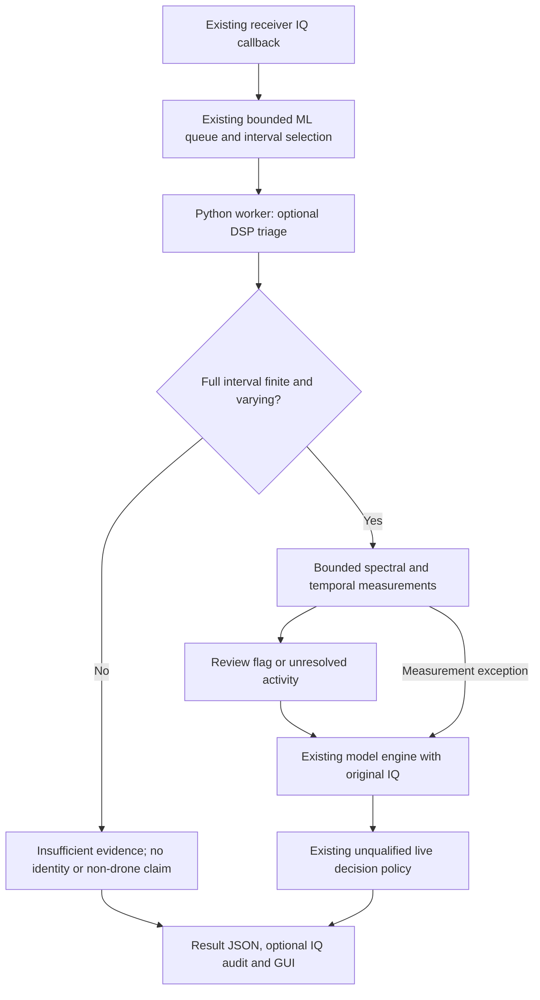

# DSP triage before live model inference

Implemented 2026-11-03. This is the observation/qualification stage of the
DSP-first routing approach, not a qualified drone/non-drone filter.

## Runtime behavior



- `Model Inference` has a **DSP triage (observation only)** checkbox, enabled
  by default. Stop inference before changing it. Restart the built application
  to load the C++ changes; this implementation does not restart a running app.
- All finite, varying observations still reach the existing model engine,
  including tone-like, noise-like, overlapping and otherwise ambiguous RF.
  The engine's existing preprocessing/activity checks remain in force.
- Nonfinite and exactly constant samples bypass the engine and return
  **insufficient evidence**, with no candidate, accepted identity or presence
  claim. This is input validity, not non-drone rejection. Missing/gapped/short
  capture handling in the existing C++ admission path is unchanged.
- A DSP diagnostic exception falls through to the model, with an explicit
  `triage_failed_open` result. A malformed IPC routing contract is rejected.
- Independent DJI/OpenDroneID and cyclostationary processing are unchanged.
  Their asynchronous outputs are **not** joined to this interval yet. The DSP
  report states `protocol_evidence: not_associated`; it never invents a decoded
  protocol or reuses another capture's evidence.
- Model weights, acquisition, band scheduling, receiver settings, training
  data and original dataset files are unchanged. This is not FPGA integration.

## Measurements and limits

Full-interval checks cover finiteness and exact constancy, up to the existing
4,000,000-sample limit. Spectral features use at most 32 disjoint, 1024-sample
frames spread across the submitted interval. Each frame has a Hann window.
The result records frame offsets, actual sample rate, bin width and measured
sample count. Features operate on private copies; the original IQ goes to ML.

Recorded features are averaged spectral flatness, strongest-bin-plus-neighbors
power fraction, lag-one coherence, peak-to-mean power and sampled peak magnitude.
These are signal descriptors, not SNR, calibrated RF power or emitter identity.

The provisional, unvalidated review hypotheses are:

| Review flag | Condition | Actual routing |
|---|---|---|
| Tone-like | Three-bin fraction > 0.8 and lag-one coherence > 0.9 | Model |
| Noise-like | Flatness > 0.85, coherence < 0.1, peak/mean power < 15 | Model |
| None | Neither condition, or insufficient sampled feature evidence | Model |

Neither flag is a proposed universal rejection rule. A weak drone underneath a
tone or noise can meet these conditions. Sparse measurements may miss short
bursts. No energy threshold, Wi-Fi recognition, absent synchronization marker,
softmax score or review flag can promote an interval to non-drone.

Existing live input remains up to three separate 8 ms intervals per capture,
with the existing rate/queue limits. This change does not add continuous
coverage, lengthen the model context, qualify sub-GHz inference or repair the
existing source-generation handling across retunes. No whole-scene “no drones”
claim can be inferred from an interval or from a lack of model results.

## UI and reproducibility

The UI exposes the current route, reason, review flag, engine invocation and
DSP elapsed time. Counters show completed current-generation DSP results,
review flags, insufficient IQ and measurement failures; they accumulate across
inference restarts in the same app process. They are not detection rates.
Detailed features are available in the exact result JSON.

Enable **Record exact inference inputs for review** to retain the original
submitted IQ, capture metadata, DSP result and model result together. Existing
limits remain 64 intervals / 256 MiB per session. Operator session context is
not automatically a verified training label.

`tools.drone_ml.input_audit` session replay now reproduces the recorded triage
option and reports `dsp_triage_replay_matches_saved`, excluding variable elapsed
time. Model score parity remains separate. The summary includes DSP routes and
review-flag counts. Legacy sessions without triage retain the original path.
Standalone file sweeps retain their original behavior.

Example (substitute actual checkpoint/session paths and a new output path):

```bash
data/drone_ml/runtime-2026-10-14/bin/python -m tools.drone_ml.input_audit \
  --model /absolute/path/to/model.pt \
  --session /absolute/path/to/live_audit_session \
  --output /absolute/path/outside_the_session/triage_replay.json
```

## Validation performed

- Main Release application `rf_monitor_gui` builds successfully.
- 25 Python tests pass: DSP routing, live IPC/audit replay, activity policy and
  FFT inference regression suites.
- C++ `ml_inference` regression passes, including counters, unqualified routing
  rejection, stale results, queue limits, worker failure and restart behavior.
- Offscreen `gui_shell` regression passes, including visible triage controls
  and navigation without starting inference or acquisition.
- Synthetic noise, tone, mixed tone/noise and short bursts reach the engine
  without mutation. A flagged noise interval has identical model scores with
  triage enabled/disabled. Nonfinite samples outside the sampled FFT frames
  are still detected by the full-interval validity check.
- Initial socket tests were blocked by sandbox IPC restrictions. The Python
  suite and C++ IPC test passed when run outside that restriction. No SDR,
  network connection, dataset download, training or live accuracy test was run.

Local synthetic DSP-only timings, 10 repetitions after one warm-up:

| Source rate | Samples per 8 ms | Median | Maximum |
|---|---:|---:|---:|
| 20 MSps | 160,000 | 1.35 ms | 2.46 ms |
| 100 MSps | 800,000 | 2.94 ms | 3.29 ms |
| 500 MSps | 4,000,000 | 12.23 ms | 12.65 ms |

These measurements exclude model, IPC, queueing, acquisition and audit writes;
they are not an end-to-end throughput guarantee. The 500 MSps case is synthetic
software input, not evidence of supported hardware streaming. Full-sample
validity checks account for rate-dependent work despite bounded FFT features.

## Before enabling actual non-drone rejection

1. Collect/review labelled active non-drone, drone and mixed-emitter sessions
   using the same FPGA chunking, sample-rate and gain profiles as deployment.
   Preserve timing and pre/post-burst context; energy activity is not a label.
2. Replay complete held-out sessions, including everything a candidate rule
   would discard. Measure drone-event misses, negative false alerts, duty,
   queue loss and decision latency; report per band, device and operating mode.
   Do not tune and certify on the same recording/session.
3. Associate decoder evidence by exact capture, generation and time/frequency
   region. A parsed Wi-Fi frame does not establish that its emitter is not a
   drone, nor that no second emitter is present in the chunk. Valid broadcast
   fields are protocol evidence, not authenticated physical identity.
4. Enable only individually qualified, scoped rules. Keep unresolved activity
   on the model path and retain an audit sample of future rejected observations.
   Reserve unknown-drone output for positive drone evidence with unknown identity.

Actual non-drone rejection, protocol-based fast paths, a qualified presence
model and validated unknown-drone classification remain pending. This change
provides measurable evidence for those decisions; it does not claim a measured
reduction in false drone alarms.
