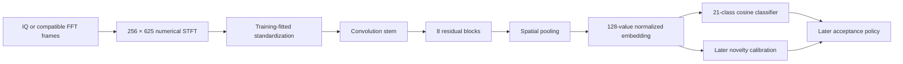

# Expanded drone model: prepared experiment and architecture

Date: 13 October 2026. This records the pretraining handoff, when training had not started.
Training was authorized on 14 October; see [the training run](DRONE_ML_TRAINING_RUN.md).

This is an optional standalone Python component. The C++ receiver, GUI, decoders,
cyclostationary analysis and security detectors are not connected to this experiment.
Original SDA recordings are read through a read-only mount. Derived arrays are written
under `data/drone_ml/2026-10-13/expanded_pretraining/` in the application workspace.

## Scope of the model

The proposed network learns **publisher-labelled aircraft-model recording contexts**.
Many captures contain both aircraft and controller emissions, and the labels do not
identify the transmitter responsible for every 8 ms window. An activity check establishes
structured RF, not drone presence. Therefore these are weak labels for development;
neither a model name in the class list nor a high softmax score establishes exact identity.

There are 21 candidate classes:

- DJI Air 2, Air 2S, Mini 4 Pro, Mini 5 Pro and Mavic 3 from reviewed DRFF metadata.
- DJI Inspire 2, Matrice 100, Matrice 210, Mavic Mini, Mavic Pro, Phantom 4,
  Phantom 4 Pro Plus, Parrot Disco, Parrot Mambo and Yuneec Typhoon H from Tampere.
- DJI Mini 2, Matrice 300 and SJRC F11 Pro from Leuven; its Inspire 2 shares the
  same conservative group as Tampere Inspire 2 rather than pretending unit independence.
- DJI Avata 2, DJI FPV and Mavic 3 Pro from reviewed RFUAV pack metadata.

Only Air 2, Air 2S and Mini 4 Pro currently have the cross-aircraft groups needed for
known-class calibration in this preparation. Other classes are explicitly training-only
extensions. They cannot receive independently supported identification thresholds yet.
The broad model is ready for a development experiment, not a 21-class release claim.

## Source review and split policy

All 808 previously inventoried RF files/archives were accounted for. Review decisions,
metadata conflicts and exclusions are in `source_review/review.json`. DRFF filenames were
checked against embedded target, condition, state, receiver, day, rate and centre. Its
character-valued conditions such as `c17` are decoded as conditions, not discarded.

- DRFF Air 2/Air 2S/Mini 4 Pro: aircraft units 1–2 train, 3–4 calibrate, 5 and above
  stay reserved. All days, receivers, states and bands of a unit stay in one partition.
- Mini 3 Pro remains wholly outside training, for unknown calibration.
- Publisher tokens `mavic3C` and `mavic3S` remain reserved unknown contexts. They are
  not silently converted into commercial aliases.
- All recordings/parts/bands with unresolved aircraft identity stay in one conservative
  model group, including cross-dataset Inspire 2. Multiple files are not multiple aircraft.
- Earlier test exposure is disclosed. Previously evaluated unit-5/Mavic3S material is
  not presented as a fresh sealed release test. Reserved unit-6+ material provides a
  potential additional assessment only for models that have those units.
- Reserved test IQ is not extracted into the development tensor corpus. The frozen review
  retains its source identities for a separately controlled later evaluation.

Explicit controller-only Leuven RC and Tampere Mambo-control captures are excluded from
this aircraft-model classifier. Controller-equipment names in RFUAV are not aircraft classes.
The RFUAV Mini 4 Pro capture is also excluded because its aircraft identity cannot be reconciled
with the DRFF holdouts. Five filename/XML conflicts are preserved as exclusions, including
FRSKY/FLYSKY disagreements and RadioMaster BOXER carrying a Radiolink AT10 II target label.
RFUAV Mini 3 has an XML/IQ pack-name mismatch and remains excluded from this selection.

DRFF mixtures and unverified environment negatives do not become clean positive/negative
labels. FPV sweep data describes transmitter equipment and includes capture-format/continuity
questions; it is catalogued but not used to invent named-aircraft labels or a generic negative
class. A separate metadata audit identified ten sweeps on two days labelled by the publisher
as having no active test video transmitter. All reviewed sweep offsets imply eight bytes per
complex sample, but numeric type/scaling are not specified by the landing page and its linked
capture-code repository returned 404. These are recorded in `background_candidates.json`;
no sweep IQ was read or relabelled as generic drone-free ground truth. Verified, representative
ordinary Wi-Fi/background examples remain a release blocker.

## Tensor preparation

Every source is read in bounded sections. Up to twelve evenly spaced, non-overlapping
8 ms windows are taken per selected recording. Short recordings use fewer windows, never
overlapping ones to inflate counts. Four evenly distributed members are selected per accepted
Leuven archive. Up to three reviewed RFUAV packs contribute bounded 160 ms prefixes; stopping
RAR decompression early means whole-member CRC integrity is **not** claimed.

The existing physical STFT contract is preserved:

1. Remove the source interval's complex mean and normalize its RMS.
2. Select one of five guarded frequency views by measured energy, with no class/model input.
3. Mix and polyphase-filter to a 20 MSps view. This is a model-input profile, not a radio cap.
4. Use 256-point periodic Hann windows, a 256-sample hop and full two-sided FFTs.
5. Form numerical log power with a −100 dB floor: **256 frequency bins × 625 time frames**.
6. Standardize using statistics fitted exclusively to eligible training tensors.

Frequency bins represent 78.125 kHz and time hops represent 12.8 µs. No colour maps,
axes, text labels, plotted screenshots or arbitrary image resizing enter the network.
A single 20 MHz view may miss hops or a wider waveform; this experiment does not establish
full-band signal capture or a complete hopping-pattern classifier.

Quality checks cover finite values, interval bounds, activity eligibility, duplicate selected
IQ hashes and partition overlap. Integer recordings are checked for ADC rail hits; floating
recordings do not establish an absolute ADC clipping threshold. Source continuity is inherited
from publisher recordings and is not independently proven where gap metadata is absent.
Complete selected ZIP members receive CRC checks; other checksums explicitly identify their
scope. Selected-window checks are not checksums of the entire 375 GB DRFF collection.

Tensors are stored in bounded NPY shards of at most 32 images. Loading uses a two-shard
memory-map cache instead of loading the whole corpus into RAM. Each record retains the source,
member, sample interval, group, role, split, selected RF offset, activity result and checksum.

## Training-only physical augmentation

Each eligible training interval receives one reproducible additional variant:

- Carrier offset uniformly between −100 and +100 kHz.
- One weaker delayed path with 30–150 ns delay, amplitude 0.10–0.35 and random phase.
- Complex Gaussian noise, with observed input power 10–30 dB above the added noise.

These are experiment settings, not a measured deployment channel distribution. The noise
ratio is **not ground-truth SNR**, because the original recording already contains noise.
The delayed copy is zero-padded, never circularly wrapped. Variants retain the original
source/group identity. Calibration and reserved tests receive no augmentation. Structured-RF
eligibility is measured again after augmentation; ineligible examples do not train the model.

## Architecture

The network is `RFResidualCNN`, defined in `tools/drone_ml/residual_model.py`.
It has **2,137,952 trainable parameters** with 21 classes, eight residual blocks and
20 convolution layers counting the three projection shortcuts. The previous baseline
has about 178 thousand parameters. This larger capacity is a hypothesis to evaluate,
not evidence of higher accuracy.

Shapes below exclude the batch dimension; the order is channels × frequency × time.

| Stage | Layers | Output |
|---|---|---|
| Input | One log-power channel | 1 × 256 × 625 |
| Stem | 5×5 convolution, 32 channels, stride 2; GroupNorm; SiLU | 32 × 128 × 313 |
| Residual stage 1 | Two blocks; two 3×3 convolutions per block | 32 × 128 × 313 |
| Residual stage 2 | Two blocks, 64 channels; first block downsamples ×2 | 64 × 64 × 157 |
| Residual stage 3 | Two blocks, 128 channels; first block downsamples ×2 | 128 × 32 × 79 |
| Residual stage 4 | Two blocks, 192 channels; first block downsamples ×2 | 192 × 16 × 40 |
| Pooling | Adaptive average pooling to 2×4 positions | 192 × 2 × 4 |
| Embedding | Flatten 1,536 values; linear 128; LayerNorm; SiLU; L2 normalization | 128 |
| Identity head | Training dropout 0.2; normalized linear weights; cosine temperature 0.1 | 21 logits |

Each residual block adds its input to the learned convolution result before activation.
When dimensions change, a 1×1 convolution projects the shortcut. This gives deeper layers
an easier path for preserving useful features. GroupNorm avoids relying on batch running
statistics for small batches. The embedding is a compact learned signal representation;
the classifier compares it with learned class weight vectors.

There is no trained binary drone/background head and no “unknown drone” softmax class.
After training, known-score, margin and embedding-distance rejection must be calibrated
using withheld groups/classes. Until that evidence exists, the engine may show experimental
candidates but must return identification unavailable rather than accept a name. Novel RF
alone is insufficient evidence for an unknown drone.

## Prepared corpus counts

The completed development corpus contains **7,367 tensors in 231 shards** (about 4.7 GB decimal):
4,328 original intervals and 3,039 training-only augmented variants. Original intervals cover
34.624 seconds of sampled RF across 362 source recordings/archive members; these are correlated
windows, not thousands of independent aircraft encounters.

| Partition | Stored tensors | Eligible for model processing |
|---|---:|---:|
| Training, originals plus variants | 6,407 | 5,929 |
| Known-class calibration | 432 | 380 |
| Unknown-class calibration | 528 | 480 |
| Reserved known/unknown test | 106 source records in review | IQ not read |

Original tensor counts: Leuven 176, Tampere 216, RFUAV 96 and DRFF 3,840. All 21 training
classes retained eligible examples. Ineligible intervals remain documented as insufficient
activity, not converted into negative labels. Training normalization is mean −18.58328374 and
scale 16.04812749 in the numerical log-power representation.

## Frozen training recipe, not executed

- Compare the residual model with the existing compact CNN on the same expanded corpus.
- Seed 17; 40 fixed epochs; batch size 8; CPU default, two Torch threads.
- Balance sampling by class, aircraft group and source recording, preventing long recordings
  or many derivatives from automatically receiving more weight.
- AdamW, learning rate 0.0003, weight decay 0.01; cosine schedule to 0.00001.
- Cross-entropy with label smoothing 0.05, plus 0.1 × a supervised contrastive loss.
- Contrastive positives require the same class but different aircraft groups. A class with
  only one unresolved group contributes no such positive pairs; they are never fabricated.
- Gradient clipping at norm 5. No final-test-driven epoch or hyperparameter selection.
- Evaluate and calibrate afterward; the trained checkpoint initially has no acceptance policy.

The default `expanded_training` command runs only preparation checks and a forward pass.
Optimization requires `--start-training`. That flag has not been used. Forward checks verify
layer shapes, finite outputs and unchanged weights; they do not measure accuracy.

A larger-model checkpoint uses a separate schema. The standalone IQ/FFT inference engine
can load it, but it cannot inherit the old checkpoint's acceptance thresholds. Existing
baseline checkpoints retain their original loader and behavior.

## Evidence and handoff

The final artifact locations, counts, hashes and readiness checks are written to
`data/drone_ml/2026-10-13/expanded_pretraining/handoff.json` and its referenced reports.
A failed or interrupted intermediate preparation folder is not a valid corpus without
its final `corpus.json`. Use only the handoff's paths.

Publisher references used for review:

- [DRFF-R2 paper](https://arxiv.org/html/2603.00106v2), alongside its local acquisition scripts.
- [Tampere publisher record](https://zenodo.org/records/4264467), which specifies signed little-endian
  IQ, band-dependent sample rates, the Yuneec 5.7 GHz exception and non-consecutive parts.
- [RFUAV publisher repository](https://github.com/kitoweeknd/RFUAV), alongside local XML headers.
- [FPV publisher record](https://zenodo.org/records/19870020), used only for the background-candidate metadata review.
- Leuven's local `README.txt`, cross-checked with selected archive/member names.

The practical limit is data evidence: 21 development labels do not imply 21 independently
validated aircraft identities. More verified aircraft/session coverage and non-drone examples,
followed by held-out evaluation and local receiver testing, are required before release.
