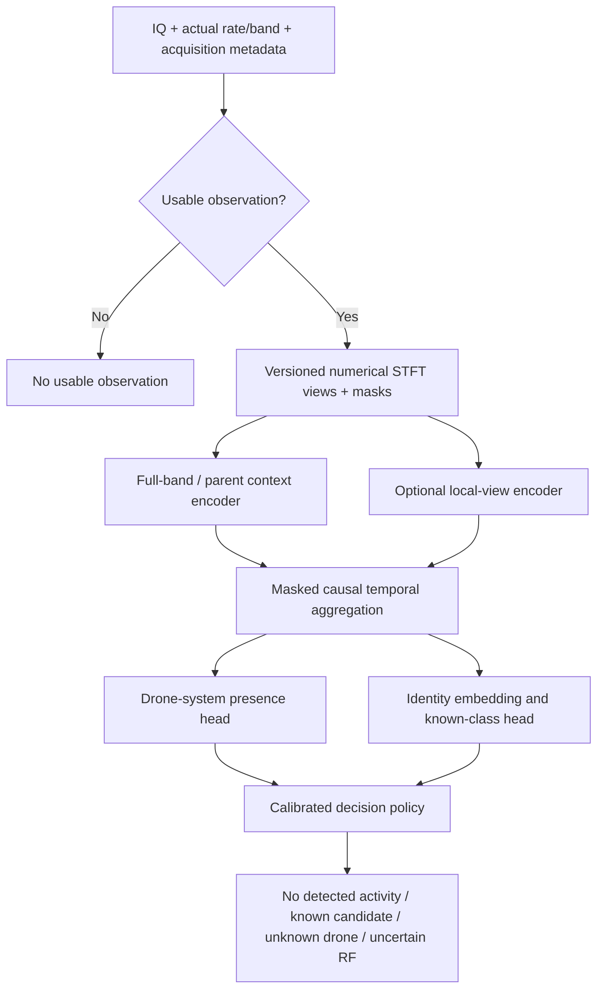

# Drone RF model: pre-training readiness and caveat register

29 October 2026. **Decision: preparation continues; no training started.** This report records the known problems, uncertainties, tradeoffs and gates before the next recognition-model experiment. It cannot establish that no undiscovered problem remains. Existing application behaviour, model checkpoints, dataset originals and frozen partitions are unchanged.

The immediate priority is trustworthy presence/rejection supervision and evaluation, followed by model identity. A larger network trained on the same weak labels would not resolve the observed false drone alarms. There is not yet evidence that one architecture is the best choice for this corpus.

## What was completed in this pass

1. Reconciled the Leuven Mini 2 source against the publisher metadata and checksum. The local `mini2vid.zip` is 4,326,090,329 bytes and matches published MD5 `2041fdaff63169879db6805835801fad`. Its SHA-256 is `231d55f115a4509a3344a4b8fafe597412446d402748f25038665b588dab3b23`. The archive and selected-member receipts are in [audit.json](../data/drone_ml/2026-10-29/pretraining_readiness_01/leuven_audit/audit.json). [Publisher file record](https://rdr.kuleuven.be/file.xhtml?fileId=154424&version=1.0).
2. Fully decompressed and CRC-checked only the **16 already admitted training members**, hashed them individually, and inspected their HDF5 structure. Each contains a compound real/imaginary vector with shape `[1, 20000000]`: **0.2 seconds at the declared 100 MSps, totalling 3.2 nominal sample-seconds**. They share the inherited `unresolved_physical_unit:DJI_Mini_2` group. This neither establishes physical continuity between members nor independence between aircraft/sessions. No numerical IQ arrays were decoded for recognition, and no unselected member was decompressed.
3. Confirmed publisher capture context: X310, 100 MSps, 2.44 GHz, semi-anechoic chamber, drone and controller seven metres from the antenna. This supports recording-level system association; it does not label every RF region or identify its transmitting endpoint. The publisher lists **CC-BY-NC-4.0**. Intended commercial use needs a separate permissions decision; do not assume downloadable means unrestricted. [Dataset record](https://rdr.kuleuven.be/dataset.xhtml?persistentId=doi:10.48804/HZRVNZ).
4. Followed the FPV publisher's acquisition-code link. The linked GitHub repository returned **404**; a focused search did not recover it. The publisher distinguishes active target transmissions from target-TX-inactive recordings, which is narrower than scene-wide drone absence. Format, actual valid sample counts and physical timing remain unresolved. No FPV IQ was newly decoded, trimmed or concatenated. [FPV publisher](https://zenodo.org/records/19870020), [linked repository](https://github.com/lizamashchenko/automated-analog-video-supressor).
5. Added an isolated read-only integrity auditor and four tests. **28 relevant tests passed**, including existing split, inventory and scoped-label checks. This is audit-tool validation, not model accuracy validation. Source stat tuples were preserved during the Mini 2 audit.

These 16 members have **not** been silently added to the scoped training export. Its current contract needs explicit archive-member and member-checksum binding before that is safe. The previously locked 18 Tampere bags and 755-entry inventory remain unchanged.

## Current evidence, without inflating the counts

| Quantity | What it actually represents |
|---|---|
| 755 inventory entries | Mixed recordings, archive members, context entries and diagnostic derivatives; not 755 aircraft |
| 517 frozen legacy entries / 42 groups | Existing split assignments; metadata consistency does not prove physical independence |
| 21 training-context classes | Classes represented in the legacy training metadata; not 21 validated live identities |
| 3 classes with separate known-calibration groups | Air 2, Air 2S and Mini 4 Pro; inherited group declarations still need independence review |
| 18 other training classes | No separate known-class calibration group in this frozen split |
| 18 verified Tampere bags / 10 model contexts | Whole-recording system labels, all in training; no per-crop truth or new held-out aircraft |
| 16 newly integrity-checked Mini 2 members | Existing train members, one unresolved group, 3.2 nominal sample-seconds; no new aircraft |
| 180 NIST entries | One conservative collection group; Wi-Fi context, not verified no-drone truth |
| 48 FPV sessions / 2 environment groups | Ten target-absent sessions; unresolved format and negative-label scope |
| Verified no-drone evaluation records in the reviewed corpus | **Zero** |

The 18 training-only classes are Avata 2, DJI FPV, Inspire 2, Matrice 100, Matrice 210, Matrice 300, Mavic 3, Mavic 3 Pro, Mavic Mini, Mavic Pro, Mini 2, Mini 5 Pro, Phantom 4, Phantom 4 Pro Plus, Parrot Disco, Parrot Mambo, SJRC F11 Pro and Yuneec Typhoon H. These are inherited labels, not newly authenticated product identities. Mini 3 Pro remains an unknown-calibration class; reserved unknown-test contexts stay reserved. See the [inventory and split review](DRONE_RF_CORPUS_INVENTORY_2026-10-26.md).

## What the eventual outputs should mean

The target should initially be **observed drone-system RF activity**. That includes a supported drone/controller link and does not prove that an aircraft is airborne. A controller-only emission must retain its role instead of becoming proof of an aircraft transmitter.

| Output | Required interpretation |
|---|---|
| No drone RF activity detected | Sufficient valid observed data, with a validated detector below its alarm criterion; not proof that no drone exists outside the observed band/time/sensitivity |
| Known drone-system candidate | Presence evidence plus a supported identity candidate; acceptance is gated by identity validation and quality |
| Unknown drone system | Supported drone activity, but no known identity passes the rejection criteria |
| Unclassified RF / insufficient evidence | RF exists but drone presence is not established, or the observation is invalid/incomplete |
| No usable observation | Receiver gap, unsupported representation, missing band coverage or another acquisition failure |

An unfamiliar Wi-Fi signal must not become “unknown drone” merely because the identity classifier rejects it. A top softmax score is not a calibrated probability that a drone is present. Shared waveforms can support a link-family claim without supporting an exact model, device category or physical aircraft.

## Blocking issues before the intended supervised run

Here, “blocking” refers to the next trustworthy presence-and-identity experiment, not a claim that every exploratory research run is impossible. No such exploratory run was launched in this pass either.

| ID | Caveat / consequence | Remedy and exit evidence |
|---|---|---|
| B1 | No verified negative evaluation corpus. Current data cannot substantiate no-drone accuracy or false-alarm rate. | Build a reviewed set of controlled target-absent scenes and relevant non-drone emitters. Define absence within the recorded scene, interval and band. Record how the label was established; split by collection session/environment before windowing. |
| B2 | Positive recording labels are weak. Quiet intervals, controller traffic and other emissions may coexist in a positive bag. Copying the bag label onto every STFT creates false positives. | Keep bag-level supervision separate from adjudicated regions and controlled negative sessions. Use a scope-aware trainer; test that no crop inherits identity automatically. |
| B3 | Mini 2 archive-member identity is not yet represented in the scoped export. A whole ZIP hash alone cannot identify the training unit. | Extend the isolated contract with archive hash, exact member path, member hash/CRC, dataset key, sample extent and frozen group. Add mismatch and reserved-member rejection tests before exporting these 16 bags. |
| B4 | Independent known-model coverage is narrow. A model can recognise the recording apparatus or one aircraft instead of the model class. | Publish a class × physical unit × session × receiver × band matrix. Reconcile source metadata; label unresolved groups honestly. Classes without independent development support remain experimental, with identity acceptance disabled. More files from the same group do not close this gap. |
| B5 | FPV encoding/count/timing ambiguity can create artificial silence or duration cues. All ten target-absent first probes had zero tails, risking a particularly strong label shortcut. | Recover authoritative writer/format evidence, verify relevant-band blocks, and establish valid sample counts. Otherwise quarantine this source from supervised training. Do not learn from padded zeros, infer they are noise, or trim/join blocks by appearance. |
| B6 | The numerical preprocessing and temporal-unit contract is not frozen. Different crops, resampling and normalization can invalidate old weights or comparisons. | Fix units, IQ types, byte order, FFT/window/hops, log scale, masks, normalization, sample-rate handling, selection policy and causal buffering. Verify offline and intended inference tensors against common fixtures. |
| B7 | Losses and metrics could target the wrong problem. A binary gate can reject an unseen drone; a closed-set identity head must choose something. | Freeze output semantics, weak-label losses, unknown-drone evaluation and independent presence/identity thresholds before tuning. Include an explicit uncertain state. |
| B8 | No agreed operating point. Optimising window accuracy can still yield intolerable alerts or delayed/missed detections. | Before training, choose the maximum false drone events per monitored hour, required detection probability by signal condition and acceptable alert delay. Report the tradeoff curve rather than guessing one “optimal” threshold. |

FPV can be explicitly excluded to close B5 for a first run; we do not need to resolve every downloaded dataset before using better-supported sources. Conversely, excluding FPV does not create negative labels elsewhere. A reduced-class experiment is also possible, but it must disclose the reduced scope rather than claim full model coverage.

## Additional data and evaluation caveats

| ID | Risk / con | Required handling |
|---|---|---|
| D1 | Overlapping windows, adjacent files and derivatives make train/test performance look better than it is. | Split before extraction by the most conservative known unit/session group. Keep all derivatives with parents; audit exact and near duplicates. Do not count windows as independent trials. |
| D2 | Source dataset, receiver, gain, chamber and frequency can correlate with model label. | Inspect label/domain overlap; evaluate held-out domains where possible and simple metadata-only baselines. If model and dataset are inseparable, report that identity generalization is not measurable from that comparison. |
| D3 | The 16 Mini 2 members total only 3.2 nominal sample-seconds and remain one group. | Additional independent sessions, operating conditions and ideally another physical unit are needed for a model-level claim. Local Mini 2 qualification remains postponed until you test it. |
| D4 | The two previously viewed reserved-source plots (`mavic3C`, `mavic3S`) contaminate the strongest claim of untouched evaluation. | Keep exposure disclosed. Do not tune against those plots, read final-test IQ, or silently move it into training. Obtain a fresh prospective holdout for the strongest final claim. |
| D5 | Unknown examples cover only a few sources/classes. Rejection cannot be validated for all possible future drones. | Use leave-model-out development folds, excluding each held-out class from training, normalization and model-specific tuning. Keep a separate final unknown holdout. Report unknown recall and known rejection together. |
| D6 | Mixed or overlapping emitters violate a single-label scene assumption. | Train local/bag predictions with explicit ambiguity; evaluate overlaps separately. Do not force one identity onto a multi-emitter observation. A model-specific emitter tracker is additional work. |
| D7 | Class imbalance and many windows from one source can dominate optimisation. | Balance sampling/losses by recording/group as well as class. Report macro, group-balanced and recording/event results, sample counts and uncertainty. |
| D8 | Augmentation may be unrealistic or erase discriminative structure. | Test plausible CFO, SNR, gain, timing and channel changes as ablations. Preserve labels only where physically justified; synthetic mixtures require known construction. Synthetic performance is not field validation. |
| D9 | NIST/FPV/local target-off context is useful but its negative truth is limited. | Use it for stress review or explicitly weak/unlabelled objectives. Do not present it as gold no-drone evaluation without evidence. Avoid self-labelling from the same model being evaluated. |
| D10 | Model aliases and RC/video roles can be conflated; shared links may not identify a unique drone. | Audit canonical labels and endpoint roles against publisher evidence. Support a hierarchy of RF activity → link family → system/model only where evidence permits. |
| D11 | Download integrity does not establish correct labels, clean RF or good signal quality. | Keep checksums separate from quality and provenance review. Inspect clipping, DC/IQ artifacts, settling, finite values, bandwidth and capture timing before feature admission. |
| D12 | Licence/attribution terms differ by source. | Record them per corpus component before selecting data for the intended product/use. Leuven's non-commercial term must not disappear when derived tensors or model artifacts are packaged. |

## STFT, localisation and runtime caveats

| ID | Risk / con | Remedy / measurable test |
|---|---|---|
| S1 | “8 ms frame” is not packet length, STFT FFT support, hop interval or temporal history. Longer input is not automatically better. | Measure duration, occupancy, gap and truncation distributions on permitted development data. Treat energy regions as regions, not decoded packets. Compare short views and context under the same budget. |
| S2 | FFT time/frequency resolution changes with sample rate; resizing images can hide that. | Use physical coordinates and anti-aliased rate/band conversions. Freeze multiple resolutions if needed. Retain sample rate and band metadata for interpretation, while testing whether they become label shortcuts. |
| S3 | Magnitude STFT discards complex phase. It cannot recover a phase sequence lost in preprocessing. | Do not promise literal Zadoff–Chu detection from coarse images. A protocol-specific complex-IQ correlation branch would require justified sequence hypotheses, synchronization tests and false-match evaluation; it is not a required universal drone feature. |
| S4 | Strong-energy selection misses weak drones and favours Wi-Fi. Cropping around a peak may discard useful context. | Retain full-band/parent context alongside optional strong-core views. Evaluate missed coverage and budget drops. Proposal confidence is RF geometry evidence, not drone confidence. |
| S5 | Broader context can dilute weak signals and admit additional emitters. It increases memory and latency. | Compare context with and without local views; measure gains and regressions by class/SNR/occupancy. Do not substitute wider crops into the old model without retraining and validation. |
| S6 | Prior diagnostics show failures on 98% duty, narrow/short components, weak signals and gain steps. | Preserve full-context fallback and uncertain geometry. Expand independent reference coverage; do not repeatedly optimise eight selected prefixes. See [context experiment](DRONE_RF_CONTEXT_REFERENCE_2026-10-26.md). |
| S7 | The 20 ms reference consumes the completed block and is not a zero-delay causal history. Physical continuity remains unverified in several sources. | Account for buffering delay; use explicit sample/timing/gap masks. Never concatenate unrelated members or tuning-separated blocks into fake long context. |
| S8 | Existing Python context processing took about 0.17–1.05 s per ≤100 ms real prefix, excluding other paths and inference. | Benchmark total pipeline stages before claiming real time. A GPU and 10 Gb NIC do not remove CPU preprocessing, copying or scheduling costs. Optimise only after profiling. |
| S9 | Band scanning, tuning/settling, dropped buffers and queue overflow create unseen intervals. | Report observed bandwidth/time, dropped samples, queue depth and invalid intervals. Reset temporal state at discontinuities. “Not observed” is not “no drone”. |
| S10 | Correlated repeated views or overlapping windows produce falsely confident voting. Persistence also delays alerts and may hide brief drones. | Aggregate by event/recording with explicit overlap awareness; measure time-to-alert, event recall and false events/hour. Do not treat the proposal branches as independent votes. |
| S11 | Future deployment may see different firmware, link mode, bandwidth, range, antenna, orientation and RF congestion. | Include these in prospective validation, track drift and retain abstention. Never assume laboratory model accuracy transfers unchanged to live USRP input. |
| S12 | C++ integration can diverge from Python tensors or block existing workers. | Require numerical parity fixtures and bounded asynchronous queues; benchmark with the current application workload. Integration remains optional/additive, with no automatic model promotion. |

The previous context experiment improved synthetic 90%-duty coverage but failed all 20 synthetic 98%-duty references. Its white/coloured-noise checks covered only 100 ms per family and are not a false-alarm evaluation. Those results motivate fallback and honest uncertainty, not permission to label all proposals as drones.

## Architecture to compare, rather than assume

The preferred **candidate** is a compact shared spectro-temporal encoder with separate presence and identity outputs, recording-bag supervision, optional local views, and explicit open-set rejection. A hard two-model cascade remains a baseline. Neither has earned selection yet.



Proposed implementation sequence, still subject to the gates:

1. **Small baseline first:** reuse a compact residual CNN design, with a separate label-scope-aware data path. Compare full context against full context plus local views. Keep parameter count modest until independent validation supports additional capacity.
2. **Scoped aggregation:** instance embeddings feed a recording-bag aggregator for weak positive recordings. Use supervised region loss only on adjudicated regions and negative-session supervision only within its supported scope. Attention or max pooling can select spurious background, so inspect attribution and compare pooling choices; attention is not emitter proof.
3. **Temporal branch:** a small causal temporal convolution or similarly bounded aggregator, with explicit missing-data masks. Candidate short observation widths are 2/8/20 ms and candidate histories 100/250/500 ms where continuity exists. These are an experiment grid, not frozen optimal settings. Do not fabricate longer history from the current 0.2 s Leuven members.
4. **Separate tasks:** presence logits, known-system logits and an embedding for rejection. Use identity loss only where the identity target is supported. Compare a jointly trained shared encoder against a separately trained presence detector plus identity model under identical data/splits/budgets.
5. **Rejection and calibration:** compare a small, predeclared set of score/embedding rejection rules on development groups. Calibrate presence and conditional identity separately. A high identity score cannot override insufficient presence evidence. Combining their scores does not automatically yield a calibrated joint probability.

| Approach | Benefit | Important con / reason it could lose |
|---|---|---|
| Hard binary gate → identity network | Clear separation; can save identity compute | Presence false negatives are unrecoverable, especially for novel drones; two models and two thresholds can compound errors |
| Shared encoder with task heads | Reuses compute and permits joint feature learning | Negative transfer, loss balancing and identity/domain shortcuts can hurt presence; must test against separate models |
| One flat classifier with background class | Simple baseline | Background and unknown drones are not homogeneous classes; an unknown can still receive a confident known label |
| Larger vision transformer | Potentially richer context | More data/compute and overfitting risk; current independent evidence does not justify making it the first solution |
| Protocol-specific correlators | Interpretable evidence for supported formats | Narrow coverage, synchronization sensitivity and additional compute; one sequence is not a universal drone signature |

The final choice should be whichever achieves lower false drone events at the required detection probability and latency, while retaining unknown-drone recall and honest identity rejection. Overall closed-set accuracy is secondary to that operating point.

## Milestones and completion criteria

| Milestone | Work and ownership | Evidence required to move on |
|---|---|---|
| M0 — Integrity and caveat baseline | Completed in this pass: Mini 2 receipt, FPV source follow-up, isolated audit tests, this register | Published checksum match; selected members traceable; unresolved claims retained |
| M1 — Scope-aware corpus | Agent: member-bound contract, DRFF/Leuven role reconciliation, class/domain/group matrix, explicit FPV exclusion unless resolved | Every admitted unit has source/hash/scope/group; no protected or duplicate leakage; no inherited crop labels |
| M2 — Presence/unknown evidence | Agent: review usable public evidence and prepare capture manifests. User: later confirm controlled scene/target states for fresh recorder sessions | Verified background train/development groups; supported positive bags; separate unknown evaluation; honest class eligibility table |
| M3 — Preprocessing and experiment freeze | Agent: numerical tensors, rate-aware views, masks, parity tests, bounded representative profiling; user confirms desired alert/latency tradeoff | Locked data and code; permitted split audit; no invented continuity; resource estimate; declared metrics and ablations |
| M4 — Pre-training review | Present resolved and unresolved B/D/S items, counts and example tensors | User can review concrete remaining compromises before training; no silent large-run launch |
| M5 — Small controlled comparisons | Only after the preceding review: baseline, shared-head and cascade experiments | Group/event results, confusion analysis, presence FAR, unknown acceptance/known rejection, timing; final test untouched |
| M6 — Larger model if justified | Increase capacity only when the smaller model shows a capacity limit rather than evidence/domain failure | Reproducible gains across development groups and seeds within resource limits |
| M7 — Qualification and optional integration | Later live USRP/Mini 2, realistic backgrounds/overlaps, C++ parity and queue/load checks | Fixed operating policy passes prospective tests; explicit promotion decision; existing functions preserved |

## Decisions and recordings still needed

The software/evidence work in M1 can proceed without hardware. The main user decisions before M4 are the intended alarm meaning (recommended: drone-system RF activity, including explicitly labelled controller activity), acceptable false events/hour and acceptable time-to-alert. A stricter aircraft-transmitter-only requirement needs more endpoint-specific evidence than these mixed recordings provide.

For later fresh recording, capture multiple independent sessions of: controlled no-drone scenes with router/phone traffic; idle/busy Wi-Fi; quiet and congested bands; drone/controller both off; controller-only; linked drone/controller at several ranges/orientations and traffic modes. Preserve actual sample rate, center frequency, gain, tuning/dropped-sample events, antenna/receiver, session identity, target states and scene notes. Keep some sessions untouched for prospective evaluation. Controlled scene labels refer to that documented scene and observation scope, not a claim of universal absence everywhere.

Mini 2 live testing remains deferred as requested. We can prepare a research model without it, but cannot honestly declare Mini 2 deployment recognition solved. We also cannot establish a reliable no-drone false-alarm rate by collecting more overlapping windows from the same unresolved background contexts.

## Reproduction and retained artifacts

Run the new auditor only into a fresh output directory; it refuses existing directories and validates frozen splits before archive access:

```bash
data/drone_ml/runtime-2026-10-14/bin/python -m tools.drone_ml.leuven_pretraining_audit \
  --review data/drone_ml/2026-10-20/expanded_v2/review/review.json \
  --plan data/drone_ml/2026-10-20/expanded_v2/review/split_plan.json \
  --output /tmp/leuven-pretraining-audit-NEW
```

- [Publisher/source follow-up receipt](../data/drone_ml/2026-10-29/pretraining_readiness_01/web_evidence.json).
- [Mini 2 member integrity and metadata receipt](../data/drone_ml/2026-10-29/pretraining_readiness_01/leuven_audit/audit.json).
- [Verification and unchanged checkpoint receipts](../data/drone_ml/2026-10-29/pretraining_readiness_01/verification.json).
- [Isolated auditor](../tools/drone_ml/leuven_pretraining_audit.py) and [tests](../tests/test_drone_ml_leuven_pretraining_audit.py).

The live false-alarm problem remains unresolved. This pass improves provenance and makes the training decisions reviewable; it does not change inference behaviour or claim a new model is ready.
