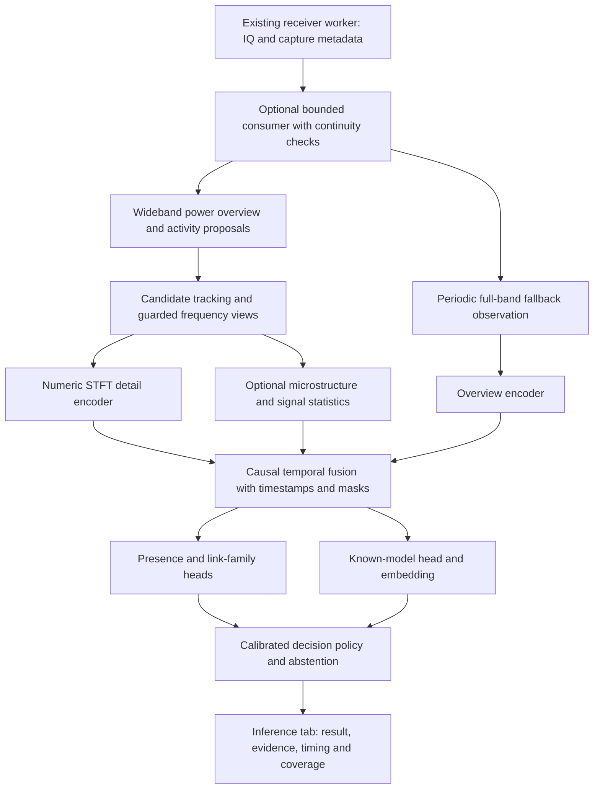

# Drone RF recognition: revised evidence-based plan

24 October 2026, Asia/Kolkata. Planning and read-only investigation; no model training, application changes, receiver operation, or dataset edits were performed for this review.

## Recommendation

Build a **signal-localized, multi-resolution temporal recognizer with separate presence, link-family, identity and rejection decisions**. Keep the existing small temporal network and a separate binary-presence cascade as measured baselines. Compare a moderately larger residual CNN plus causal temporal convolution against them before committing to ConvNeXt, Swin, MaxViT or a learned YOLO detector.

The logical decision is hierarchical: first establish drone-associated evidence, then decide whether a particular identity is supported. This does not require two separately trained networks or discarding all borderline inputs at an early binary threshold. Unknown RF and unknown drone must remain distinct outcomes.

No available evidence identifies a universally best architecture or observation length. Choose the winner by unseen-unit/session performance at a fixed false-alert budget, including end-to-end acquisition coverage and latency. Optimizing closed-set crop accuracy alone would repeat the current problem.

## 1. What was verified

### Download and existing implementation

- NIST `2_4ghz_indoor.h5` is present at 21,600,072,448 bytes. The completed verification job records the matching publisher SHA-256 `73948e960d0c222c685875cbbeb1556dce1ab04dd500b3cc00dbfb46253b14f3` and valid 180-capture layout. This review checked that record and current file size, not a second full-file hash pass.
- It contains 180 one-second captures at 30 MSps, centered on 2437 MHz: **180 seconds of recorded IQ**, not hours of continuous, independent negative trials. Three captures completed initial temporal diagnostics. Cross-capture continuity is not established. Current inventory labels remain unavailable and training eligibility false.
- The existing temporal candidate has 254,103 parameters, an 8 ms tile encoder and causal temporal blocks. It is untrained. Its initial 128 ms CPU timing was about 84 ms for forward execution only, excluding acquisition and preprocessing.
- The previous expanded residual experiment did not establish improved generalization: its group-balanced accuracy was 67.71%, versus 68.40% for the previous residual, on the limited existing development groups. Unknown-model raw scores became more confident. This is evidence against assuming that more parameters or epochs alone will solve false alarms.
- The current inference observer submits at most two jobs/second, with up to three disjoint 8 ms intervals per job. Its maximum is 48 ms of analyzed IQ per wall-clock second when available and successful; this is a software sampling policy, not a 10 GbE limitation. Disjoint intervals cannot be treated as a continuous temporal sequence.
- Read-only GPU query confirmed **NVIDIA RTX 3060 Ti, 8,192 MiB, driver 595.99.02**. No new GPU speed or training result was measured.

Evidence: `data/drone_ml/2026-10-23/nist_background_01/{progress,inventory,temporal_report}.json`, `docs/DRONE_TEMPORAL_MODEL_CANDIDATE.md`, `docs/DRONE_ML_EXPANDED_FINAL_VALIDATION.md`, `src/ml_inference.cpp`, `tools/drone_ml/preprocess.py`.

### What the supplied STFT report establishes

The 79-page report contains a cover, index and **77 dataset entries**. Its accompanying CSV contains **305 plotted-region rows**:

| Source | Report entries | Plotted regions | Interpretation |
|---|---:|---:|---|
| DRFF-R2 | 8 | 32 | Selected recordings for eight source aliases |
| KU Leuven | 14 | 56 | Includes controller/video variants of the same aircraft |
| RFUAV | 37 | 148 | Includes standalone controller and link-product categories |
| Tampere | 15 | 60 | Repeated models across bands and control/video recordings |
| Analog FPV | 3 | 9 | Three frequency examples, not three verified aircraft models |

All pages were screened as rendered contact sheets; the cover, index and Mini 2 pages were inspected at larger resolution. Numerical findings were cross-checked against the report CSV, JSON metadata and generating scripts. This is not a manual emitter annotation of all 305 regions or a review of every original recording.

The generating code usually takes an initial roughly 100 ms window from one selected recording, detects connected energy regions, then favors strong/distinct examples. It does not sample a representative distribution of sessions, SNRs or modes. Analog FPV examples are 6.5536 ms captures with nested zooms, not 100 ms histories. The report shows analog examples at nominal 1240, 3445 and 5840 MHz; it is not exclusively a 5.8 GHz corpus.

Important limits:

1. The cover explicitly allows any emitter, including Wi-Fi, in the detected regions. A page's aircraft name is recording context, not proof of every box's source.
2. These are energy components, not decoded protocol packets. Thresholding can split a burst, join emissions, or miss a weak/continuous signal. Apparent packet sizes and recurrence require validation.
3. Packet STFTs use adaptive decimation, variable lengths, and FFT sizes from 32 to 256. Effective sample rates in the CSV range from 2.5 to 200 MSps. They are not a homogeneous set of 256-by-256 model inputs.
4. Report SNR is a percentile contrast above an estimated floor. It is not calibrated per-emitter SNR, especially in mixtures.
5. Filenames, axes, labels, color limits and plot layouts must never become training inputs. Regenerate numerical arrays from admissible raw IQ.
6. Crops show both sub-millisecond structure and multi-millisecond bursts. They do not establish that 8, 20 or 128 ms is sufficient for every link.
7. The report reads Tampere center frequency as unknown and plots offsets. Do not treat those offsets as absolute RF frequencies; reconcile acquisition metadata before using absolute coordinates.

On the Mini 2 video page, two selected regions are about **1.10 ms long and 18.75–19.34 MHz wide** by the report's detector. The RC page also includes narrow components and approximately 31 microsecond components. These are useful scale observations, not independently verified Mini 2 packet types or Zadoff–Chu detections.

The live selector scores five possible 20 MSps views using their central 16 MHz; the model still receives the full 20 MSps view. Incorrect centering or inadequate transition-band margin could remove information from a roughly 19 MHz signal. Stronger Wi-Fi could also win the selector. Both are hypotheses to measure, not established explanations of the local Mini 2 failure.

## 2. Assumptions from the architecture PDF to change

| Proposed assumption | Assessment and revised decision |
|---|---|
| YOLO plus ConvNeXt/MaxViT is already the best production model | Useful challengers, but no local comparison establishes that. First measure inexpensive proposals and a compact residual temporal model. Learned localization needs reviewed labels and proposal-recall testing. |
| Published 97–98% closed-set results predict live recognition | They use different splits, sources, tasks and hardware. They do not establish our background rejection or unseen-model behavior. |
| RFUAV's FFT experiment establishes the best setting for 37 classes | The original preprocessing experiments use a five-camera-drone subset. NFFT=256 is a useful tested setting in that protocol, not a universal optimum. [R1] |
| MRSF proves our expected low-SNR and latency figures | Its paper uses 50 ms segments, a file-level development split and simulated degradation. It reports 88.29% at **-20 dB**, not -15 dB. Its 35.41 ms measurement used an RTX 5080 and excluded acquisition; it is not our 3060 Ti or a complete live test. [R2] |
| All data should become 100 MSps | Preserve physical scale and actual observed bandwidth. Narrow recordings cannot gain spectrum through upsampling. Use documented bandwidth profiles; never present unobserved bins as measured silence. |
| A 1024-point FFT at 100 MSps resolves fine 15 kHz OFDM subcarriers | Bin spacing is 97.656 kHz, before window broadening. It cannot resolve 15 kHz spacing. A separate longer-window/narrower-rate diagnostic is required if subcarrier structure is needed. |
| 32,768 samples with NFFT=256 and hop=128 gives exactly 256 time frames | Without padding/centering it gives 255 frames. Padding conventions must be explicit and identical in training and inference. |
| High overlap alone reveals chirps | Overlap gives more correlated time positions, not a shorter analysis window. Choose FFT duration as well as hop. A visible ridge does not prove a ZC sequence or an aircraft identity. |
| Time-median subtraction removes Wi-Fi | It suppresses persistent components and may suppress analog FPV or sustained drone video. Preserve original power alongside any residual channel; Wi-Fi is not always stationary. |
| Phase derivative and group delay are interchangeable | Time and frequency derivatives are different quantities. Phase features require complex data, convention checks, low-magnitude masking and CFO/channel robustness tests. Do not add them as a decorative third image channel. |
| Absolute carrier frequency identifies the model | Center frequency can reveal collection setup or operating channel. Use it for tracking and coverage; test identity without it. Require held-out-channel results before feeding it to the identity head. |
| Sigmoid outputs at 0.5 solve simultaneous drones | They require multi-label truth and calibrated thresholds; they do not separate overlapping emitters or count identical models. Keep ambiguous mixtures explicit. |
| FHSS, OFDM, analog video and Wi-Fi form mutually exclusive drone categories | These are waveform/link properties, not reliable aircraft-presence labels. Wi-Fi can carry drone links; RC equipment can control non-drone devices. Use separate label axes. |
| DRFF `environment` files are automatically clean negatives | The paper describes background capture before activation, but local audits found `mini5PRO_1` / `hover` metadata in an indoor-environment file. Reconcile the contradiction; do not assume either stale metadata or clean absence. [R3] |
| Domain-adversarial training must help | If class and source are correlated, erasing source information can erase useful class information. Measure shortcuts first; add this only as a controlled experiment. |
| 60 seconds of ambient data completes calibration | It cannot characterize a rare false-alert rate across deployment conditions. Collect multiple environments/days and measure event-level uncertainty. |
| A 4.6 ms model pipeline guarantees no receive drops | Acquisition, buffers, transfers, preprocessing, candidate count and concurrent GUI work must be measured. Fast forward execution alone cannot guarantee coverage. |

Keep the useful parts: raw-IQ provenance, source-level splits, separate overview/detail representations, avoiding rendered colormaps, physical augmentation, and optional raw-IQ evidence. The PDF's parameter choices remain hypotheses.

## 3. Define what each output means

Use a structured result, not one mandatory drone name:

| Result | Required evidence |
|---|---|
| No drone signal detected in the observed band/time | Valid, sufficient observation with a qualified presence policy; report observed frequencies and coverage. This is not proof no aircraft exists nearby. |
| Unclassified RF / insufficient evidence | Active RF without adequate drone evidence; weak, clipped, partial, unsupported, mixed or unfamiliar input; also stale/gapped input. |
| Drone-associated signal; model unknown | Positive evidence supporting the drone-associated class, but no supported model passes identity acceptance. Rejection alone cannot create this result. |
| Known drone-model candidate | Highest model score for diagnostics. It is not an accepted identity or unconditional probability. |
| Accepted model / link identity | Supported class, required signal quality and temporal consistency, plus thresholds independently calibrated for that operating domain. |
| RC transmitter / analog video / shared link family | Use the narrowest supported interpretation where radio equipment is not unique to an aircraft. Never map a generic RC product automatically to a particular drone. |

Presence, waveform family, product/model, individual airframe, transmitter role and mixture state are distinct labels. This project initially targets model/link recognition, not identifying a serial-number-equivalent airframe. Some devices share the same link hardware; if RF observations cannot distinguish them across units, return the shared family or a candidate set.

Router-versus-phone attribution should use supporting protocol/role evidence where available. Their Wi-Fi waveform alone does not reliably distinguish those device categories. Existing protocol/cyclostationary evidence may assist, but failure to match a known marker must not universally veto an unfamiliar drone.

## 4. Recommended pipeline

**Discovery is an RF localization stage, not a binary drone veto.** Start with noise-aware multiscale activity proposals plus periodic all-band coverage. Review failure modes at low SNR and with continuous signals. Add a small segmentation/object detector only if it improves recall and cost on human-reviewed regions. Do not train a detector and evaluate it against the same automatic energy boxes as if those were truth.

Track candidates over time and retain multiple simultaneous regions. A hopping trajectory can leave a fixed ROI; use wideband history and uncertain associations rather than stitching unrelated channels together. A full-band fallback prevents proposal misses from becoming silent blind spots. Limit expensive candidates with a documented scheduling policy and expose unprocessed coverage when overloaded.

### Temporal and spectral scales

| Path | Initial experiment | Purpose and limit |
|---|---|---|
| Compatibility baseline | Existing 20 MSps, FFT 256, hop 256, 8 ms tile | Reproducible control. Window and hop are 12.8 microseconds; bins are 78.125 kHz. Retain exact preprocessing for this experiment. |
| Wideband overview | Native capture rate; at 100 MSps compare FFT 512/1024, 50% overlap, 20/50 ms windows | Find multiple occupied regions and hopping context. Aggregate power at explicit time scales; keep average and peak information, not max-only noise amplification. |
| Main detail view | Trial 25/50 MSps views for suitably wide sources; FFT 256/512 respectively, 50% overlap | Both give 97.656 kHz bins, 10.24 microsecond windows and 5.12 microsecond hops. Measure filter passband margins; use wider views when required. Lower-bandwidth sources keep supported profiles/masks instead of upsampling. |
| Optional microstructure | 0.25–2 ms snippets; trial 2–5 microsecond FFT windows and 50–75% overlap | Examine fast sweeps/transients without compressing them into long-window thumbnails. Trigger per candidate; validate against IQ. No mandatory universal chirp gate. |
| Temporal recognition | 8 ms embeddings; compare 64/128/256/512 ms actual contiguous context | Start with 128 ms as a candidate, not a conclusion. Preserve event durations and physical frequency scale when pooling. |
| Confirmation/history | Up to about 1 second of valid feature history, extended only if needed | Slower recurrence can require more history. Missing samples, tunes and uncertain associations reset or mask history; do not invent continuity. |

At 20 ms compressed to 512 time columns, each display column spans about 39 microseconds. A 66 microsecond feature then spans fewer than two columns. A macro-image suitable for occupancy can therefore erase microstructure; a separate detail path is justified, but must demonstrate measurable benefit.

Eight milliseconds may contain a burst but not its recurrence or enough hops. Conversely, merely making windows longer does not reject Wi-Fi: our earlier local linked/target-off activity audit found activity in nearly all 8 ms windows and all eligible longer contexts. Select context at matched false-alert operating points, including sparse-link recall and detection delay. The RFUAV source lists some hopping periods of hundreds of milliseconds, so 20 ms cannot universally contain several cycles. [R1]

### Candidate network and fair comparisons

1. **A: existing 254k-parameter CNN + causal TCN.** Train with reviewed presence and identity masks; this is the inexpensive temporal baseline.
2. **B: separate presence CNN then identity CNN.** Evaluate the user's original cascade idea fairly, including the end-to-end recall lost at its first stage and unfamiliar-drone recall.
3. **C: recommended challenger.** A small residual detail encoder, overview encoder and causal TCN with shared presence/link/identity heads. A concrete starting design is a half-width ResNet-18-style detail encoder with four stages of 32/64/128/256 channels, two residual blocks per stage, and a 128-dimensional pooled embedding. Fuse overview features and a small masked signal-statistics vector into 128 channels. Use six causal kernel-3 temporal blocks with dilations 1/2/4/8/16/32 and channel-wise normalization. Add presence, waveform/link, K-class identity and embedding heads. Exact parameters/FLOPs must be measured after tensor shapes are frozen; aim for a few million parameters initially.
4. **D: larger challenger only after A–C.** ConvNeXt-Tiny or Swin-Tiny with matched inputs, splits and training budget. Pretrained image weights are an initialization option, not proof RGB preprocessing is appropriate. If a larger teacher wins, test distillation to a compact student using training data only.

Optional residual-power, cyclic-correlation, burst-spacing and IQ/chirp branches enter one at a time. Preserve original power and quality metadata. Scalar cyclical features can supplement the learned representation without making familiar protocols a mandatory entry condition. Defer individual-airframe IQ fingerprinting; it may encourage unit memorization when the target is model generalization.

Joint supervised losses use only verified labels: presence on reviewed positives/negatives, identity only on eligible known-model examples, link loss only when its taxonomy is justified. Unlabelled data do not silently receive negative labels. Unknown-exposure training, if tested, uses separate models from unknown calibration and final testing. Maximum-logit, energy and embedding-distance rejection are alternative measured baselines; compare before combining them. Temperature scaling does not by itself solve unknown detection. [R4]

## 5. Dataset preparation before large training

### One manifest with explicit evidence

Every sequence needs: original source/hash/member, native encoding/rate, RF center or explicit unknown, occupied/usable bandwidth, timestamps/sample offsets, clipping and continuity status, receiver and gain, session/site/day, physical unit, controller, model alias, link/mode, annotation scope, label confidence, partition and parent lineage.

Separate raw recording labels, reviewed source-attributed ROIs, unlabelled proposals and collection-context labels. A source saying drone-on does not make every time/frequency crop positive. Conversely, quiet subwindows of a positive sequence cannot automatically teach that an intermittent link is absent. For weak recording labels, compare sequence/bag supervision against carefully annotated subsets rather than broadcasting labels to all packets.

Reconcile aliases before deriving K: `mini3` versus `mini3pro`, Mavic Mini versus Mini 2, controller versus aircraft, and the DRFF `mavic3S` alias versus the paper's Air 3S naming. Treat contradictions as unresolved instead of guessing a merge. Band variants are not additional aircraft models. The report's 77 entries and the PDF's proposed approximately 48 classes do not establish a verified label count.

### Use available sources according to their limits

- **NIST:** ordinary-RF robustness and review material. Keep the existing development-only group assignment. Do not move reviewed development examples into training without a versioned redesign and new untouched evaluation groups. Do not treat all 180 captures as independent sessions or certify scene absence from a picture alone. If source-supported weak negatives are explored later, label that assumption and compare with a stricter subset.
- **FPV:** local metadata contains 48 rows, including 10 `drone_freq=none` rows across two indoor environments. These are promising source-declared target-absent sessions, not newly verified globally drone-free scenes. Inspect archive metadata, acquisition gaps, actual valid samples and label scope. Its sweep snippets must not be concatenated into fictitious 128 ms sequences. Train/test groups must include the entire sweep/session and related positives.
- **DRFF:** valuable unit/day/receiver and coexistence tests. Reconcile environmental-file contradictions first. Mixtures have scene/set labels, not automatically pure ROI identities. Prevent duplicate nested source copies from crossing partitions.
- **Leuven/Tampere:** clean signal morphology and positive reference learning; few independent units and limited environments. Controller/video variants and dual-band recordings of a unit remain grouped.
- **RFUAV:** useful waveform/controller coverage. A product name does not uniquely identify an aircraft. Group files by original capture/session where possible, not merely filename. Source/receiver separability and center-frequency shortcuts require explicit tests.
- **Local Mini 2 linked/target-off recordings:** retain as existing diagnostic development data; they do not supply an independent final test or verified absence throughout the off scene. Fresh recorder sessions remain the route to local qualification when the user is ready.

### Splits and leakage controls

Freeze train, model-selection development, threshold-calibration and final-test groups before deriving tensors. Keep connected source lineage, overlapping windows, physical-unit captures, duplicate archives, paired receivers and augmentation descendants together as required by each experiment. Use multiple experiments for cross-unit, cross-session/day, cross-receiver and leave-one-source-out questions; do not pretend one random split proves them all.

Hold out complete drone models from all training, including representation pretraining, for genuine unseen-model evaluation. Unknown calibration and final unknown models must also differ. Existing Mini 3 Pro development data are already inspected and cannot be called a new sealed test. Because the supplied report displays many sources, record this inspection and reserve genuinely untouched groups for final evaluation. Do not automatically admit the report generator's first-file selections into training; check existing partition manifests first.

Run a metadata-only shortcut baseline (dataset, band, receiver, rate, gain and session) and evaluate receiver/source predictability from embeddings. Test matched-band subsets and controlled carrier shifts. Extremely good random-split results with poor cross-source results are a reason to revise the corpus, not increase the network.

### Preprocessing and augmentation

Use numerical log-power arrays with a documented physical grid. Retain quality/noise information separately: per-window unit-RMS or min-max normalization can erase signal-versus-noise evidence. Compare the existing normalization against training-fitted scaling plus robust noise-relative power; fit global statistics on training only. Estimate noise cautiously when most of the band is occupied. Preserve a raw-power path for continuous signals.

Perform train-only time offsets, controlled CFO, realistic gain changes, channel filtering/multipath and noise/real-background mixtures. Derive ranges from supported data or sensitivity studies, not arbitrary universal CFO or sample-clock offsets. A 0.5% rate change is 5,000 ppm; do not call it a realistic oscillator error without evidence. Keep clean-parent/mixture backgrounds in the same partition and masks for partial/cropped signals. Synthetic overlays and degradations supplement, rather than replace, natural coexistence testing.

## 6. Inference integration without disrupting current functions

Use an optional consumer of the existing receiver workers. It must not acquire its own USRP handle, retune the radio, change shared gain/rate, or block receive/GUI threads. A separate process owns model execution. Existing tabs and security/cyclostationary functions retain their behavior when inference is off or fails.

The temporal model needs a new versioned input contract: actual sample rate, RF/DSP tune, valid sample count, device timestamp, sequence number, continuity/gap flags and quality. Reusing existing workers is sensible; pretending their present sparse 8 ms IPC stream is continuous is not. If workers do not expose continuous observations on a band, report sampled monitoring and blind intervals until an additive capture subscription is available. A bigger NIC cannot create observations during receiver tune-away periods.

Use bounded rings/queues, versioned shared-memory slots or measured copies, and explicit ownership. Cache CNN features so overlapping contexts do not recompute old tiles. Reset history on gaps, tune/source/profile/model changes and invalid views. Track per-candidate processing delay and coverage. Bounded overload drops inference work and marks evidence stale rather than slowing acquisition or asserting absence.

At 100 MSps, one sc16 channel is 400 MB/s payload; conversion to complex float32 is 800 MB/s before extra copies. These are budgeting calculations, not a rate cap. At that rate a 128 ms raw ring alone needs 51.2 MB in sc16 or 102.4 MB in complex float32. Keep long history as compact features; retain raw IQ only as long as the actual diagnostic/processing need. Use the actual UHD-returned rate and measured analog passband; supported transport and daughterboard configuration remain relevant even with 10 GbE. [R5]

Develop in PyTorch CUDA using the existing isolated GPU environment, then benchmark ONNX Runtime CUDA and, if worthwhile, TensorRT FP16 for the frozen winner. Verify numerical and decision parity, not just successful export. No promised sub-5 ms pipeline or zero-copy claim without measurements. Include background candidate load and concurrency with the real application.

GUI fields: result/abstention reason, candidate versus accepted identity, link family and role, calibrated presence score only if validated, known-class ranking labeled as conditional scores, current ROI and full-band STFT, observation duration, time since last evidence, processed/skipped coverage, gaps/clipping, model/policy version and preprocessing/inference/end-to-end latency.

## 7. Evaluation and promotion gates

Report metrics by source, physical unit, band, receiver, session, SNR/quality and link mode. Preserve recording/session uncertainty; thousands of overlapping crops do not create thousands of independent trials.

- Proposal recall against reviewed regions, including weak, sustained and mixed emissions; downstream oracle-ROI versus real-proposal comparison to separate localization failures from classifier failures.
- Drone encounter recall at a fixed **false confirmed alerts per observed hour**, with alarm merge/cooldown rules frozen. Report monitored wall time and actually observed band-time separately; include missed events during blind intervals.
- Known-model per-class, macro/group-balanced accuracy; correct accepted identity, wrong accepted identity and rejection. Ranking accuracy is not acceptance accuracy.
- Unseen-drone presence recall, unknown-as-known false acceptance and known rejection, with several unknown models. Include near relatives and shared-link models, not only obviously different radios.
- Ordinary non-drone false alerts separately from unknown-model false acceptance; known Wi-Fi traffic alone does not establish the whole scene is drone-free.
- First evidence and confirmed-decision delay, p50/p95/p99 processing and end-to-end latency, memory/CPU/GPU load, receive overflows, inference drops, coverage and changes to other tab performance.
- Compare at equal false-alert/false-acceptance constraints over multiple seeds. Report confidence intervals clustered by independent group. Calibrate on separate groups; final tests remain untouched until model and policy are frozen.

Provisional engineering targets, not achieved claims: choose a useful per-band presence-recall goal (for example 95% of supported encounters) and false-alert budget (for example at most 0.1 confirmed false alert/hour) before model selection. Set acceptable identity-error/abstention tradeoffs by class. With zero false alarms, the approximate one-sided 95% Poisson upper bound is 3/T per observed hour: a 0.1/hour bound needs about 30 hours, under that statistical assumption. Multiple days/environments are still needed. Even if NIST's 180 seconds were verified negative, zero alarms there would only give about 60/hour by that calculation. It is not a field qualification dataset by itself.

Do not promote classes lacking independent evidence simply because their logit exists. Do not disable abstention to make the GUI look decisive. Live Mini 2 and ordinary-RF trials remain necessary to claim performance on this receiver, even if offline development can proceed now.

## 8. Milestones and next executable work

| Milestone | Work | Completion evidence |
|---|---|---|
| M0 — source review | Completed NIST verification; inspect reports, generation method, current inference and research | This plan; completed inventory/audit; identified assumptions and label gaps |
| M1 — label and split contract | Reconcile aliases, units, background scope, duplicates and reserved groups; establish supported outputs | Versioned manifest, exclusion ledger, per-class/source independent-group counts; no unresolved label promoted to truth |
| M2 — reviewed signal corpus | Stratified ROI/sequence review; build ordinary-RF and positive groups; retain unknown models and clean final partitions | Audited annotations with source/time/frequency provenance, agreement checks and difficult no-proposal examples |
| M3 — input and coverage experiment | Compare current view selection with wider/multiple views; 8–512 ms context study; numeric STFT profiles and replay parity | Localization recall, partial-band statistics, fixed split comparisons, CPU/GPU and memory measurements |
| M4 — baseline training | Train A and B; measure separate-stage versus joint temporal behavior | Reproducible checkpoints, resume support, per-group presence/identity/rejection results, no live promotion |
| M5 — representation/model ablation | Train C; add microstructure/residual/cyclostationary features individually; test D only if justified | Matched-operating-point improvement across seeds/groups; size/cost tradeoff documented |
| M6 — calibration and stress replay | Fit thresholds on independent calibration; replay long background, mixtures and unknowns | Event metrics, uncertainty bounds, failure cases, fixed policy and eligible class list |
| M7 — additive live integration | Versioned temporal consumer, GPU runtime/export, GUI evidence and coverage | Offline/live input parity, bounded overload, worker failure isolation and inference-on/off regression evidence |
| M8 — field qualification | Fresh target-absent scenes and known/unknown encounters, including Mini 2 when available | Independent local performance and false-alert duration; explicit promotion decision per class/domain |

**Immediate next task:** M1 plus the first M2 review batch. Start from metadata and the new report to select candidate regions, verify them against permitted raw IQ and source records, and produce a small defensible training/development corpus. In parallel within that work, prepare an offline replay of current versus wider frequency views to test the Mini 2 failure hypothesis. Do not start a large all-folder training run before these checks, and do not wait for every class to be perfect before evaluating a clearly scoped baseline.

The main change to our approach is to make source attribution, temporal coverage and calibrated abstention first-class parts of the model system. Architecture size becomes a measured choice after those foundations are in place.

## Sources and review scope

Supplied evidence (read-only):

- `/media/sudeep/Storage/datasets/_packet_stft/drone_packet_stft_report.pdf`
- `/media/sudeep/Storage/datasets/_packet_stft/drone_packet_stft_params.csv`
- `/media/sudeep/Storage/datasets/_packet_stft/packet_stft.py` and `make_report.py`
- `/home/sudeep/Desktop/testms/drone_rf_classifier_x310_architecture_plan.pdf`
- `/media/sudeep/Storage/datasets/FPV_Analog_Video/iq_recording_meta.csv`

Primary external references retrieved for this review:

- [R1: RFUAV paper, v2](https://arxiv.org/html/2503.09033v2). Distinguish the full corpus from the five-class preprocessing experiment; do not transfer reported results to our operating point.
- [R2: Multi-Representation Signal Fusion](https://www.mdpi.com/2504-446X/10/9/672). Useful representation ablations; the paper explicitly limits interpretation of its noise tests and timing.
- [R3: DRFF-R2 paper, v2](https://arxiv.org/html/2603.00106v2). Supports acquisition context and grouping, but does not resolve contradictions in a specific local file.
- [R4: Open-Set Recognition: a Good Closed-Set Classifier is All You Need?](https://arxiv.org/abs/2110.06207). Motivates testing strong simple rejection baselines; its vision results do not establish RF performance.
- [R5: Ettus X3x0 manual](https://files.ettus.com/manual/page_usrp_x3x0.html). Transport, clock and hardware documentation, not an application throughput measurement.
- [RFML hub](https://github.com/r4d10n/rfml-moe-hub). Author-reported benchmark evidence, useful for selecting challengers. Its scores are not independently reproduced here and do not prove our unseen-device or background performance.

This review did not extract new IQ from reserved final tests, fit thresholds, train networks, download another dataset, or enable live identity acceptance. The supplied report itself exposes selected examples; record that exposure when designing future evaluation.
