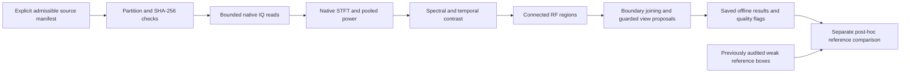

# Offline RF localization baseline

24 October 2026. Follow-up to `DRONE_RECOGNITION_AUDIT_2026-10-24.md`.

25 October follow-up: [multiscale comparison and review preparation](DRONE_RF_LOCALIZER_MULTISCALE_2026-10-25.md). The baseline here remains unchanged; the alternative improves selected weak-signal coverage but has a documented Tampere fragmentation regression and is not promoted to live inference.

## Outcome

An executable **IQ-only RF-region localizer** now exists as an isolated offline experiment. It finds useful frequency views without the STFT report's coordinates. It does not classify drones, create supervised labels, change the GUI, or replace the current inference preprocessing.

The first test supports keeping localization in the recognition architecture, but **does not qualify this implementation for live deployment**:

- All eight selected Leuven Mini 2 report regions have at least 80% rectangular coverage by an independently generated proposal. Corresponding proposed views contain their frequency extents. This is weak-reference containment, not drone-detection recall.
- The two broad video references have rectangle intersection-over-union (IoU) of 0.884 and 0.869. The two approximately 31 microsecond references are contained inside much larger proposed bursts, with IoU below 0.004.
- Synthetic colored noise produces many proposals; weak synthetic signals fragment or disappear. RF activity alone cannot establish drone presence.
- Real recordings produce hundreds of proposals per 100 ms. The Python implementation takes longer than the observed duration on this CPU path, before classification.
- A trained presence/identity system, reviewed labels, qualified rejection, and efficient live processing are still pending. No real-data training was launched.

## Implemented path



`tools/drone_ml/rf_localizer.py` accepts only IQ, actual sample rate, duration and a fixed configuration. It has no annotation, class-name or model-score input.

- Native FFT 1024, hop 512, periodic Hann; two adjacent power frames are pooled, then smoothed over three frequency bins.
- At 100 MSps the frequency grid is 97.656 kHz, output step 10.24 microseconds, and pooled frame support 15.36 microseconds. At 20 MSps those are 19.531 kHz, 51.2 microseconds and 76.8 microseconds. This is a coarse localization profile; physical resolution is not constant across rates.
- A constant mean is removed within each processing chunk. This suppresses receiver DC but can affect signals at DC.
- Power is compared with a within-time spectral 20th percentile and a within-frequency temporal 20th percentile. Their union retains both burst and persistent narrowband candidates. These are relative contrasts, **not calibrated noise floors, SNRs, probabilities or confidence estimates**.
- Connected components above 6 dB need at least two cells above 10 dB, six cells total and three frequency bins. Up to 256 components per chunk are retained; any discarded count is explicit.
- Reads use approximately 10 ms chunks with overlapping boundary support, never more than four million complex samples per read. Components touching adjacent boundaries can join when their frequency intervals overlap. Such joining can merge overlapping emitters; regions are not emitter tracks.
- Each proposal requests the smallest eligible 20/25/50/100/native-MSps view meeting a 20% total frequency-margin condition and existing native-band guards. Native full-band fallback is recorded when the margin cannot fit. These are view specifications, not generated classifier tensors or support for feeding wider inputs into existing weights.
- Every result retains a requirement for a full-band overview fallback, unknown drone presence, null accepted identity and false training eligibility. The fallback classifier and scheduler are not implemented here.

The initial synthetic seed-7 white-noise pilot produced 112 proposals in 20 ms with 8/5 dB thresholds. The default was changed to 10/6 dB using that synthetic pilot **before reading real-source results**. Thresholds were then held fixed for the reported experiments. This is an exploratory baseline, not independently calibrated CFAR.

## Real-source experiment

All reads use the existing explicit train/development-only manifests. Source SHA-256 values were verified, and source stat tuples including atime were unchanged. NIST's complete HDF5 file was hash-checked once for its three selected records. Protected final-test IQ was not opened.

Each row below uses only the initial approximately 100 ms; small unprocessed tails are recorded. Captures are not joined. Continuity and label limitations remain those of the existing manifests.

| Source | Native rate | Regions | CPU wall time | Wall / observed duration, approximately |
|---|---:|---:|---:|---:|
| Leuven Mini 2 video prefix | 100 MSps | 489 | 1.339 s | 13.4× |
| Leuven Mini 2 RC prefix | 100 MSps | 480 | 1.238 s | 12.4× |
| Tampere Mavic Pro, 2G source | 120 MSps | 712 | 1.644 s | 16.4× |
| Local Mini 2/controller linked recording | 25 MSps | 539 | 0.244 s | 2.44× |
| Local target-off recording | 25 MSps | 362 | 0.229 s | 2.29× |
| NIST selected capture 1 | 30 MSps | 291 | 0.314 s | 3.14× |
| NIST selected capture 2 | 30 MSps | 199 | 0.320 s | 3.20× |
| NIST selected capture 3 | 30 MSps | 281 | 0.318 s | 3.18× |

None hit the per-chunk proposal limit. Counts are candidate load, not numbers of packets, transmitters, drones or false alerts. NIST remains unlabelled development material; target-off confirms only the target state in the source context. Neither is automatically a verified globally drone-free scene.

Timing includes source reading, CPU STFT, quantiles, components and merging. It excludes full-file hashing, model inference, receiver acquisition and plotting. These are single exploratory measurements, with possible host contention; no p95 latency, GPU benchmark or real-time guarantee is implied. A 10 GbE NIC does not remove this software cost. Keep this implementation offline until the algorithm is useful and the end-to-end implementation is measured and optimized.

Saved outputs:

- `data/drone_ml/2026-10-24/localizer_real_01/report.json`
- `data/drone_ml/2026-10-24/localizer_nist_01/report.json`
- `data/drone_ml/2026-10-24/localizer_comparison_01/comparison.json`

### Containment is not precise packet detection

The comparison command runs only after proposals are saved. It reads the completed localizer report and the previous frequency-view audit, matches source hashes/rates, then computes overlap. Reference coordinates never influence proposal generation or proposed view selection.

| Weak report reference | Reference rectangle covered | Rectangle IoU | Proposed nominal view |
|---|---:|---:|---:|
| Mini 2 video P1 | 99.99% | 0.884 | 50 MSps |
| Mini 2 video P2 | 100% | 0.266 | 20 MSps |
| Mini 2 video P3 | 100% | 0.869 | 50 MSps |
| Mini 2 video P4 | 98.97% | 0.515 | 20 MSps |
| Mini 2 RC P1 | 100% | 0.458 | 20 MSps |
| Mini 2 RC P2 | 100% | 0.674 | 20 MSps |
| Mini 2 RC P3 | 100% | 0.00355 | 20 MSps |
| Mini 2 RC P4 | 100% | 0.00227 | 25 MSps |

Only four of eight have IoU at least 0.5. The broad video candidates are approximately 21.78 and 21.09 MHz wide, exceeding the 20 MHz central-margin capacity of a 25 MSps view. This coarse detector therefore requests 50 MSps. It does not prove that the waveform intrinsically requires that rate; smoothing, threshold extent and guard rules contribute.


Visual review adds an important distinction: the two tiny RC references lie **inside larger visible bursts**. A low IoU against those tiny boxes does not necessarily mean a bad parent-burst proposal. It can mean the report selected an internal feature while the localizer selected the surrounding transmission. Do not train a detector to split every such feature into a separate emitter. The figure does not establish Zadoff–Chu sequences, packet semantics or emitter identity.

Use two annotation scales next: a parent RF burst/region and optional internal-feature regions. Evaluate their localization separately. The eight selected weak boxes, overlapping training-related source lineage, and sparse annotations cannot establish independent recall or precision. Other proposals are unlabelled, not automatically false positives.

## Synthetic controls and failure cases

`tools/drone_ml/localizer_synthetic.py` generates five fixed seeds per condition. Each recording lasts 20 ms at 20 MSps. Signal cases contain three known synthetic regions: a broad burst crossing a chunk boundary, a simultaneous narrow burst and a sustained narrowband source. The quoted SNR is added signal/noise PSD in occupied bins, not total wideband SNR. These Gaussian band-limited signals are not simulated drone protocols.

| Condition | Known synthetic regions | Regions with ≥80% reference-area coverage | Total proposals |
|---|---:|---:|---:|
| Added signals at +10 dB | 15 | 13 | 19 |
| Added signals at 0 dB | 15 | 0 | 136 |
| Added signals at −5 dB | 15 | 0 | 1 |
| White Gaussian noise only | 0 | N/A | 0 |
| Colored Gaussian noise only | 0 | N/A | 80 |

At 0 dB, generated proposals intersect injected regions but are too fragmented to cover their full extents. At −5 dB nearly everything is missed. Colored noise uses a smooth frequency-dependent gain with no added emitter and exposes the spectral-floor assumption. A receiver response or colored background can resemble a sustained occupied region.

There are only 0.099968 seconds analyzed per condition across the five seeds. Zero white-noise proposals over that tiny duration cannot support a field false-alarm claim. Colored-noise proposals are a synthetic failure/control result; they are not measured live drone false alerts, since no drone decision is made.

Saved full results: `data/drone_ml/2026-10-24/localizer_synthetic_01/report.json`.

## Tests and reproduction

Seven new tests cover deterministic noise/zero behavior without asserting absence; multiple simultaneous regions; cross-chunk joining and persistent-region handling; 20/25/100/200 MSps bounds and explicit trailing coverage; malformed inputs and frequency guards; visible proposal truncation; time-aware matching; partition rejection before IQ access; checksum mismatch; source preservation and output non-overwrite.

Combined with the previous review, public/temporal and presence tests, **38 tests passed**. The existing presence-training test performs one epoch on a temporary synthetic fixture; no downloaded-data model was trained or changed.

Run from the project root, choosing new output directories for each execution:

```bash
data/drone_ml/runtime-2026-10-14/bin/python -m tools.drone_ml.localizer_audit run \
  --manifest data/drone_ml/2026-10-23/temporal_research_01/sources.json \
  --output data/drone_ml/2026-10-24/localizer_real_repeat --seconds .1

data/drone_ml/runtime-2026-10-14/bin/python -m tools.drone_ml.localizer_audit compare \
  --localizer data/drone_ml/2026-10-24/localizer_real_repeat/report.json \
  --references data/drone_ml/2026-10-24/frequency_views_01/report.json \
  --output data/drone_ml/2026-10-24/localizer_comparison_repeat

data/drone_ml/runtime-2026-10-14/bin/python -m tools.drone_ml.localizer_synthetic \
  --output data/drone_ml/2026-10-24/localizer_synthetic_repeat
```

## Next milestones

1. **Review parent regions and internal features separately.** Select admissible examples across source, bandwidth, strength, continuity and mixtures, including random windows with no proposals. Preserve recording-context versus emitter-label distinctions. Do not make this localizer's boxes its own ground truth.
2. **Reduce noise-related proposals without deleting continuous links.** Compare receiver/passband normalization, a separate stable-spectrum path and longer integration for weak emissions. Fit any correction only from eligible training/calibration material. Keep original power, explicit coverage and short-burst tests. Avoid a mandatory temporal-change gate: it would hide sustained emissions.
3. **Measure candidate recall/load and parent boundaries at multiple scales.** Use a coarse overview and a bounded fine refinement stage; separate full bursts from internal features. Preserve a periodic overview path so a missed proposal cannot silently become a negative presence decision.
4. **Freeze a corrected corpus and input contract.** Resolve background-label scope and FPV padding; preserve rates, missing context and lineage. Generate consistent numerical detail/overview tensors for matching training and inference. Existing model weights must not receive arbitrary wider inputs.
5. **Train and compare the small temporal and binary-cascade baselines.** Report presence false alerts, unknown rejection and group-balanced identity performance with independent groups. Proceed to the larger joint model only after this baseline is meaningful.
6. **Optimize and integrate only after those gates.** Profile vectorized/accelerated processing and bounded candidate scheduling, then connect an optional consumer to existing receiver workers. Live Mini 2 and controlled no-target sessions remain qualification work when available.

The source-review and first localization experiment are complete. Label reconciliation, robust localization, corrected training, calibrated recognition and live qualification remain incomplete. No receiver connection is needed for the next offline steps.
