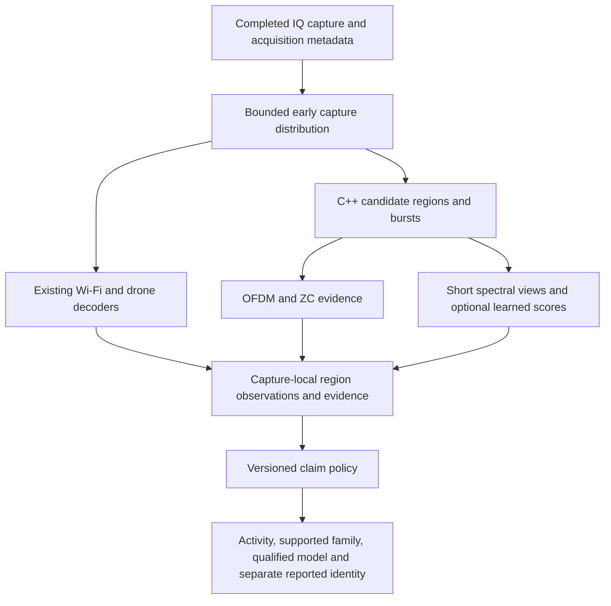

# Drone RF activity and model classification implementation plan

Prepared 10 November 2026. Revised to prioritize an early model-separability experiment alongside capture-local protocol and decoder integration. This is the implementation handoff for the coding agent. The revision changes the design and task ordering; implementation tasks below remain open.

## 1. Objective and acceptance contract

Build a native C++ inference path that consumes the app's captured IQ alongside existing decoders, detects drone-system RF activity, and accepts a drone model name only when evidence supports it. Train offline in Python. Preserve uncertain observations and display coverage loss.

The decision hierarchy is activity → validated waveform/link family → qualified model identity. Permit a broad waveform label when an exact link generation is unresolved. Model classification remains the user objective, with acceptance restricted to distinctions reproduced across independent aircraft, sessions and receivers.

The primary selection objective is correct accepted model identities at a specified background false-event rate, with encounter recall and decision delay constraints. Window accuracy alone cannot select the release model.

### Independent output fields

| Field | Status and meaning |
|---|---|
| Observation quality | Valid, partial or unusable, with observed band/time and coverage |
| Activity | None detected, drone-system activity or uncertain |
| Family | Accepted family, candidate family or unresolved, with evidence scope |
| Model | Accepted model, classifier candidates or unresolved |
| Decoded identity | Reported identity with message provenance, independently attributed |
| Conflict | Whether qualified evidence sources disagree, with both claims retained |

Each field carries its own evidence, observation time and qualification status. A valid observation can simultaneously support drone activity, an accepted family and unresolved model identity. Derive a concise GUI summary from these fields.

An accepted RF model requires accepted activity and class eligibility. An accepted family is useful but is not a compulsory gate for an independently qualified model claim. Unusable observations cannot produce a fresh none-detected decision. Conflicting accepted identities leave inferred identity unresolved while preserving the source claims. None detected applies only to valid, sufficiently covered observations within the qualified band/time/sensitivity envelope.

A controller can generate drone-system activity. Report aircraft/controller role separately and keep airborne status unknown unless independent evidence supports it.

### Candidate output semantics

- Compatible models come from a sourced, versioned family-to-model catalog. Mark catalog completeness and unknown coverage explicitly. This is reference compatibility information.
- Classifier candidates are observation-specific ranked hypotheses. Label uncalibrated candidates experimental and keep them separate from accepted identity.
- A calibrated candidate set requires measured true-model inclusion and set size on independent groups, including unfamiliar models. A catalog lookup or top-k softmax list cannot establish exhaustive exclusion of other aircraft.

### End-to-end inference architecture

All usable candidates receive structural examination. Unresolved activity remains eligible for learned analysis and broad fallback coverage. Strong protocol evidence can support a scoped claim without waiting for CNN approval. The learned path contributes only qualified claims. Evaluate each path and the combined policy at the same false-event operating point.

Maintain a bounded evidence ledger with capture/region identifiers, observation time, availability time, revision, provenance, valid support and claim scope. Publish early uncertain results when appropriate and explicit later revisions. Expire stale claims. Conflicting qualified identities produce a conflict state or unresolved identity, with both sources visible. Repeated windows and DSP/ML measurements derived from the same samples cannot be counted as independent confirmations.

### Two workstreams and first deliverable

The first deliverable is a spectral-only model-separability report on reviewed regions with held-out physical aircraft. Start this as soon as a bounded identity subset and preprocessing contract are ready. Whole-corpus reconciliation, a negative corpus, burst tracking, decoder association and the combined evidence policy are not dependencies of this exploratory identity experiment.

Workstream A reviews the identity subset, trains the spectral baseline, reports per-unit separability and rejection/coverage, then compares ZC/OFDM augmentation on identical regions and splits. Workstream B validates structural/decoder evidence and implements bounded capture distribution and native inference. These are scheduling lanes for the coding agent; they do not require multi-agent execution.

Version one groups observations within one capture and frequency region. It can aggregate bursts inside a verified contiguous capture and associate decoder evidence using sample/frequency overlap. Use a bounded decoder wait and a simple later revision when necessary. Cross-capture tracking, hop association and emitter split/merge handling are deferred to measured follow-up work.

Background and unfamiliar-model evaluation remain required before deploying accepted model names or none-detected decisions. Early identity results establish model separability only.

### Operating targets to settle before threshold selection

Record maximum false drone events per monitored background hour, minimum encounter recall by signal/interference condition, maximum first-alert delay, minimum correct-identity acceptance coverage, maximum wrong-identity acceptance rate, scan bands/revisit schedule and resource limits.

Sudeep is the decision owner for operating targets and deployment acceptance. The coding agent owns the proposed measurement definitions, trade-off curves, feasibility/resource estimates and a concise decision sheet. T05 defines the output contract and prepares that sheet; T31 records Sudeep’s chosen targets, date, evaluation scope and rationale before release threshold selection. The agent must not invent acceptance targets.

Targets may remain pending while exploratory training, feature verification, replay and trade-off reporting proceed. T31 blocks T10’s frozen operating-point acceptance and release claims, rather than the early classifier or contract implementation. Separate diagnostic threshold sweeps from the accepted release policy. If targets change after viewing final results, create a new evaluation version and reserve fresh final evidence.

## 2. Verified starting point and implementation boundaries

- `src/scanner.cpp` calls the IQ observer at the processing tail. Moving delivery earlier is required to start model processing independently of Wi-Fi decoding.
- `src/main.cpp` wires drone, model and short-range consumers. Audit all scanner modes and replay entry points before changing this wiring.
- `src/ml_inference.{hpp,cpp}` provides worker lifecycle, bounded jobs, generation invalidation, provenance and history. The current path invokes `tools/drone_ml/live_worker.py`.
- Current selection admits at most two capture jobs/second, with up to three disjoint 8 ms intervals and a four-million-complex-sample copy budget. These are legacy behavior, not justified final detection coverage.
- `src/security/wifi_frame_event.hpp` contains capture identity, timestamps, overflow marks and decoder outcome fields. Some outcome fields are filled only after decoding.
- `src/drones/addon.hpp` tracks worker ownership. Stop only services started by the requesting owner.
- `tools/drone_ml/presence_dataset.py`, `presence_train.py` and `presence_predict.py` provide reviewed-data preparation, training and offline scoring. The scorer intentionally leaves production presence and identity unqualified.
- `hybrid_model.py`, `temporal_model.py`, `hybrid_inputs.py` and `hybrid_feature_policy.py` are experimental reference components. Inspect their contracts before reuse. The existing feature policy explicitly excludes unimplemented ZC features.
- `rf_localizer_multiscale.py` supplies an offline reference. Its whole-chunk adaptive context is not yet a streaming-equivalent C++ algorithm. Weak/high-duty failures require fallback and evaluation.
- `src/cyclostationary/ofdm_structure.hpp` already exposes OFDM hypotheses, prefix coherence and held-out structure measurements. Audit this and the spectral-correlation implementation before writing new DSP. Existing hypothesis coverage and qualification still need verification.
- No qualified presence checkpoint or native C++ model backend was established in this work. Synthetic tests demonstrate software behavior only.

Before each change, read applicable AGENTS.md instructions, inspect git status and preserve unrelated edits. Avoid broad scanner rewrites and duplicate inference services. Existing callers and modes need explicit compatibility coverage.

## 3. Data strategy

### Located sources and initial assignments

Counts are the 10 November filesystem inventory. Sizes are decimal GB, including archives. They do not certify file integrity or label eligibility.

| Source | Local location | Inventory | Initial use |
|---|---|---|---|
| DRFF-R2 | `/media/sudeep/Storage/datasets/DRFF-R2` | 726 MAT files, 401.94 GB | Core approved identity groups; mixed/environment material subject to scope review |
| KU Leuven | `/media/sudeep/Storage/datasets/KULeuven_DroneRF` | 16 ZIPs + 71 MATs, 49.01 GB | Approved identity/feature examples; deduplicate archives and extracted members |
| Tampere | `/media/sudeep/Storage/datasets/Tampere_DroneRF` | 19 BINs, 8.56 GB | 18 previously approved recording bags; separately review controller-only recording |
| RFUAV | `/media/sudeep/Storage/datasets/RFUAV` | 37 RARs, 109.20 GB compressed | Selected additional known classes and source-transfer evaluation |
| DroneDetect V2 | `/home/sudeep/Downloads/DroneDetect_V2.zip` | 390 DAT members, 70.61 GB archive | Interference experiments after encoding/label/group verification |
| NIST | `data/drone_ml/public_sources/nist_mds2_2731_v1_3_2` | 21.60 GB HDF5 | Background-context review; negative eligibility requires evidence |
| Air 3S/O4 | `data/air3s_o4` | 41 CF32 files, 1.88 GB | Local feature checks and receiver-domain development |
| Local RF fingerprint | `data/rf_fingerprint` | 11 CF32 files, 10.56 GB | Review device/scene provenance before assigning labels |
| Wi-Fi captures | `data/wifi_captures`, `data/hackrf_wifi_validation` | 10 and 209 CF32 files | Separate real recordings, synthetic fixtures and derivatives; review negatives |
| FPV analog | `/media/sudeep/Storage/datasets/FPV_Analog_Video` | 10 ZIPs, 26.79 GB | Exclude from first supervised run until format/zero-tail issues close |
| Combined replay | `/home/sudeep/Documents/drone_iq_combined` | 1.60 GB CF32 | Integration replay with explicit hard boundaries and parent lineage |

Inspect other local Wi-Fi/short-range recordings only if their metadata can resolve a material data gap. Never execute or unpickle arbitrary downloaded dataset objects to inventory them. Use documented format readers and bounded archive inspection. Validate archive paths before extraction.

### Additional acquisition priorities

1. DroneRFa raw IQ and metadata, to reproduce the ZC/OFDM analysis on the relevant eight DJI types. Confirm the actual publisher release; third-party listings confuse DroneRFa and DroneRFb.
2. CardRF, if raw IQ and access terms are available, for drone/controller and ordinary Wi-Fi/Bluetooth from a common study.
3. DroneRFb-DIR after checking its physical-unit/model matrix, for independent-unit evaluation.
4. CageDroneRF selectively if raw IQ provides needed source diversity.

Spectrogram-only image releases cannot supply complex correlation features. Keep them outside the paired-feature experiment unless running a separately scoped localization study. Downloading alone does not approve training use. Retain source licence, permitted use, release version and checksums.

### Manifest contract

For each recording/member store source dataset and version, absolute source path, archive hash/member path/member hash where applicable, encoding/endian/layout, actual rate and tuning, valid sample extent, continuity/gaps, receiver, physical unit, collection session, operating state, transmitter role, label scope/evidence/reviewer, parent lineage, partition and admission reason. Unknown metadata stays unknown.

Store waveform/link-family labels and model labels separately, each with supporting evidence and eligibility. A model name alone cannot establish a link generation.

Each derived example references its parent and exact sample/frequency interval, preprocessing version, feature version, hashes, masks and target eligibility. Canonical model aliases require review; Mavic Mini and Mini 2 remain separate labels.

### Splits and admission

- Preserve frozen legacy partitions and final-test exclusions. A new experiment can use new sources through a separately versioned, documented split.
- Group before windowing by the most conservative physical unit/session/source lineage. Hash duplicates and reconcile archive/extracted duplicates.
- Preserve independent training, model-selection development, threshold calibration and final evaluation roles. The existing trainer uses train/calibration/development; extend the experiment contract explicitly rather than silently reinterpret historical artifacts.
- All preprocessing statistics and model-specific template discovery use training data only.
- Start independent-unit identity evaluation with Air 2, Air 2S and Mini 4 Pro where existing review declares distinct groups. Audit those declarations. Other classes may contribute experimental training but need eligibility flags.
- Reserve whole drone models for unknown-class evaluation. None of their derivatives or templates can enter identity training.
- Recording-level labels cannot automatically label every crop. Use reviewed regions for the first strong-label run. Add multiple-instance bag training only as a separate comparison with independently reviewed evaluation.
- DroneDetect WIFI/BLUE/BOTH folders are interference contexts; never infer background absence from those names.
- NIST Wi-Fi context and local operator notes require scoped evidence review. The previous inventory has zero verified negative evaluation records; new candidates may close this after review.
- Controller-only examples are positive for supported drone-system activity, with role retained. They cannot establish an active aircraft link.

Deliver a class × unit × session × receiver × partition matrix, admitted/excluded ledger and negative-hours coverage report before the real-data run.

## 4. Burst histories, evidence paths and model experiment

### Version-one regions and temporal support

Use one observation per capture and frequency region, retaining constituent burst timestamps and original complex-IQ coordinates. Keep multiple simultaneous proposals, sustained-transmission regions and uncertain broad fallback coverage. Measure proposal recall separately from classification.

Each observation carries sample start/end, absolute frequency bounds, bandwidth uncertainty, duration, power normalization context, symbol/CP hypotheses, ZC measurements and optional spectral embedding. Region grouping does not establish physical-emitter identity. Ambiguous overlapping signals remain unresolved. Bound retained IQ and observation memory.

Retain the legacy 8 ms / 20 MSps / 256 × 625 representation as the first spectral baseline. Compare longer 32–128 ms and hundreds-of-milliseconds views only within available, verified continuous recordings. This can assess temporal benefits without implementing tracking. Select duration from measured recall, model accuracy and delay.

Reset waveform context at gaps, retunes, source/session transitions or unproven continuity. Version one never joins captures or associates frequency hops into a device track. Preserve gaps in coverage reports. Never infer transmitter silence while the receiver observes another band.

Advanced tracking is P2. Introduce it only after a documented failure of capture-local inference warrants it. That later design must address hop ambiguity, split/merge behavior, clock comparability, sparse-history expiry and cross-capture false association before promotion.

Do not force every occupied bandwidth into a 20 MSps crop. Establish supported bandwidth/rate profiles from training data and deployment coverage. Preserve physical scales using appropriate channelization/resampling, padding and masks. Wider unsupported signals produce an explicit unsupported/partial observation.

### Primary structural and decoder evidence

Evaluate the existing cyclic-prefix, OFDM-structure and spectral-correlation code as the first structural detector. Use verified hypothesis banks for supported waveform families. The documented 15 kHz DroneID subcarrier spacing implies about 66.7 microseconds of useful symbol time. Legacy Wi-Fi uses 312.5 kHz / 3.2 microseconds, while 802.11ax also uses 78.125 kHz / 12.8 microseconds. Include applicable CP lengths and rate uncertainty. These examples do not define every DJI or Wi-Fi waveform.

Test noise, multipath, clock/frequency offsets, interferers and repeated hypothesis searches. Bound aggregate false alarms at the actual search budget. A structural match establishes its qualified waveform scope. It cannot automatically establish drone presence, link generation or airframe identity. Background evidence is still required for qualification.

### Spectral branch

Use numerical log-power arrays without colormaps or text overlays. Freeze FFT window, hop, log floor, DC handling, resampling response, passband and scaling. Fit normalization on training data. Compare one resolution with a second physically specified resolution before retaining the extra cost. Preserve source quality in audit metadata; prevent receiver-specific quality availability from acting as an identity shortcut.

### Independent ZC evidence and optional learned features

Reuse existing C++ DSP measurements where their math and provenance fit. For each same-region IQ view calculate a bounded set of normalized template correlations, peak prominence/spacing and repeated-frame evidence, plus OFDM cyclic-prefix/symbol-duration correlation hypotheses. Carry measurement availability, valid support and template-bank version.

Validate template domain carefully. A frequency-domain ZC sequence and its transmitted OFDM time waveform require the correct subcarrier mapping, FFT length, cyclic prefix, rate and frequency-offset treatment. Generic roots 600/147 from a DroneID format are not a complete model-template bank. The DroneRFa paper reports additional downlink sequences; reproduce those against approved training signals before treating them as model-discriminative.

Keep a ZC/decoder claim path outside learned feature fusion:

| Evidence level | Maximum claim before further qualification |
|---|---|
| Single normalized correlation peak | Candidate sequence match |
| Verified sequence combination, spacing and OFDM geometry | Supported protocol-pattern evidence within tested scope |
| Successful decode with integrity checks | Decoded protocol message |
| Parsed model/identity field | Reported identity, separate from inferred identity |
| Reproduced model-specific sequence across independent units | Model-specific evidence only within its validated operating scope |

A CNN score cannot erase a verified message or promote a weak peak to a decoded claim. CRC supports integrity rather than transmitter authentication. Calibrate each rule on held-out negatives, including unrelated OFDM and competing templates. Missing ZC is not a negative label. ZC/OFDM measurements alone do not establish aircraft presence. Bound search over rate/frequency/timing hypotheses and count truncated searches. Feature windows must end no later than the decision time.

### Learned model role, architecture and losses

Run the reviewed-region spectral baseline immediately. Develop the structural/decoder baseline alongside it and require their comparison before selecting the deployment system. Train the learned path to improve unresolved activity and qualified family/model distinctions, and quantify its incremental gain over that baseline. A staged cascade must retain uncertain observations; a failed physics match cannot veto all downstream analysis.

Start with a compact real-valued residual spectral encoder, a small MLP for structural features plus masks, feature concatenation, an activity head, an optional supervised family head and a known-model head with an embedding. Add a causal descriptor-sequence aggregator only after the per-burst baseline is measured. Preserve availability, elapsed time, association uncertainty and gap masks. Reuse existing model components if their shape/scaling contracts fit. Compare against a separate presence/identity baseline if joint training hurts either task.

Train presence loss on reviewed positive/negative observations. Apply family and identity losses only where their respective labels are verified. Preserve family-only supervision when exact identity is unsupported. Apply identity cross-entropy only on verified known-model examples. Treat weak bags separately. Optionally compare a metric-learning term after the basic fusion baseline is measured; avoid adding several untested losses simultaneously.

Use class-and-group-balanced sampling. Apply realistic gain, frequency-offset, timing, noise and multipath perturbations on training IQ before recomputing both feature branches. Do not augment just one branch inconsistently. Synthetic mixtures need valid target labels and are additional training coverage; real mixtures remain evaluation evidence.

### Core Wi-Fi and drone-decoder evidence; optional learned fusion

Decoder evidence extraction and region association are P0 work, especially for Wi-Fi-link drones. A standard Wi-Fi PHY match supplies transport information; the drone decision needs qualified protocol, traffic or RF evidence. First audit what FrameEvent currently exports. Derive packet-length/timing summaries, frame categories, retries and conversation-level direction only from valid available evidence. Avoid literal MAC addresses, SSIDs, serials or decoded product names in learned RF identity inputs. Keep direct decoded claims separate.

Match by run/session/capture and overlapping sample/frequency region. Preserve timestamp uncertainty. No decode means unavailable. Use modality dropout and masks during training. Compare RF-only versus RF-plus-decoder models on identical sessions.

Late decoder evidence can update an observation explicitly with a new revision time. Offline evaluation must simulate the same availability delay; using future decoder results would leak information into early decisions.

### Evidence policy, rejection and qualification

Freeze per-source claim rules, contradiction handling, evidence expiry and decision revisions. Validate structural-only, decoder-only, learned-only and combined paths. Confirm no correlated measurements inflate confidence. Independent negative sessions and unfamiliar link families are required for all paths.

Compare calibrated presence thresholds, class-score/margin rejection and class-embedding distance. Energy-based logit scoring is an optional comparison; RF power is a separate measurement. Fit acceptance using calibration groups after model selection, with frozen final evaluation.

Never force an unfamiliar RF observation into a known class. Unknown-drone output requires positive presence evidence. Validate per-class acceptance eligibility and controller-only behavior. Choose persistence jointly with first-alert delay and brief-event recall. Overlapping windows are correlated observations.

## 5. Step-by-step coding sequence

Suggested new filenames are provisional. Reuse an existing equivalent before adding a module.

### Step C01 — Inventory and manifest audit (P0)

Extend `corpus_inventory.py`, `corpus_sources.py` and `label_contract.py` for the newly discovered sources. Add DroneDetect archive metadata inspection without bulk decoding. Generate the matrix and admission ledger in a new experiment directory. Keep final-test IQ unopened.

Tests must catch archive/extracted duplication, parent leakage, unsupported sample layout, missing evidence and reserved-source access. Exit with a machine-readable readiness report and actionable blockers.

### Step C01a — Controlled X310 background collection (P0, independent data lane)

Use the existing capture/audit facilities before the new live classifier exists. The coding agent prepares a recording recipe, metadata validator and review template. Sudeep operates or arranges the X310 and scene controls, documents nearby equipment and target/controller states, and approves the scoped negative labels. Hardware access and physical scene verification must be established before a session can count.

Capture quiet RF, router idle/load, phone hotspot/uploads, camera/video streams, Bluetooth coexistence and combinations under the intended receiver settings and scan schedule. Record actual sample rate, tuning, gain, antenna, clock/session, overflow marks, gaps and timestamped scene notes. Record paired positive sessions using the same receiver conditions when available to avoid a receiver-to-label shortcut. Keep controller-only sessions separately labelled as drone-system activity where supported.

Define the negative claim within the controlled scene, observed band and time. An absence of decoded DroneID or a powered-off target alone cannot prove the scene contains no drone systems. Ambiguous scenes remain unlabelled stress data. Review representative IQ and validate encoding/continuity before admitting a session.

Separate collection sessions/days or environments for training, calibration, development and a sealed final set before extraction. Plan exposure duration from the proposed false-event target and session variability. A short zero-alarm recording cannot demonstrate a very low hourly false-event rate. T29 produces verified training/development/calibration material; T30 reserves untouched X310 final sessions and their metadata. T04 consumes this local evidence alongside reviewed public sources. A missing X310 or operator is an explicit data-collection blocker while T26/T09 continue.

### Step C02 — Spectral subset first, then paired-input contract (P0)

First freeze the existing spectral preprocessing and reviewed-region manifest for C04a. This subset can proceed independently of the full paired-input export. Then extend `hybrid_inputs.py` or a focused paired-feature module. Define exact view/context geometry, masks, physical units and preprocessing versions. Store compact training shards plus per-example lineage. Write bounded cache generation with atomic completion markers and resumable, hash-verified work. Refuse to reuse caches with mismatched contracts.

Verify synthetic known-parameter waveforms, short tails, nonfinite IQ, gaps and source preservation. Review real paired examples before bulk export.

### Step C03 — Protocol feature implementation (P0)

Inventory existing ZC/OFDM implementations under `src/drones`, native decoder components and `src/cyclostationary`. Extract only validated reusable measurements, avoiding decoder ownership coupling. Expose an offline probe for exact-region feature output.

Test correct/wrong roots, constant phase rotation, timing offset, realistic CFO, cyclic-prefix variation, noise, ordinary Wi-Fi and mixtures. Reconcile Python and C++ feature normalization and coordinates. Report every unavailable/truncated measurement.

### Step C03a — Capture-local region descriptors and replay (P0)

Implement bounded region/burst records within each capture, coverage intervals, expiry and simple decoder-result updates. Reuse capture contracts and burst hints. Test sustained transmissions, weak bursts, overlapping emitters, gaps, retunes and incorrect evidence association. Preserve IQ lineage.

Deliver structural-only and decoder-only replay baselines in parallel with C04a. These are dependencies of combined-policy evaluation, not of the first classifier. Define event truth without deriving labels from the predictions being evaluated.

### Step C03b — Core decoder evidence association (P0)

Execute C09's evidence extraction and replay association now, alongside C03a. Audit Wi-Fi and native drone decoder field availability and actual arrival times. Direct decoded claims remain usable without a learned traffic branch. Validate region matching and late revisions before combined-policy development.

### Step C04a — Early spectral-only identity baseline (P0, first learned result)

Use reviewed regions and independently grouped aircraft from an admitted subset. Reuse the current spectral trainer and checkpoint/report conventions. Train only the supported model labels. Freeze normalization on training data and preserve calibration/development/final exclusions.

Produce per-unit confusion matrices, class/group counts, accepted accuracy versus rejection coverage, receiver/session breakdowns and explicit unsupported classes. Report results even when they disprove model separability. Do not wait for C03a, C03b or the combined evidence policy. Negative-corpus work proceeds separately; this milestone does not qualify background rejection.

#### Required same-family challenge

The existing Air 2 / Air 2S / Mini 4 Pro subset spans advertised O2 / O3 / O4 transmission families. Treat it as a cross-family sanity baseline. Good three-class accuracy alone cannot demonstrate within-family model discrimination; poor performance remains an actionable failure. Manufacturer family names are provenance hints: verify recorded controller, firmware, band, link mode and actual waveform where possible.

T26 must search the admitted sources for at least one pair of distinct aircraft models sharing a verified link family, with independent physical units for each model across training and evaluation. Mini 4 Pro versus another independently sampled O4 model is an example to investigate, not an assumed available pair. Prefer matched receiver, band and operating conditions; audit residual source/receiver confounding. Multiple files or sessions from one physical aircraft do not satisfy the independent-unit requirement.

T09 must contain a separate same-family evaluation section with pair selection evidence, per-unit results, confusion and accepted-error/coverage curves. Distinguish the same-family pair both in a pairwise diagnostic and within the broader class set. Compare spectral and structural features using identical approved groups. Prevent family/model identifiers from entering the input through filenames, metadata or decoded product fields.

If no suitable pair exists, continue the cross-family run and explicitly mark same-family model separability untested. Publish a concrete missing-data matrix and collection/download request. Classify the result as cross-family-labelled model discrimination, with family confounding unresolved, rather than demonstrated exact-airframe discrimination. T09’s report may be complete with this limitation; exact-model qualification remains open. T32 closes that evidence gap before T18 enables accepted model-name claims. A family-only release requires an explicitly reduced scope approved by Sudeep.

Do not repurpose the existing held-out unknown models or final-test units to create an easy same-family pair. Additional same-family acquisition and any new split must have documented provenance and exposure history.

### Step C04b — Paired-feature and hybrid comparison (P0)

Extend `presence_train.py` and existing hybrid/temporal modules as appropriate. Support presence and masked identity targets, group sampling, model selection and resumable training. Save optimizer/scheduler/RNG state and atomic checkpoints. Keep training recipes, package versions, source/split hashes, seed and feature policy in the report.

Run a tiny synthetic end-to-end test, then a short real-data memory/throughput pilot only when readiness permits. Compare the structural/decoder baseline, spectral-only, structural-feature learning and fused inputs with equal partitions and comparable optimization budgets. Add family supervision where reviewed and compare short views against descriptor histories. Train several seeds for finalists. Never automatically deploy the best training checkpoint.

### Step C05 — Calibration and full-session replay (P0)

Create or extend the replay runner to use actual candidate selection, capture-local region association, evidence arrival/revision, sampling and causal scheduling. Freeze and calibrate the complete claim policy, including structural and decoder thresholds. Include an oracle reviewed-region path solely to diagnose localization loss. Fit rejection on calibration data, then freeze and evaluate final sessions once.

Report event recall, correct/wrong accepted identity, unknown acceptance, background false events/hour, deferred fraction, time-to-alert and source/group breakdowns. Define event matching, merger interval and background-time denominator before evaluation. Count unprocessed coverage separately. Use session/group-level uncertainty estimates; correlated windows are not independent trials.

### Step C06 — Early capture distribution (P1)

Audit `Scanner` capture completion and processing queues in every relevant mode. Introduce delivery before decoder processing using bounded immutable capture ownership. Preserve existing processing-tail observers for consumers that require decoder completion, or migrate each caller explicitly.

Capture metadata published early contains acquisition fields. Decoder outcome fields arrive later as a separate result update with the same capture key; never mutate shared metadata read concurrently. Ensure exactly-once delivery per capture per consumer. Bound retained bytes across all queues and outstanding references; shared ownership alone does not bound memory.

Exercise scanner modes, drone-only coordinated visits, replay, stop/reconnect and decoder backlog. Measure observer copy/enqueue latency and ensure overload cannot block acquisition indefinitely.

### Step C07 — C++ activity scheduler and candidate extraction (P1)

Extend `ml::Inference` lifecycle/backend structure where feasible. Use a dedicated worker and bounded jobs, fair scheduling across candidate regions and an explicit fallback coverage budget. Keep expensive FFT/correlation/model work off acquisition and GUI threads.

Define stale-job policy, maximum observation age, per-band coverage and memory budgets from replay measurements. Track drops by cause and stage. Reset waveform context on unproven continuity, retune, gain/profile change or source/session transition. Keep version-one aggregation within a capture and region. Port verified region descriptors and evidence rules alongside the scheduler; cross-capture tracking is outside this milestone. Port the successful offline localizer only after causal support and boundary behavior are specified.

### Step C08 — Native model backend and package (P1)

Evaluate ONNX Runtime as the initial C++ backend through a small export/parity spike using the actual selected architecture. Verify supported operations, masks, dynamic/fixed shapes, build availability and CPU performance before committing. CPU C++ inference is the first portable target; GPU inference is an optional measured backend.

Package weights, preprocessing/feature schema, template bank, label map, class eligibility, normalization, rejection/persistence policy, validation scope, runtime requirements and checksums together. Reject incompatible or partially written packages. Preserve explicit rollback. Use RAII for runtime sessions and deterministic thread/resource configuration.

Compare Python and C++ intermediate tensors, feature vectors, logits and final decisions on lawful fixtures including near-threshold cases. Define numerical tolerances from measured backend variation. Benchmark acquisition-to-result latency, not just forward passes.

### Step C09 — Core decoder evidence delivery (P0 reference, P1 live wiring)

Extend existing frame observation wiring to a bounded evidence store keyed by capture and region. Implement duplicate/retry handling and timestamp uncertainty. Add explicit revision semantics for late evidence. Complete offline evidence association under C03b before C05. Integrate live delivery with C06/C07. Optional learned traffic fusion remains P2 and requires an ablation against the core evidence policy.

Test two emitters in one capture, incorrect associations, delayed/out-of-order events, no decode, gaps, retries and reconnects. Decoded Wi-Fi never vetoes a whole capture.

### Step C10 — UI and lifecycle integration (P1)

Update `ml_panel` and the coordinated Drones view to display independent activity, family and model fields, compatible-model catalog entries, observation-specific classifier candidates, observed region/time, separate decoder claims, uncertainty, coverage and backend health. Preserve experimental candidate visibility with clear score semantics.

Retain worker ownership from `drones::Addon`. Handle enable/disable, model load failure, crash recovery and source invalidation. Model failure makes full classifier status incomplete. Historical results must not look current. Keep the default deployment policy unqualified until explicit release acceptance.

### Step C11 — USRP shadow qualification and release (P1)

Confirm actual USRP sample-rate/tuning/gain readbacks, interface throughput and overflow behavior. Record scenes with quiet background, busy Wi-Fi/cameras/uploads, controller-only, linked ground operation, authorized flight when available, mixed emitters and changed distance/orientation. Keep timestamped scene evidence and exact analyzed intervals.

Compare inference on/off under similar receive conditions. Preserve raw recordings within a storage budget and hash reviewed artifacts. First live sessions may guide development; reserve a fresh session after any resulting changes. Mini 2 testing can remain deferred, in which case Mini 2 live qualification remains pending.

Promote only the package that passes the frozen gates. Document accepted classes, bands, receiver profiles, tested conditions, performance limits and rollback instructions.

## 6. Prioritized task checklist and dependencies

P0 delivers the early identity result and independently testable evidence paths. P1 integrates and qualifies the capture-local system. P2 addresses measured follow-up needs. Existing task IDs are retained where possible. T23 is explicitly deferred; T26–T28 separate the early classifier and lightweight region work.

| ID | Priority | Task | Depends on | Done |
|---|---|---|---|---|
| T01 | P0 | Audit code, modes, OFDM and decoder contracts | — | [ ] |
| T02 | P0 | Inventory/checksum sources; reconcile expanded corpus incrementally | T01 | [ ] |
| T03 | P0 | Publish broader activity/family/model labels and group matrix | T02 | [ ] |
| T26 | P0 | Admit identity subset and audit independent-unit same-family pair availability | T01 | [ ] |
| T09 | P0 | Spectral report with separate cross-family and same-family results or explicit gap | T26 | [ ] |
| T04 | P0 | Admit independent positive/background groups including reviewed X310 sessions | T03, T29 | [ ] |
| T05 | P0 | Define outputs and prepare operating-target decision sheet for Sudeep | T01 | [ ] |
| T29 | P0 | Agent prepares recipe; Sudeep records/verifies scoped X310 background groups | T01, T05 | [ ] |
| T30 | P0 | Reserve independent X310 final sessions with sealed data/metadata contract | T29 | [ ] |
| T31 | P0 | Sudeep selects operating targets; agent records accepted decision | T05 | [ ] |
| T06 | P0 | Freeze paired-input and capture-local observation contracts | T26, T05 | [ ] |
| T07 | P0 | Verify OFDM/ZC evidence and same-region alignment | T06 | [ ] |
| T08 | P0 | Export reviewed paired identity inputs with lineage | T06, T07 | [ ] |
| T27 | P0 | Compare spectral, structural and hybrid identity models (C04b) | T09, T08 | [ ] |
| T19 | P0 | Implement offline decoder association and statistics | T01, T06 | [ ] |
| T28 | P0 | Implement capture-local descriptors, coverage and replay | T06 | [ ] |
| T24 | P0 | Evaluate structural/decoder evidence and contradictions | T04, T05, T07, T19, T28 | [ ] |
| T10 | P0 | Presence evaluation and frozen combined-policy operating-point acceptance | T04, T05, T27, T24, T31 | [ ] |
| T11 | P1 | Implement bounded early capture distribution | T01, T06 | [ ] |
| T12 | P1 | Implement C++ scheduler and capture-local descriptor parity | T07, T11, T28 | [ ] |
| T25 | P1 | Integrate live decoder delivery and evidence-policy parity | T12, T19, T24 | [ ] |
| T13 | P1 | Prove native backend on baseline, repeat export check for selected model | T09 | [ ] |
| T14 | P1 | Package selected model/rules and establish full Python/C++ parity | T10, T12, T13, T25 | [ ] |
| T15 | P1 | Integrate independent fields, candidates, lifecycle and updates in UI | T14, T25 | [ ] |
| T16 | P1 | Run sustained replay and overload regressions | T15 | [ ] |
| T17 | P1 | Controlled USRP shadow sessions | T16 | [ ] |
| T32 | P0 | Close same-family independent-unit evidence gap and qualify requested model claims | T09 | [ ] |
| T18 | P1 | Fresh live evaluation and model-name release approval by Sudeep | T17, T30, T31, T32 | [ ] |
| T23 | P2 | Add cross-capture/hop tracking only for a documented version-one failure | T17 | [ ] |
| T20 | P2 | Evaluate optional learned Wi-Fi feature fusion | T10, T19 | [ ] |
| T21 | P2 | Compare extra spectral scale or phase-preserving branch | T10 | [ ] |
| T22 | P2 | Consider ensemble/quantization with measured benefit | T14, T18 | [ ] |

T32 is an exact-model release gate, not a prerequisite of the early experiment. T29/T30 explicitly assign local negative acquisition; T31 explicitly assigns operating-target ownership. Diagnostic work in T10 can proceed while T31 is pending, but frozen acceptance cannot.

T26 performs the same source-integrity and split checks as the broader inventory, limited to the first experiment's subset. Its independence from T02/T03 avoids waiting for unrelated archives. T09 has no dependency on negative-corpus preparation, decoder association, tracking or the combined policy. T27 similarly tests identity feature gains before deployment calibration.

C++ and decoder preparation proceed alongside classifier work. Full deployment acceptance still requires independent background and unfamiliar-model evaluation. Package a spectral baseline if hybrid features fail to improve independent results. Advanced tracking cannot block version-one delivery. Optional enhancements require a new version and repeat all affected calibration, parity and release gates.

## 7. Verification and handoff requirements

Run the targeted Python presence, label-contract, hybrid, temporal and localizer tests affected by each change. Relevant existing files include `tests/test_drone_ml_presence_training.py`, `test_drone_ml_dsp_triage.py`, `test_drone_ml_hybrid_inputs.py` and `test_drone_ml_hybrid_model.py`. Add regression tests for new behavior rather than duplicating implementation logic.

For C++, build and run the applicable ML inference, scanner, coordinated scheduling, GUI-shell and decoder regression targets selected from CMake/CTest. Existing `test_ml_inference` and `ml_inference_probe` are useful starting points. Thread/lifetime changes need concurrency stress coverage and sanitizer runs where supported. Do not claim live timing from synthetic fixtures or one forward pass.

Every milestone report must list changed files, exact commands/results, artifact paths and hashes, open blockers, unsupported claims and the next executable task. Maintain this checklist as work completes. Claim completion only for the milestone actually achieved. Preserve original datasets and final-test seals.

The revised architecture also requires tests for false structural matches across the full hypothesis search budget, stale/conflicting evidence, correct single-peak versus decoded-message claims, incorrect capture-local association, observation gaps, continuous signals and exact model abstention across aircraft using similar waveforms.

## 8. Reference material

- Existing app/model contract: `AI_MODEL_MAKING.md`.
- Data eligibility and caveats: `docs/DRONE_ML_PRETRAINING_READINESS_2026-10-29.md`.
- Existing grouped results: `docs/DRONE_ML_EXPANDED_FINAL_VALIDATION.md`.
- Initial offline scorer: `docs/DRONE_ACTIVITY_INITIAL_SYSTEM.md`.
- Basak et al., magnitude spectrogram residual classification: https://arxiv.org/html/2011.13663v1
- RFUAV, spectrogram detection and model classification: https://arxiv.org/html/2503.09033v2
- Li et al., ZC correlation plus time-frequency feature fusion: https://arxiv.org/html/2504.02844v1
- CageDroneRF, classification/localization/open-set baselines: https://arxiv.org/html/2601.03302v1
- Wi-Fi traffic-based drone identification: https://arxiv.org/abs/1905.06396
- Energy-based rejection method: https://arxiv.org/abs/2010.03759

Paper results establish candidate methods. The release choice depends on the project's independent-group and prospective USRP measurements.

Additional references for this revision:

- DroneID waveform and decoder analysis: https://www.ndss-symposium.org/wp-content/uploads/2023/02/ndss2023_f217_paper.pdf
- Decoder implementation and candidate false positives: https://github.com/BadException/DJI-DroneSecurity
- Legacy versus 802.11ax numerology: https://www.ni.com/en/solutions/semiconductor/wireless-connectivity-test/introduction-to-802-11ax-high-efficiency-wireless.html

Official family references for the first-experiment confounding check:

- Mavic Air 2, OcuSync 2.0: https://www.dji.com/mavic-air-2/specs
- Air 2S, O3: https://www.dji.com/air-2s/specs
- Mini 4 Pro, O4: https://www.dji.com/mini-4-pro/specs

These specifications describe advertised transmission systems. Confirm the captured link/profile before treating these as recording-level labels.
