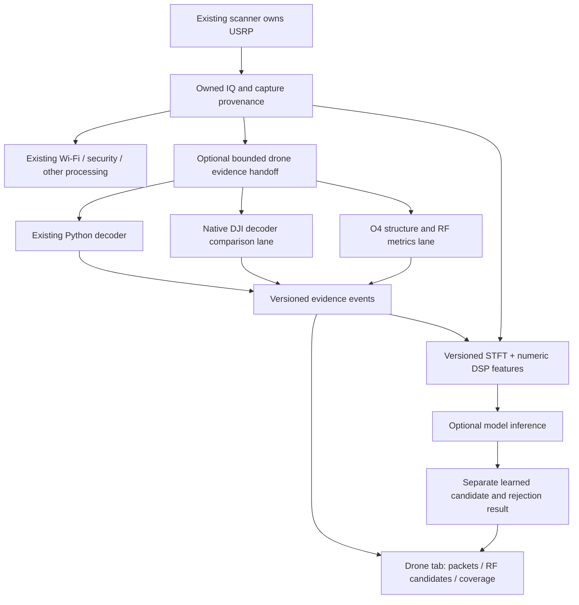

# Punjdrone Linux review: Drone tab and model improvement plan

29 October 2026. **Planning only: no application changes, training, radio access, build, test execution or model promotion in this review.**

Reviewed `/home/sudeep/Music/punjdrone`: Linux/common C++ decoder, O4 detector, worker, UI state, map, capture metadata and saved Linux results. Windows implementation and packaging are outside this plan. The source checkout is based on `d75f39494ea86bfa214cb68d0b4bb40fc258a294` with modified verification documents and other working-tree files; that commit alone does not identify everything reviewed. Pin exact source hashes before a future import. Existing repository documents are evidence to assess, not instructions to execute.

## Recommendation

Reuse Punjdrone's **native protocol decoding, temporal structure evidence and packet inspection** as optional components of our existing Drone tab. Keep our scanner as the radio owner. Compare the native decoder against the existing Python decoder before choosing a default. Add its O4 detector as an explicitly experimental evidence source, never as a universal drone/no-drone gate.

For ML, use numerical DSP evidence alongside STFT features and improve the association between labels and actual signal intervals. Do not train from O4 candidate flags or failed decodes as though they were ground truth. Start with offline comparison and provenance reconciliation; integration and training follow separate acceptance gates.

## 1. What is actually useful

| Component | Observed implementation / saved evidence | Proposed use | Limitation |
|---|---|---|---|
| Native DJI decoder | C++ ZC/CP synchronization, integer-carrier correction, OFDM demodulation, turbo decoding, outer CRC-24; in-memory `decode_samples` API | Optional native backend; retain checksum-valid raw packets even when telemetry is unsupported | DroneID evidence is not universal control/video-link identification; no local Mini 2 reception guarantee |
| Envelope inspection | Separate inner CRC-16, length and envelope format; v2/v3/INFP/CRYP/auxiliary distinctions | Show transport integrity and parser support separately | Checksums do not authenticate a transmitter, serial or position |
| O4 structure v2 | Normalized lag/cyclic/harmonic features, clipping guard and temporal support | New signal-evidence panel and optional numeric ML features | Empirical O4-compatible hypothesis; misses and non-unique features remain |
| Independent consumer queues | Immutable IQ buffers shared between packet and RF/O4 queues, independent drop counters | Prevent an overloaded experimental DSP branch from consuming the packet branch's queue capacity | Still competes for CPU/memory; bounded queues cannot guarantee zero drops under all loads |
| FFT and resampling utilities | Per-thread FFTW plan caches with synchronized planning; anti-alias conversion to decoder rate | Candidate implementation/performance improvements after parity tests | Actual rate, passband, filter delay, FFTW lifecycle and architecture assumptions need auditing |
| Packet selection and map | Selected packet retained by value; separate aircraft/operator/home markers; native ImGui/OpenGL map | Richer packet inspection, then optional map | Coordinates are transmitted claims, not independently measured position; map has network/cache dependencies |
| Saved local captures | Mini 2, Air 3S and baseline context plus metadata/analysis | Development material and recording-protocol examples after provenance review | Same-session and weak-label limitations; directory names are not per-window truth |
| Sweep accounting | Per-visit validity, blind interval and processing time | Borrow coverage accounting concepts | Do not import its standalone USRP owner or sweep schedule into our running scanner |

Primary implementation references: [decoder API](/home/sudeep/Music/punjdrone/include/droneid/dji.h), [O4 implementation](/home/sudeep/Music/punjdrone/src/o4/o4_detector.cpp), [worker queues](/home/sudeep/Music/punjdrone/src/ui/receiver_worker.h), [packet parser](/home/sudeep/Music/punjdrone/src/proto/frame.cpp), [map selection](/home/sudeep/Music/punjdrone/src/ui/map_state.h).

### Evidence strength and important contradictions

- The saved final Linux CTest log records **18/18 suites passed**. This review read that log; it did not rerun the suite or establish that a new integration passes. [Saved log](/home/sudeep/Music/punjdrone/data/analysis/final_20261029/linux-ctest.log).
- The final ten-minute Linux DJI processing log records **9,216,000,000 samples at 15.36 MSps**, 37,500 O4 windows and zero recorded overflows/gaps/packet or RF queue drops. It also records **zero decoded packets and zero O4 candidates**. This demonstrates throughput under that run's workload, not positive-source recall or high-rate capacity. [Log](/home/sudeep/Music/punjdrone/data/analysis/final_20261029/live-dji-split-600s.log).
- The retained nine-clip CLI/UI comparison has payload/checksum agreement. Several checksum-valid packets remain unparsed. The native parser currently accepts supported v2 lengths and explicitly names only product ID 63 as Mini 2. Our existing Python parser has broader model-name mapping and accepts a different version/length set. A wholesale replacement risks a functionality regression. [Parity results](/home/sudeep/Music/punjdrone/data/analysis/final_20261029/corpus/ui_verification.json), [current backend](/home/sudeep/Documents/newrocktest-cpp/src/drones/python/backend.py).
- The public Mini 2 reference decodes successfully, but the local capture report documents Mini 2 sweeps with no CRC-valid results. Porting the decoder does not itself solve our live Mini 2 problem. Old README statements and build phases are less reliable than later source/log evidence. [Capture report](/home/sudeep/Music/punjdrone/data/CAPTURE_REPORT.md).
- O4 v2's new-file evaluation reports candidates in **7/8 O4-labelled prefixes**, no candidates in **24 non-O4 control prefixes / 960 windows**, and no candidates in **three O4+ prefixes**. One Avata 2 prefix and local 2.4 GHz Air 3S captures are missed. These are file-level results, not independent aircraft accuracy. Non-O4 controls can contain other drones, so this is not a no-drone false-alarm measurement. [O4 report](/home/sudeep/Music/punjdrone/docs/O4_DETECTOR.md).
- The source exposes an important runtime distinction: `decode_file` maintains a streaming resampler, while each `decode_samples` call constructs a new resampler. An adapter must deliberately handle overlap, filter boundaries and original-sample indexing; “streaming” cannot be inferred merely from the existence of both APIs.

## 2. The main integration mismatch—and the available solution

Our [scanner](/home/sudeep/Documents/newrocktest-cpp/src/scanner.cpp) requests four **one-second** subcaptures per step. Its optional IQ observer runs after existing Wi-Fi packet processing. The [Drone add-on](/home/sudeep/Documents/newrocktest-cpp/src/drones/addon.hpp) then selects at most four separate **20 ms** snippets and assigns each a new continuity epoch.

Punjdrone's O4 detector uses **16 ms non-overlapping windows**. The strong path needs five complete windows, with the current window and at least three of five matching: earliest candidate at **80 ms**. The weak path needs the current window and eight of ten matching: earliest candidate at **160 ms**. These are minimum evidence durations, not guaranteed detection times.

Therefore, four dispersed 20 ms snippets cannot be concatenated to provide the required history. Fortunately, a valid one-second capture already has enough within-capture duration. The first integration can work inside existing captures without changing the receiver's dwell or taking control of its tuning.

Proposed capture contract:

- Immutable complex IQ plus actual sample rate, actual RF/DSP tuning, usable passband, run/session/capture IDs, original sample offset, device timestamp, gain/scaling and gap/overflow status.
- Continuous ranges within a capture are explicit. Reset history at retune, real sample gaps, rate changes, source changes and queue loss. Never stitch captures solely because their centre frequency matches.
- Start with bounded continuous analysis spans, for example 320 ms when available, and report how much of each capture was analysed. This is a trial budget, not a fixed operating recommendation. Longer/full-capture processing is conditional on measured load.
- The existing observer receives a reference whose lifetime ends with processing. Workers must not retain that pointer. Establish owned immutable buffers or a bounded owned-copy handoff, and measure copy time; claiming a zero-copy integration without changing ownership would be unsafe.
- Separate queues for packet decoding, RF/O4 evidence and optional ML. A slow consumer loses its own work, records a gap and resets history. It cannot block acquisition or evict another consumer's entries. CPU/memory contention still needs load tests.
- Keep actual input rate distinct from an algorithm's internal rate. Use native wideband data or validated channelized data as appropriate. Do not reuse Punjdrone's historical 1 GbE/20-MSps schedule as a cap on this project's 10 GbE setup.

Our present Python Drone adapter accepts up to 100 MSps, whereas the new native decoder/O4 API advertises 10–250 MSps. API acceptance is not proof of usable passband, feature invariance or throughput. Higher rates require qualified processing paths, not simply removal of validation bounds. At 100 MSps, 160 ms of cf32 is about 128 MB; sharing, channelization and bounded lifetimes matter.

## 3. Additive architecture

Initial implementation choice: extract a narrowly scoped native DSP module and call it from an **optional worker process**, preserving the fault-isolation pattern already used by our decoder. Use a versioned bounded IQ/event protocol; do not launch the standalone Punjdrone GUI or its radio worker from our app. Profile IPC/copy cost before considering in-process execution. Process separation is a reliability choice, not a licence workaround.

A future import must pin source/dependency hashes and notices, avoid building another ImGui/GLFW application inside ours, and isolate FFTW/turbofec symbols and CPU-feature requirements. Do not import encoders, test transmitters, standalone acquisition or platform packaging as runtime dependencies.

## 4. Proposed Drone tab

Retain the current DJI live, Wi-Fi Remote ID and offline review functions. OpenDroneID work stays deferred; this proposal does not replace or expand that path.

| View | Information to show | Guard against misleading presentation |
|---|---|---|
| Overview | Enabled backends, current band, observed duration, most recent evidence, coverage age | “No supported evidence in analysed data” differs from “no usable data”; neither proves no drone exists |
| Decoded packets | Native/Python source, sample/time interval, outer CRC, inner CRC, envelope, parser support, reported identity, raw payload | Retain checksum-valid unsupported payloads; no fabricated serial/model/coordinates |
| Signal evidence | O4-compatible candidate, strong/weak path, 16 ms history, correlation/prominence/harmonic metrics, clipping and reset reason | Label experimental; scores are not probabilities; candidate windows are not drone counts |
| Selected event | STFT/context, relevant numerical feature trace, original sample range, matching decoder/model evidence | Association requires time/frequency/source overlap; being in the same capture is insufficient |
| Model comparison | Learned class scores/rejection beside DSP evidence, with disagreement status | Keep reported packet identity separate from ML prediction; no silent override or multiplication of uncalibrated scores |
| Coverage/performance | Analysed/omitted samples, passband, queue depth, dropped work, processing/queue latency, time since last visit | Include observer processing delay and scanning blind intervals |
| Offline comparison | Same permitted IQ interval through current/native/DSP paths | Keep offline results visibly separate from current live state |

The existing Model Inference tab remains the main model view. Drone-tab event selection can link to the corresponding model/STFT result using a common event/source ID, avoiding a second independently computed display that could silently show different samples.

**Map is a later UI milestone:** reuse stable packet selection and coordinate validation first. Plot only supported reported coordinates, with separate drone/operator/home markers and timestamps. Unknown/O4-only evidence creates no marker. Online tiles remain an explicit setting; cached-only mode must work. A default map centre is not a detected position. The Linux map adds libcurl/stb and cache/render lifecycle work; it does not improve RF detection.

**Direction finding stays deferred:** paired acquisition, same-session phase calibration and known-angle tests remain prerequisites. The map cannot substitute for DF, and one two-antenna baseline does not establish unambiguous 360° position/range. Existing mono recordings cannot validate physical bearing accuracy.

## 5. How this should improve the model

### Better inputs, not automatic labels

Keep the STFT branch for broader waveform/context information. Add an optional numerical feature branch containing normalized ZC correlation and timing consistency where supported, CP/lag features, cyclic and harmonic strengths, prominence, temporal support, bandwidth/occupancy and quality masks. Include missing-feature indicators: an unavailable correlator result is not a zero-evidence measurement.

Proposed experiments, all using the same permitted groups and evaluation policy:

1. Frozen DSP rules alone, with candidates and abstentions.
2. STFT-only compact baseline.
3. STFT plus numerical DSP features, using a small MLP feature encoder fused with the spectrogram embedding.
4. Short STFT views plus genuinely continuous temporal feature history, compared with the same model without that history.

Choose based on false drone events/hour, known/unknown detection, identity rejection, latency and resource cost. The new branch must improve independent results rather than merely imitate the O4 thresholds. DSP negatives must not be a hard gate excluding all examples from ML; otherwise every unsupported link is invisible to the learned model too.

We should not immediately enlarge the vision backbone. This project contributes complex-IQ structure that a magnitude-only STFT cannot preserve, plus better temporal evidence. Testing those additions is more directly motivated than increasing parameter count.

### Evidence and label policy

| Source of evidence | Permitted proposed use | Not permitted automatically |
|---|---|---|
| Valid protocol frame and reviewed source association | Protocol-positive example for its supported interval; reviewed reported identity metadata | Ground truth that the whole recording is that drone, that every nearby burst belongs to it, or that the identity is authenticated |
| Supported packet model claim plus controlled session truth | Candidate identity supervision after provenance/scope review | Using decoded serial/GPS/model strings as input shortcuts to the RF identity network |
| O4 candidate | Feature, weak evidence or review priority | Gold O4/model/presence label |
| Failed DJI decode / no O4 match | Difficult or unresolved example | No-drone negative |
| Known non-O4 drone | Negative for an O4-specific rule | Negative for drone presence |
| Documented controlled background | Potential negative supervision/evaluation within its supported scope | Assuming all files named baseline are independently verified drone-free |

Protocol-positive snippets can be strongly selection-biased towards high-SNR, decodable broadcasts. Keep undecoded and weak examples in the sampling plan; otherwise the trained presence detector learns “easy DroneID” instead of general drone-system activity. Do not use model outputs as labels and then score against those same labels.

Original-sample timing needs its own verification. The native decoder returns padded burst-window starts, not necessarily exact symbol boundaries, and resampling/filter support can extend the required interval. Define the associated RF region conservatively before exporting instance labels.

Local Mini 2 and Air 3S recordings are useful additional context, but their labels are not independently checked in this planning pass. Air 3S recordings used to design O4 thresholds are **not an unseen test for the combined pipeline**, even if a new neural network has never trained on Air 3S. Keep development and final unknown-model evaluation separate.

## 6. Cross-project dataset exposure is a new gate

A metadata-only comparison of Punjdrone result paths/member names with our frozen 517-entry review found:

| Punjdrone report | Rows | Exact matches to our train | Calibration matches | Locked test matches | Not exactly matched |
|---|---:|---:|---:|---:|---:|
| O4 v2 new-file set | 35 | 13 | 5 (3 unknown, 2 known) | 3 unknown | 14 |
| O4 v2 external regression | 60 | 29 | 3 unknown | 7 (6 unknown, 1 known) | 21 |
| Final retained decoder corpus | 9 | 5 | 0 | 0 | 4 |

Across the first two reports, the ten locked source matches are nine `mavic3C`/`mavic3S` contexts and one `mini4PRO_5_hover_c3_u2_d1.mat` known-test entry. The results indicate those source prefixes were evaluated in the other project. This review read saved metadata, not their raw IQ. No frozen assignment was changed.

Consequences:

- The other project's term “holdout” does not make its data a valid untouched holdout for ours.
- Do not import those inputs, derivatives or resulting candidate labels into training. Treat their reports as exposed engineering evidence.
- “Not exactly matched” does not mean independent: archive/member aliases, physical-unit groups and derived clips still need reconciliation.
- Freeze the DSP profile and reconcile cross-project hashes, members, groups, derivative lineage and exposure before the next model experiment. A fresh prospective holdout is needed for the strongest combined-system claim.

This extends the earlier two-plot exposure warning. It does not invalidate every previous experiment, but it prevents us from overstating independence after importing a detector informed by the other project's evaluations.

## 7. Milestones and acceptance gates

| Milestone | Deliverable | Completion criterion |
|---|---|---|
| P0 — Source/data provenance | Exact Linux component hashes, dependency notices, cross-project source/group/exposure ledger | No unexplained protected-source admission; no inference that filename/product family equals measured RF identity |
| P1 — Offline native comparison | Optional native adapter run beside the current decoder on approved fixtures | Payload/CRC/telemetry comparison, unsupported formats retained, original-sample timing verified; every lost old decode explained |
| P2 — Continuous DSP evidence | O4 branch on owned continuous spans, versioned evidence records and independent bounded queues | 80/160 ms persistence behaves correctly; gap/retune/drop reset tests; no fabricated continuity or identity |
| P3 — Additive Drone UI | Packet inspector, evidence timeline, coverage and offline comparison | Existing controls/results preserved; stale/offline/candidate/decoded states distinct; no marker or drone count from candidate windows |
| P4 — Workload qualification | Existing app plus optional native/DSP lanes under representative rates and traffic | Baseline comparison of Wi-Fi/security results, acquisition drops, memory, queue age and UI responsiveness; failures confined to optional lane |
| P5 — Model-ready corpus | Scope-aware positive/negative/unknown evidence, feature schema, preprocessing parity and ablation plan | No automatic weak-label promotion, no protected leakage, class eligibility explicit, background evaluation and timing targets reviewed before training |
| P6 — Controlled model comparison | DSP-only, STFT-only and hybrid experiments | Independent group/event results justify the chosen architecture; no automatic deployment |
| P7 — Optional map and later live validation | Reported-location map; prospective Mini 2/other-source tests when available | Correct coordinate provenance; no-aircraft-source/unknown cases retained; reception and identity qualification stated separately |

P1–P3 can be prepared and verified offline. P4 includes offline stress work first; live radio tests and P7 happen when appropriate equipment/source truth is available. No hardware is needed merely to write the adapters or verify known fixtures. Real controlled background and target sessions remain necessary to claim live false-alarm/recall performance.

## 8. Caveats to preserve in the decision

1. This is chiefly DJI DroneID plus one empirical O4 profile, not broad non-DJI/FPV/915 MHz recognition. It complements our existing waveform work.
2. O4+ remains unsupported by this profile. Do not lower thresholds merely to make all downloaded classes produce candidates.
3. The current O4 implementation assumes normalized IQ for its ±0.999 clipping test. Adapter scaling, gain, resampling and channelization can change the feature distribution; version and validate them.
4. The strongest-band auto-centre option can select Wi-Fi instead of DroneID and holds one choice for a file. Multi-channel analysis needs a bounded hypothesis/channelization strategy, not a promise that auto-centre tracks drones.
5. The Linux zero-drop soak does not establish throughput at our higher rates or while Wi-Fi/security/ML all compete. Budget both memory lifetime and compute; do not reinterpret API limits as hardware caps.
6. No CRC or decoded model field authenticates the aircraft. Spoofed/replayed broadcasts are possible; associate their claims with existing replay/security evidence only when source/time semantics support it.
7. Retaining more decoded packet formats must not reduce current telemetry support. Keep Python fallback and require explicit comparison before any default switch.
8. The original plan, README and later logs differ. Use current code and pinned results, with dates; do not copy old launch recipes or stale network assumptions.
9. GPL/AGPL and third-party notices already exist in both projects. Preserve provenance and evaluate the intended distribution requirements; isolation does not remove them. This review does not establish licence compatibility for a particular distribution.
10. Automatic sweep and DF are separate projects in practice: importing them would alter radio ownership, scan latency and calibration assumptions. They are outside the first additive integration.
11. The present no-drone/unknown-drone evaluation gap is not solved just by finding more candidate windows in Punjdrone. Rules need labelled evaluation too.

**Recommended first implementation after this plan is reviewed:** P0 and P1, followed by P2's continuous-data adapter. That gives measurable protocol and signal evidence before changing model architecture or spending time on another large training run.
