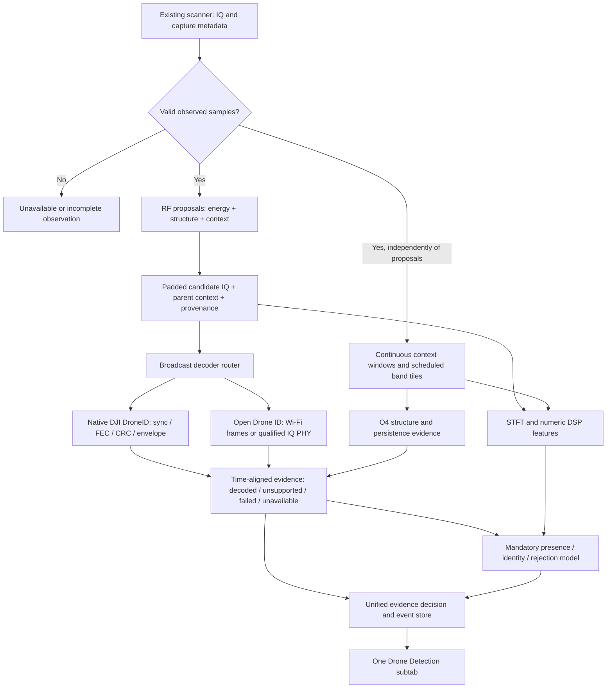

# Unified Drone Detection: RF proposals, broadcast decoding and ML

30 October 2026, revision 2. **Plan only. No application code, model, receiver setting or dataset is changed.** This revision makes classification mandatory and adds a real-world scenario walkthrough. The walkthrough is an engineering failure analysis, not a hardware trial, IQ replay benchmark or measured accuracy result.

This revises the UI and decoder scope of the [Punjdrone Linux integration plan](PUNJDRONE_LINUX_INTEGRATION_PLAN_2026-10-29.md). The requested destination is one **Drone Detection** subtab that replaces the simple “Enable DJI add-on” experience with a unified service: supported DJI DroneID decoding, O4-compatible structure detection, Wi-Fi Open Drone ID decoding and **mandatory model classification**. Open Drone ID is explicitly included; its earlier deferral no longer applies to this plan. Linux only. This revision supersedes optional-classifier language in earlier plans.

## Decision on the proposed architecture

The proposed progression is useful: locate relevant IQ, try broadcast decoding, and pass the signal and evidence to the model. Three corrections are necessary:

1. **Energy selects RF candidates; it does not establish that a signal belongs to a drone.** Call the first stage an RF proposal/localisation stage, not a drone classifier.
2. **Initially trim a padded candidate interval, not an allegedly exact packet.** Energy boundaries can miss preambles, weak edges and overlapping emissions. Keep the parent context; refine packet boundaries after synchronization where possible.
3. **Do not require decoder success or an energy proposal before classification.** Unsupported, weak and non-broadcasting drone links must still reach the model. A mandatory background/context classification stream starts directly from valid IQ, independently of burst detection. Event crops add detail to that stream; they are not its sole input.

The classifier is an essential service component, with presence, known-identity and rejection outputs. Presence is not vetoed by failure to name an exact model. A qualified decoded broadcast is also not hidden because the model disagrees. The system preserves both evidence sources and reports conflicts.

The design broadens coverage; it cannot guarantee detection of every drone. A passive RF receiver cannot identify a silent drone or an emission outside its observed band/time. O4-compatible evidence is not yet confirmed O4 identification, and the available Open Drone ID receiver does not support Bluetooth.

## End-to-end flow

This is a logical sequence with independent bounded workers. Start mandatory classification and decoder attempts in parallel; classification must not wait for a decoder timeout. The RF-only model path always works with an explicit missing-decoder-evidence mask. Join completed evidence by source/sample interval, explicitly mark pending/unavailable evidence, and append late decoder results without silently changing the original inference provenance. A model trained to consume decoder features must see the same missing-evidence masks and timing policy at inference. Positive decoder evidence can produce an immediate protocol alert while the required model result is pending.

## 1. RF localisation and IQ extraction

Use a lightweight multiresolution proposal stage combining adaptive energy/background estimates with existing spectral/cyclostationary structure. Maintain full-context coverage for continuous, weak, high-duty or uncertain signals. Avoid making strong-energy selection the only entry to decoding or ML.

Each proposal contains:

- Original capture ID, source/session/configuration epoch, actual sample rate and frequency, device timestamp and exact original sample offsets.
- Estimated time/frequency support, boundary uncertainty, parent interval and selected channel bandwidth.
- Pre/post-roll and resampler/filter support; truncation, clipping, gaps and usable-passband flags.
- Selection method/profile, energy/structure measurements and reason for admission. These are not presence probabilities.

Maintain **two views**: a local padded view for packet synchronization and fine features, plus a wider parent/context view for temporal and continuous-link information. Padding is protocol/rate dependent and must be validated by frame-recovery tests, not picked as one universal packet length. A clipped packet can trigger a bounded retry with more parent context if those samples are available.

Do not split every fluctuation inside an OFDM transmission into a new emitter. Preserve overlapping/ambiguous regions instead of claiming exact separation. Duplicate proposals from multiple methods must retain lineage and be coalesced without counting the same samples as independent evidence.

## 2. General broadcast decoder service

“General decoder” means a common router and result schema around separate protocol implementations. It is not a universal decoder for all drone links.

| Backend | Planned output | Boundary of support |
|---|---|---|
| Native DJI DroneID | Synchronization, outer CRC-24, inner CRC-16/envelope status, raw payload, supported telemetry and reported model | Supported broadcast formats demonstrated in O1/O2/O3/O3+ associated recordings; not complete control/video decoding or automatic RF generation identification |
| O4 structure v2 | Correlation/prominence/harmonic features and strong/weak temporal candidate state | Detection hypothesis only; no O4 payload decoding, exact model, position or unique-aircraft count; O4+ remains unqualified |
| Wi-Fi Open Drone ID | Beacon/NAN message packs, IDs, aircraft category and supported reported telemetry | Supported Wi-Fi PHYs and message versions; no BLE, authentication verification or universal exact-model field |

**DJI:** reuse Punjdrone's native chain but compare it with our existing Python implementation before default replacement. Its parser supports fewer layouts/model-name mappings, so preserve working old-format decoding via an internal fallback until native parity is demonstrated. Keep checksum-valid unsupported payloads visible. “O1/O2/O3/O3+ supported” must be expressed as a tested model/format matrix, not four guaranteed universal decoders. A packet's dataset label cannot determine a live generation label.

**Open Drone ID:** prefer complete FCS-valid Wi-Fi frames already produced by our workers as input to the common broadcast service. Compare the native parser with our existing Remote ID parser before selecting a default. Use Punjdrone's IQ-based PHY only for an explicit additional coverage path or offline replay, with channel centering, qualified sample rate, full-frame context and a separate budget. Do not routinely decode the same Wi-Fi IQ twice when a suitable frame already exists.

Punjdrone's standalone `--odid` mode currently excludes its DJI processing. The requested simultaneous service is therefore **new integration work**, not a GUI rename. Instantiate independent protocol adapters instead of importing that exclusive-mode switch. Deduplicate the frame and IQ Open Drone ID paths by capture/source interval and packet identity; distinct on-air retransmissions remain distinct receptions.

The existing native ODID documentation lists OFDM/DSSS support but excludes HT/VHT/HE, CCK 5.5/11 Mb/s and Bluetooth. Its strongest recorded transmitter validation is an ESP32-S3 Beacon/NAN source; that is not equivalent to validation on every compliant aircraft. These limits remain visible in the unified UI.

## 3. Continuous O4 and temporal evidence

Preserve the existing 16 ms evidence windows, earliest strong confirmation at 80 ms and weak confirmation at 160 ms while reproducing the frozen profile. Reset on gaps, retunes, queue loss and configuration changes. A short RF proposal must not reset or fabricate the independent context stream.

Our present add-on's four dispersed 20 ms snippets cannot supply this history. The scanner already requests one-second subcaptures, so initially process owned continuous spans within each valid capture. Do not assume continuity between separate captures. Report duration actually analysed; processing a fraction of a capture is reduced coverage, not full monitoring.

O4 evidence remains separate from generic drone presence. An O4-negative result may be a perfectly valid O1/O2/non-DJI drone signal. Its empirical profile has known misses and cannot become a veto over the classifier.

## 4. Model input and decision policy

Retain the model's local/parent STFT views and add a compact numeric feature branch for correlation, cyclic structure, temporal support and quality masks. Optional decoder-status features must be evaluated as an ablation, not assumed helpful. Serial numbers, GPS, filenames and claimed model names must not leak into the RF identity model as shortcuts.

The classifier receives undecoded candidates, decoded cases and scheduled continuous context independent of the proposal stage. Full mode must cover the declared observed time/frequency domain with qualified overlapping tiles, not just a few representative snippets. Stride, frequency overlap and tile bandwidth are frozen against minimum detectable event duration and edge sensitivity. Additional candidate crops may be prioritised, but cannot starve baseline coverage. Do not require a pre-existing model to select the training examples for its replacement. Failed decode, no O4 match, a Wi-Fi-like waveform and low energy are not automatic negative labels.

The event store keeps independent fields for protocol evidence, reported identity, learned identity and evidence of drone presence. The presentation policy is:

| Evidence | User-facing interpretation |
|---|---|
| Supported broadcast passes required validation | Decoded drone-associated broadcast; show reported fields as unauthenticated claims |
| Valid transport but unsupported payload | Protocol packet decoded; identity/telemetry unavailable |
| O4 structure profile matches | O4-compatible RF candidate; identity unverified |
| Qualified presence model accepts activity, identity rejects known classes | Unknown drone-system candidate, within the model's validated operating scope |
| RF activity without sufficient presence evidence | Unclassified RF / insufficient evidence |
| Valid analysed observation without accepted evidence | No drone RF activity detected in this observation; show coverage and validation limits |
| Invalid input, processing unavailable or insufficient context | Insufficient observation; never substitute “no drone” |

A decoded ID remains available if mandatory ML fails, but the service then explicitly reports **DEGRADED — classifier unavailable**, not normal full detection. There is no normal-operation “disable classifier” switch. A model disagreement is shown, not silently used to overwrite a reported ID or erase a valid protocol detection. Do not multiply uncalibrated correlation and softmax scores into an invented probability. Only label model probabilities as calibrated when the relevant evaluation supports that claim.

Before a qualified presence/rejection model exists, decoder/DSP development builds are explicitly **diagnostic previews**, not the completed unified detector. Shipping/enabling normal full mode is blocked until the mandatory classifier and end-to-end gates pass. The existing forced-classification behaviour must not manufacture a definitive drone/no-drone decision.

## 5. One unified subtab

Replace the simple DJI enable view with **Drone Detection**, containing:

1. **Main control:** Enable/Stop Unified Detection; source selector Live or Offline replay; status of the shared receiver. Start checks model/checkpoint/preprocessing compatibility and worker readiness. Stop has documented retained-history behaviour.
2. **Backend status:** DJI broadcast, Open Drone ID, O4 structure and mandatory ML. One main enable action starts the unified service. Protocol-specific diagnostics remain available; normal full detection cannot run with classification switched off. Show STARTING / READY / DEGRADED / STOPPED, with the reason and affected coverage.
3. **Evidence/event table:** acquisition time, band/channel, evidence type, decoded protocol, reported identity, ML candidate/rejection, quality/freshness and source. Keep candidate RF events separate from identified broadcast sources; neither is automatically a physical-drone count.
4. **Selected-event details:** padded/parent STFT, original sample coordinates, DSP trace/history, packet bytes, checksum/envelope/parser status and model result. Do not show a model result from different IQ as if it described the selected packet.
5. **Reported position panel:** optional map, distinct aircraft/operator/home markers only when supported valid coordinates are available. No map position from O4 candidates or model predictions.
6. **Coverage/performance panel:** analysed and omitted duration, queue drops, gap resets, decoder rejection reasons, processing age, observed passband and missing transports. Advanced controls remain within the same subtab.

Open Drone ID messages feed this same event store rather than a separate duplicated list. Preserve every field currently exposed by our existing Remote ID UI, including unsupported/authentication-page status. Link to the existing Model Inference page for full model diagnostics; do not remove that page or require it to be open.

The same emitter may broadcast both DJI and Open Drone ID. Associate sources only with defensible evidence; do not merge solely by nearby time, position or a matching self-reported name. Retain protocol-specific source identities and association confidence/reasons.

## 6. Preserve existing functions and receiver ownership

- Our scanner remains the only receiver owner. The new service cannot retune, change gain/rate, stop scanning or open the same USRP independently. No imported standalone Punjdrone sweep/receiver loop.
- Use owned immutable IQ and bounded per-consumer queues. The current observer's borrowed vector cannot outlive the callback; fix ownership before asynchronous retention. Measure any copy overhead.
- Packet decoding, O4/context, ODID PHY and ML have independent budgets and visible overload states. Errors cannot terminate existing Wi-Fi, security, cyclostationary, LoRa or recording work.
- Reserve processing capacity for mandatory baseline ML coverage and packet evidence; optional map rendering, duplicate refinement and additional decoder retries yield first. If baseline work still drops or misses its freshness deadline, mark the affected interval degraded. Never silently retain a full-coverage badge while shedding required inference.
- Reuse native C++ DSP behind an optional isolated worker interface first. Avoid duplicating ImGui/GLFW/OpenGL application infrastructure. Preserve FFT/thread lifecycle and dependency attribution.
- Do not inherit the source project's historical transport caps. Respect actual rates/passbands and profile processing cost on this 10 GbE setup. More transport bandwidth does not remove processing/memory limits.
- Preserve the legacy implementation behind an internal rollback option during migration. The user-facing default changes to the unified service only after parity and regression gates; this is a staged replacement, not two permanent competing enable buttons.

## 7. Training and validation gates

The [pre-training caveat register](DRONE_ML_PRETRAINING_READINESS_2026-10-29.md) still applies. The new DSP service supplies evidence and better crop association, not a substitute for trustworthy negatives, group separation or live qualification.

Explicit gates:

- Audit source hashes, member paths, session/aircraft groups and cross-project evaluation exposure. Punjdrone's two O4 result sets overlap ten of our locked test sources; do not admit them or their derivatives to training or call them untouched final validation.
- Freeze proposal/padding/channelization, DSP features, masks and model preprocessing. Preserve raw-parent lineage and the relationship between bag labels and instance regions.
- Use controlled no-drone backgrounds, supported positive sessions and genuinely withheld drone models. No decoder failure is a gold no-drone label; a decoded broadcast is not proof that every surrounding transmission belongs to that aircraft.
- Avoid selection bias: decodable broadcasts are often easier than weak/interfered control/video traffic. Evaluate both, and retain no-proposal misses in end-to-end recall.
- Compare DSP-only, STFT-only and hybrid systems under identical permitted splits. Report false drone events/hour, event recall, known-model error, unknown acceptance/known rejection, coverage and time-to-alert—not just window accuracy.
- Test proposal boundaries by complete-frame recovery versus parent-window decoding, including low-SNR edges, overlapping sources and frames spanning chunk boundaries. Exact burst geometry requires independent evidence; energy segmentation alone cannot certify it.
- Freeze event grouping/alert persistence before final evaluation. Correlated windows are not independent detections, and overlapping decoder paths must not inflate totals.
- Recheck existing packet fields and functions, queue overload/reset handling, rate transitions, unsupported frames and reconnect/recovery. Reserved raw test IQ stays unopened during development.

## 8. Milestones

| Milestone | Deliverable | Acceptance before proceeding |
|---|---|---|
| U0 — Freeze scope and evidence contract | Linux component provenance, source/test exposure ledger, unified event schema and coverage matrix | Claimed support distinguishes protocol decoding, experimental structure and identity; no protected data admitted |
| U1 — RF proposal and context adapter | Padded IQ regions plus proposal-independent classification tiles, parent references, continuous spans, ownership and independent queues | Boundary recovery, no-proposal events, gap/overlap handling and time/frequency accounting verified |
| U2 — Unified decoder service | Native DJI plus existing fallback, Open Drone ID adapters, O4 temporal evidence | Old supported cases retained; CRC-valid unknown payloads exposed; simultaneous branches work without separate radio ownership |
| U3 — Single-subtab preparation | Unified enable, mandatory-model readiness, event table, live/replay source and coverage | Existing fields preserved; model faults/overload show degraded state; diagnostic preview clearly distinguished from full mode |
| U4 — Offline and workload acceptance | Shared fixtures, CPU/memory/queue measurements and existing-function regressions | Packet parity, bounded failure isolation, measured load and honest coverage; prospective live checks scheduled separately |
| U5 — Pre-training review | Scoped corpus, feature/temporal contract and DSP/STFT/hybrid ablations | Known caveats shown and unresolved compromises reviewed before training; negatives and split validity support intended claims |
| U6 — Mandatory model and complete-system qualification | Controlled model comparisons, scenario suite, coverage/load tests and prospective live validation | Required recall/false-alarm/latency bounds met; no silent omissions or missing classifier; only then review replacement of the existing default |

The first implementation should cover U0–U2 while preparing the model corpus and inference contract. Decoder/DSP previews can improve engineering evidence, but the requested segment is not complete until the mandatory classifier and unified end-to-end system pass U6. Identity accuracy, drone-presence recall and observation coverage remain separate outcomes to validate.

## 9. Real-world scenario walkthrough and design changes

The following cases were walked through against the proposed dataflow and current code. Outcomes are expected behaviour and acceptance requirements, not tests performed on live drones.

| Scenario | How the simpler pipeline could miss it | Revised handling | Required evaluation |
|---|---|---|---|
| Mini 2 is linked but no supported DroneID packet is received | Decoder-first gating drops its control/video activity | Mandatory context/STFT classification runs without broadcast evidence; protocol absence is not a negative label | Controlled linked sessions, including intervals with no successful decode; report missed presence independently of identity |
| Weak distant drone beside a much stronger router | Energy top-K selection or strongest-band centering selects only Wi-Fi | Proposal-independent band tiles, channel-local context and bounded alternative frequency hypotheses; do not erase all Wi-Fi-like regions | Real near/far mixtures and controlled interference/SNR sweeps; clipping and receiver sensitivity limitations stated |
| Continuous or almost continuously occupied link | Noise estimator absorbs the transmission; no burst edge is found | Direct context classification plus reference-reliability flags and persistent structure analysis | Continuous/high-duty examples, including the existing 98%-duty failure mode |
| Short transmission occurs between sampled 8 ms snippets | Existing sparse inference selection never sees it | Qualified overlapping temporal tiles over the observed span; fast evidence path does not require 80/160 ms O4 persistence | Random event start phases and boundary-straddling short bursts; define minimum supported duration |
| Drone hops or changes between 2.4 and 5 GHz | Receiver is elsewhere; cropped histories are joined incorrectly | Per-band observation ledger, gap-aware reset and coverage warnings; address acquisition gaps as a separate system requirement | Controlled hopping/channel switching with source timing truth; measure unobserved events and time-to-first-detection |
| A frame begins at a processing boundary | Crop or resampler cuts preamble/tail | Padded overlap, valid-sample ownership and bounded parent-context retry | Compare whole-parent and chunked decoding at varied offsets without double counting |
| Two drones plus Wi-Fi transmit together | One dominant crop and single scene label hide the weaker drone | Multiple event/region hypotheses and independent per-region outputs; multi-label presence/context supervision where labels support it | Unequal-power simultaneous sources; count target opportunities missed, not just “some drone detected” |
| Unseen drone or changed firmware/waveform | Known-class softmax chooses the wrong model or DSP signature rejects it | Open-set identity rejection and independently trained presence; allow unknown drone-system candidate or uncertain RF | Leave-model/session/domain-out evaluation; unknown classification is not guaranteed by rejection alone |
| O4+ or an O4 mode absent from the empirical profile | No O4 flag is treated as no drone | O4 profile is one feature source, never a veto; mandatory generic classification still runs | Known profile misses retained in development evaluation; new modes held out prospectively |
| Wi-Fi-only or Bluetooth-rich busy scene | Higher sensitivity labels all activity as drones | Verified background training, calibrated event thresholds, unresolved-RF state and quality-aware aggregation | Long independent background sessions; false drone events/hour and alert burden |
| Broadcast identity conflicts with model output | Sequential classifier suppresses a real decoded packet or overwrites its model claim | Retain protocol and learned identity separately; flag conflict and keep protocol evidence visible | Deliberate mismatched/replayed fixture claims and ordinary model confusions; no identity authentication claim |
| Remote ID uses an unsupported PHY or Bluetooth | No message is decoded and system falsely clears the scene | Unsupported transport coverage is visible; ordinary RF classification only within its validated band/waveform scope | Actual supported-transmitter tests; unsupported cases marked outside qualified coverage, not successes |
| GPU failure, full queues or slow preprocessing | Required windows disappear while the UI appears healthy | Mandatory model health/freshness checks; supported fallback only if qualified; otherwise degraded state and loss ledger | Model crash, queue saturation, worker restart and stale-result fault injection |
| Gain jump, clipping, retune or sample loss | Artifact triggers a drone or corrupts temporal history | Quality masks, valid-segment processing where boundaries are known, hard reset at unknown gaps; no fabricated silence | Gain/clipping/gap tests plus real congested captures; invalid time counted separately |
| Drone is silent, outside coverage or below useful receive sensitivity | There is no usable RF evidence to classify | Explicit physical coverage limitation; independent sensing would be required for a physical-presence guarantee | Outside this passive-RF claim; never report a physical all-clear |

The main conclusion is that **a mandatory classifier must have a route from IQ that bypasses both energy selection and decoding**. Otherwise it cannot recover a drone discarded upstream, regardless of model accuracy.

## 10. Acquisition coverage and existing-function constraint

Current code has two independent sources of omission: the Drone add-on selects up to four separate 20 ms snippets, and the model observer selects 8 ms intervals with a 500 ms submission throttle. The unified mandatory inference scheduler must replace this sparse selection for its own processing path; simply connecting the new classifier to those unchanged callbacks would preserve the blind spots.

The default 2.4 GHz schedule contains 13 centres × four one-second subcaptures, or **52 seconds of requested listening per complete schedule**, before other overhead. This is not a measured per-frequency revisit time: overlapping passbands may observe a frequency at several centres, and 5 GHz/band switching adds its own schedule. Actual usable frequency coverage and blind intervals must be computed from capture metadata. A classifier cannot repair an event emitted entirely during an unobserved interval.

Therefore separate two delivery modes:

- **Existing-scan compatibility mode:** preserve all current scan behaviour and analyse the IQ it supplies. This is additive, but must display its measured coverage limits. It cannot promise near-continuous multi-band detection.
- **Qualified coverage extension, later:** evaluate wider simultaneous capture and software channelization, or a separately configured additional receive chain where hardware permits. A single scanner/arbitration service still owns all receiver configuration. Measure passband coverage, sample transport, per-band duty and full application load before changing a schedule. Do not trade away Wi-Fi/security/LoRa coverage silently to improve the drone metric.

The user's 10 GbE hardware makes broader acquisition worth evaluating; it does not make separated bands simultaneously observable through one tuning. If the current receiver resources cannot meet both existing monitoring duties and the desired drone-observation coverage, report the resource conflict and required configuration/hardware rather than conceal it through software thresholds. No receiver changes are made by this planning revision.

## 11. Detection, alerting and mandatory-service readiness

- Separate an early **suspected-activity event** from an accepted drone-system alert and an accepted model identity. Longer temporal support can refine a decision, but must not delay a valid protocol report or erase a short independently supported detection.
- Evaluate both early and confirmed time-to-alert. A long persistence rule can reduce false alarms while missing brief events; freeze that tradeoff and test it explicitly.
- “Unclassified RF” is not counted as a correctly detected drone merely to inflate recall. Report target events that remain unresolved, wrong-model events and missed targets separately.
- Mandatory inference must produce either a fresh result or an explicit failed/unprocessed status for each scheduled inference unit. The operator can stop the whole detector; a failed classifier cannot leave normal full detection marked ready.
- If ML fails, continue displaying valid decoder evidence and retain bounded diagnostic data, but show degraded service immediately. Automatic restart/fallback is bounded and must not overwrite evidence or destabilise other functions.
- No-drone wording requires valid, fresh, qualified coverage and processing. Where only a subset was observed/analysed, use “No accepted drone evidence in analysed data” with the missing coverage shown. Neither wording is a physical guarantee.

## 12. Validation that measures missed drones honestly

Create a scenario matrix across model/link family, physical aircraft, session/site, band, operating state, distance/received quality, interference, orientation and simultaneous sources. Separate true controlled source state from the model/decoder's predictions. Use chronological replay and prospective captures to measure the complete chain, not shuffled windows alone.

For each labelled target event, record a failure stage: **not observed by receiver → invalid samples → not scheduled/dropped → proposal miss → model unresolved/rejected → protocol failure → alert policy suppressed → correct detection/identity**. Protocol failure is diagnostic and cannot itself veto model detection. Count receiver/scheduler omissions in system-level recall; also publish conditional recall on usable observed events so the two are not confused. Keep per-target metrics for mixed scenes.

Before training, freeze numerical operating goals for each qualified scenario: minimum supported signal/event duration and passband coverage, minimum event detection probability, maximum false drone events/hour, maximum time-to-alert, known-model error and unknown-drone rejection/acceptance. Choose thresholds on development groups; measure the final system on independent, unexposed groups. The plan does not invent an achieved performance number or set every ambiguous signal to “drone” to approach zero misses.

Report uncertainty as well as counts. For illustration, even **zero misses in 299 independent target trials** only gives an approximately 1% one-sided 95% upper bound on miss probability under an identical independent-trial model. Correlated windows from one recording do not provide those 299 trials, and the bound does not transfer automatically to untested environments or models. Zero observed errors is not a universal zero-miss guarantee.

Release gates are now: mandatory-model readiness; supported-protocol regression parity; proposal-independent time/frequency inference coverage; honest blind/drop accounting; no existing-function regressions; agreed recall/false-alarm/latency criteria with uncertainty; and prospective mixed-scene/live qualification. Until these pass, the new implementation remains a diagnostic preview.

## Source references reviewed

- [Prior Linux comparison and detailed caveats](PUNJDRONE_LINUX_INTEGRATION_PLAN_2026-10-29.md).
- [Current Drone add-on and capture selection](/home/sudeep/Documents/newrocktest-cpp/src/drones/addon.hpp).
- [Native DJI decoder API](/home/sudeep/Music/punjdrone/include/droneid/dji.h) and [telemetry parser](/home/sudeep/Music/punjdrone/src/proto/frame.cpp).
- [O4 profile and measured limits](/home/sudeep/Music/punjdrone/docs/O4_DETECTOR.md).
- [Open Drone ID implementation and transport limits](/home/sudeep/Music/punjdrone/docs/OPEN_DRONE_ID.md).

This document changes the plan only. It does not assert that the unified backend, exact burst trimmer, improved classifier or combined single-subtab UI has already been implemented.
