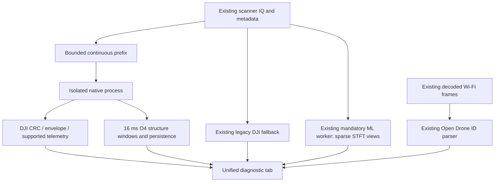

# Unified drone integration and hybrid model implementation

1 November 2026. The first integration is implemented in the working tree. It
is a **diagnostic service**, not completion of every item in the October 30
plan. No Git commit/branch merge or deployment was performed. No training or
hardware session was started; existing model checkpoints are unchanged.

## What is now integrated

The Drones page has a single **Drone Detection** subtab. Its main start action
starts native DJI/O4 analysis, the existing Python DJI fallback, Wi-Fi Open
Drone ID and the existing model worker. It reuses already running workers.
Stopping it stops workers it started; independent workers keep their own
controls. Offline IQ review remains available and separate.

The classifier is required by the service. If it is off or fails, the tab says
the service is incomplete. Even with inference running, the current build is
marked diagnostic/degraded because no presence-qualified model is deployed.
Decoded broadcasts remain visible when ML fails; decoder failure does not gate
the independently supplied ML input. An already running custom model is reused;
otherwise the unchanged default is the October 14 residual checkpoint. Start a
custom model in Model Inference before starting the unified service. The tab
shows the loaded model hash/architecture when available.

The imported Linux DSP subset is pinned by file hashes in
`third_party/punjdrone_linux/SOURCE_MANIFEST.json`. All 23 imported files match
their recorded hashes. Source/license notices are retained. The executable
adapter has no radio owner or UHD link; it consumes local framed IQ through the
existing detector transport. No upstream Windows, GUI, map or transmitter
executable is built.

## Current limits, deliberately visible

| Component | Actual implementation and limit |
|---|---|
| Native DJI | CRC24 packets, inner envelope/CRC16 status, payload, source metadata and supported telemetry. Does not infer O1/O2/O3/O3+ generation from a packet or decode their entire control/video traffic. Parser model-name/layout parity is incomplete; legacy fallback stays. |
| Native channel selection | Strongest 10 MHz estimate per bounded decoding window. A stronger interferer or concurrent transmitter can hide another link. Results can vary with window boundaries; not exhaustive multi-emitter coverage. |
| Native context | Up to 160 ms contiguous prefix per capture; 40M samples/job maximum and one queued job plus one processing. Backend accepts its implemented 10–250 MSps range. These are software analysis bounds, not new radio/NIC settings. Captures may be much longer than the selected prefix. |
| Continuity | Retunes, source/session/configuration changes, timestamp gaps and queue loss reset native context. Non-finite IQ is rejected. Decoder windows carry 2 ms overlap; packet duplicates near that overlap are suppressed. |
| O4 | Existing experimental profile, 16 ms feature windows; earliest strong support at 80 ms and weak support at 160 ms. O4-negative is not no-drone. Candidate windows are not unique drones or authenticated identities. O4+ remains unqualified. |
| Open Drone ID | Existing complete Wi-Fi Beacon/NAN frame path and field inspector, message versions 0/1/2. No BLE or signature verification. No additional native IQ PHY imported. |
| Live classifier | Existing unqualified checkpoint and sparse 8 ms sampling, independent of decoder success. Does not run the new hybrid architecture and cannot declare validated drone absence or exact live identity. |
| Performance | Background native process and bounded queue; no DSP runs on the GUI. The capture observer still copies IQ on the processing lane, up to 320 MB/job at the native maximum. Peak copy time is displayed. CPU/memory contention and sustained throughput require measurement; zero impact on scanner latency is not established. |
| Association | Protocol sources, native packets and learned candidates remain separate evidence. No new cross-protocol unique-aircraft count or time-aligned fusion policy is claimed. Retained evidence is historical. |

Counters expose offered, omitted, processed and dropped samples, unhealthy
captures, errors, queue age, computation time and continuity breaks. These are
coverage diagnostics, not a detection probability. Native output retains up to
64 packet rows, counts worker row overflow and stores the latest O4 feature
window. Supported broadcast CRCs do not authenticate a sender.

## Model improvement implemented

`tools/drone_ml/hybrid_model.py` is a separate, untrained research architecture:

1. Numerical STFT tiles: `1 × 256 × 625`, each representing 8 ms. Existing CNN
   channel widths `16 → 32 → 64 → 96`, adaptive pooling and 64-dimensional output.
2. Nine numeric signal features plus nine availability masks:
   `18 → 32 → 32`, with SiLU activations. Features are five O4-profile
   correlation/prominence measurements, clipping fraction, ZC correlation,
   occupied-bandwidth fraction and burst duty cycle. The last three require
   extractors/alignment before use; missing measurements are masked. O4
   measurements are features, not labels or proof of drone presence.
3. Concatenate STFT and DSP embeddings: `96 → 64` fusion with SiLU.
4. Six causal temporal residual blocks, 64 channels, kernel 3, dilations
   `1, 2, 4, 8, 16, 32`. A 127-tile receptive field, at most 128 tiles/context
   (1.024 seconds). Proposed default is 32 tiles/256 ms; this setting has not
   been selected by RF validation. Outputs become available at tile end.
5. Separate presence logits, known-model logits and normalized 64-dimensional
   embedding. With 21 identity classes, total parameters: **261,975**.

Invalid tiles and explicit segment boundaries reset temporal state. Available
non-finite features are errors; unavailable values cannot affect outputs. No
serial, claimed product name, filename or GPS field enters the network.
Measurements must come from the same view and contiguous context, and finish
by the relevant tile end. A 16 ms feature must not be assigned to the earlier
8 ms tile using future samples.

The loss helpers distinguish adjudicated regions from weak recording bags.
Negative bags supervise valid observed tiles; positive bags use pooled presence
and presence-weighted identity evidence instead of automatically assigning the
recording identity to every tile. Unknown-drone bags may train presence without
a known-model target. These losses are experimental and still need comparison
with simpler baselines; neither loss nor a large softmax value is an acceptance
policy. A scope-aware corpus loader is still required.

No weights were trained, checkpoint written, model promoted or identity
acceptance enabled. This work improves the available architecture and contracts;
**there is no measured recognition-accuracy improvement yet**.

## Validation performed

- Application and native worker build successfully.
- Nine selected CTest suites pass: native O4, resampling, unified lifecycle,
  native IPC, Remote ID monitor/parser, legacy DJI decoder, rendered DJI/unified
  GUI and existing ML transport. The native IPC suite has five cases, including
  real recorded packet recovery across a job boundary, continuity reset,
  non-finite input recovery and oversized-header rejection.
- Thirteen Python tests pass for the hybrid model, existing temporal model and
  profile exposure matching. They cover causality, segment resets, missing
  features, backward gradients, scoped supervision and reserved-source matches.
- Existing recorded Mavic Air 2 fixture decodes through the native worker and
  retained fallback. The native parser recovers its serial/telemetry but has no
  model-name mapping for it. This is one regression fixture, not broad drone
  recognition qualification.
- The existing ML test initially failed because sandbox rules denied Python
  wrapping its inherited local socket. It passed outside that sandbox, without
  hardware or real model input. Test failure diagnostics now identify the
  failing line and worker state.
- Unified GUI rendered and inspected at 1280 × 900 using offline/synthetic
  fixtures. [Screenshot](../data/drone_ml/2026-11-01/unified_hybrid_01/unified_gui_fixture.png).
- Synthetic CPU forward smoke: two Torch threads, batch 1 × 16 tiles/128 ms,
  three warmups and 20 measured calls. Median **96.1 ms**, maximum **99.4 ms**.
  Includes CNN/fusion/TCN/heads; excludes IQ copy, channelization, STFT, feature
  extraction, scheduling and IPC. This does not establish live throughput,
  accuracy or GPU performance; maximum is not a worst-case latency bound.
- Both prior residual checkpoints still match their earlier SHA-256 receipts;
  the October 29 readiness lock remains intact. Dataset originals and frozen
  partitions were not modified. No raw reserved final-test IQ was opened.

Detailed artifacts:
[architecture and readiness](../data/drone_ml/2026-11-01/unified_hybrid_01/architecture_and_readiness.json),
[verification](../data/drone_ml/2026-11-01/unified_hybrid_01/verification.json),
[profile exposure audit](../data/drone_ml/2026-11-01/unified_hybrid_01/profile_exposure/audit.json).

## Data caveat discovered and recorded

Three upstream evaluation reports were matched by source path/member against
our frozen review, without opening RF data. The two O4 reports contain ten
distinct reserved source/member overlaps: nine unknown-test sources and one
known-test source. Their evaluations already exposed these inputs to upstream
profile development/review. This does not prove threshold tuning used every
row, but they cannot support a claim of untouched independent final evaluation
for the imported profile or a hybrid system using it. The original partitions
remain reserved; this is not permission to move them into training. Unmatched
reports are not automatically cleared, and this audit is not a complete search
for all possible aliases/derivatives/upstream exposures.

## Next milestones and exit conditions

1. **Finish trustworthy supervision.** The reviewed inventory has zero verified
   negative records and zero adjudicated regions. Acquire/review controlled
   no-drone sessions with router/phone/interference backgrounds, usable gain and
   sample metadata; split by session/environment before extraction. Target-off
   and synthetic silence do not establish no-drone ground truth. Finish
   archive-member scope support for the audited Mini 2 bags. Quarantine FPV
   padding/format ambiguities until resolved.
2. **Finish aligned input preparation.** Extract padded local bursts and wider
   context, join numerical DSP evidence by original sample interval and source
   epoch, implement late/missing masks and feature dropout, and test tensor
   parity. Use generic RF proposals without making them a presence gate.
3. **Train controlled comparisons.** Compare STFT-only, STFT+causal context and
   STFT+context+masked DSP on the same scoped splits. Evaluate feature/source
   shortcuts and missing-feature ablations. Keep the current application model
   unchanged until an improvement is demonstrated.
4. **Calibrate and qualify decisions.** Freeze event false alarms/hour,
   detection-by-condition and alert-latency goals before selecting thresholds.
   Evaluate withheld drone models, known rejection and verified backgrounds.
   Only three classes have independent cross-aircraft calibration coverage;
   eighteen remain training-only. Obtain unexposed final evaluation groups for
   the imported profile/hybrid system. Report uncertainty rather than inventing
   a unique “best” threshold from current data.
5. **Complete live integration.** Replace sparse representative ML sampling
   with a qualified coverage scheduler, bind the trained model and calibrated
   policy, add event association and latency/coverage accounting, then test
   live USRP/Mini 2 and mixed scenes. Decoding must remain usable if ML fails,
   with the service explicitly degraded. No full-mode readiness until this
   mandatory classifier path passes end-to-end tests.

The full proposal/context router, multi-emitter tiling, aligned hybrid
inference, qualified unknown/no-drone decisions and sustained live qualification
remain pending. This document records implemented work without silently marking
those plan items complete.
