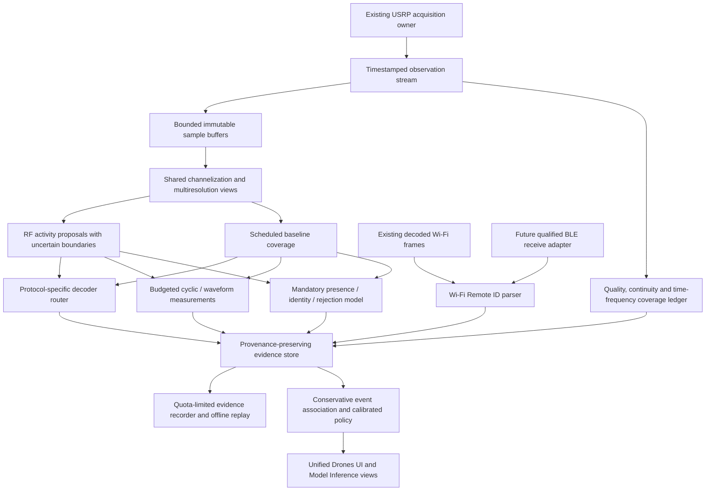

# Upgraded drone detection approach — master plan

2 November 2026 · **Planning only**

The user's instruction to “fight” the approach means **challenge its assumptions and weaknesses**. This document plans passive reception, analysis and validation. It does not implement code, start training, operate radios or change existing functions.

## 1. Decision: upgrade observation coverage before adding more classifiers

The strongest next architecture is a **coverage-aware passive RF detection service with parallel protocol, signal-structure and learned analysis**, followed by conservative evidence association and calibrated decisions. Keep the classifier mandatory, but do not make it depend on successful packet decoding or a supposedly drone-specific energy gate.

The current system has useful components. Its central weakness is that they see different, often sparse portions of the RF stream and have different validation levels. A better model cannot recognize an emitter whose band was not acquired, whose burst was outside the selected prefix, or whose samples were dropped before inference.

Priority order:

1. Measure exactly what the receiver acquired and each analysis branch processed.
2. Improve time/frequency coverage without disrupting existing receivers and workers.
3. Preserve undecoded and weak signals through generic DSP and mandatory ML paths.
4. Establish trustworthy background and independent positive evidence.
5. Train and calibrate presence, identity and unknown rejection.
6. Expand supported transports/link families using explicit evidence gates.
7. Qualify sustained live operation and present limitations clearly in the GUI.

This is an engineering recommendation based on the code and available experiments, not proof that one architecture is universally optimal. The detailed training workstream remains in [AI_MODEL_MAKING.md](AI_MODEL_MAKING.md); this master plan coordinates acquisition, DSP, decoders, models, evidence, UI and qualification around it.

## 2. What the system actually does today

Reviewed implementation includes the capture wrapper/scanner, drone observer/supervisor/native worker, cyclostationary decisions and catalogue, ML input selection, Remote ID integration, and their current validation reports. Historical documentation contains deferred features and old transport assumptions; current code and dated results take precedence over old aspirations.

| Component | Current evidence | Remaining limitation |
|---|---|---|
| USRP acquisition | `UsrpCapture` configures one selected RX channel per instance; finite sample-count capture commands, actual-rate readback, tune metadata and overflow records | No demonstrated simultaneous all-band surveillance; a finite capture schedule can leave gaps |
| Scanner | Existing band/channel schedule; both-Wi-Fi mode alternates bands | Application-selected scan coverage is not continuous coverage of every relevant band |
| Native drone observer | First contiguous prefix, at most 160 ms and 40M samples; bounded child queue | Later capture content is omitted; overflow/queue loss must invalidate history |
| Native DJI decoder | Broadcast synchronization, CRC/envelope evidence and supported telemetry | Strongest-channel selection can miss a weaker signal; unsupported payload layouts remain |
| Python DJI fallback | Up to four dispersed 20 ms windows within existing bounds | Not continuous history; current live rate range excludes some high-rate sources |
| O4 detector | 16 ms structure measurements and persistence; strong/weak support starts at 80/160 ms under the current profile | Candidate structure, not payload decoding, exact model or validated O4+ coverage |
| Wi-Fi OpenDroneID | Existing FCS-valid Beacon/NAN frame parsing, supported message versions and freshness tracking | Bluetooth absent; no signature verification; OTA sensitivity and sustained coverage unqualified |
| Cyclostationary sidecar | Cyclic/OFDM/CP/chirp/code/morphology measurements with bounded processes and evidence checks | Experimental patterns; no independently validated named-drone-link catalogue |
| Named-link research | Three OcuSync-related chirp hypotheses with explicit blockers | Marker compatibility is not unique family identification; no Lightbridge or universal family acceptance |
| Existing ML | Independent mandatory worker; up to three disjoint 8 ms intervals under its budget; live STFT preview | No qualified presence model; sparse inputs; exact live identity acceptance not established |
| New hybrid candidate | Causal STFT/DSP input preparation and untrained temporal architecture | No trained replacement, calibrated rejection policy or live deployment |
| Wi-Fi security | Existing DoS/replay-related analysis remains separate | A security incident is not evidence that its emitter is a drone |

The latest replay covered **27 cases / 22 dataset model-context labels / 21.6 sample-seconds**, not 22 successfully identified drone models. In the first 26 cases, the first-prefix path recovered zero CRC-valid packets; extended replay recovered one Mini 5 Pro-context packet. Avata 2 candidate evidence also appeared after the first prefix. Five previously selected successful packet clips yielded 3/5 recoveries as-is and 5/5 with frequency-grid views. These controls demonstrate specific coverage failures; they do not estimate population recall.

The new model input pipeline prepared **198 views and 5,564 valid tiles**, but labels remain unset. There is still no verified no-drone evaluation corpus in the reviewed data. These facts determine the upgrade sequence. [Replay evidence](docs/DRONE_IQ_REPLAY_AND_MODEL_INPUTS_2026-11-02.md).

## 3. Assumptions to challenge explicitly

| Assumption | Why it fails or remains unproven | Replacement |
|---|---|---|
| “Drone energy classifier first, then everything else” | Energy identifies activity, not device purpose; Wi-Fi can dominate weak drone signals | High-recall RF proposals plus scheduled baseline coverage independent of proposals |
| “Trim the exact burst before decoding/classifying” | Boundaries are uncertain, synchronization needs context, and continuous/high-duty links may have no clean burst boundary | Padded local views and a wider contiguous parent view; record truncation/uncertainty |
| “Decoder → classifier is the universal pipeline” | Some drones do not transmit supported IDs or are not decodable at the received conditions | Parallel decoder and mandatory ML paths; both receive valid scheduled observations |
| “First 160 ms represents a capture” | Replay already found useful later evidence | Stateful chunking across genuine contiguous samples, plus explicit coverage accounting |
| “The strongest channel is the target” | Strong interferers hide weaker links | Overlapping channelized views with background exploration and bounded candidate priority |
| “8 ms is either enough or not enough for all drones” | Tile duration, packet length, burst recurrence and decision history are different quantities | Keep short tiles and compare genuine longer contexts per family and operating condition |
| “All links fit a 20 MSps model view” | Some structure may cross view boundaries or need a wider footprint | Overlapping local views plus parent-band context; add a wider/multiresolution branch only if measured gains justify it |
| “O1/O2/O3/O3+ are four complete decoders” | Broadcast formats and air-link generations are different claims | A tested packet/envelope/model-context matrix; generation unknown unless independently supported |
| “O4-negative means non-drone” | O4 is one experimental structure hypothesis | Never use it as a generic presence veto |
| “OFDM/DSSS/LoRa-like means drone” | These structures are shared by non-drone emitters | Keep waveform, protocol, drone relevance and identity separate |
| “A router/phone/drone is identifiable from Wi-Fi alone” | Shared PHY and mixed controller/aircraft roles limit attribution | Qualified role evidence and abstention; no forced category |
| “High softmax means a real known drone” | Closed-set models can be confident on background and unfamiliar drones | Independent presence qualification and calibrated identity rejection |
| “Many files/views mean many independent aircraft” | Derivatives and repeated sessions are correlated | Parent-group splits and independent-unit/session evidence |
| “More DSP branches can only improve detection” | Search multiplicity and correlated nuisance patterns increase false alarms and cost | Freeze search budgets and calibrate the full combined decision process |
| “10 Gb networking solves real-time processing” | Host copies, channelization, DSP, GPU transfer and queues remain | Measure each stage and sustained end-to-end coverage |
| “RF silence proves no drone exists” | No observable transmission means no direct RF evidence | Restrict claims to observed RF; independent sensing is needed beyond that boundary |

A particularly important tradeoff: an OR rule across all branches can improve recall while sharply increasing false alarms; an AND rule can suppress false alarms while missing drones that only one branch detects. Neither is the default solution. Calibrate evidence-specific policies and preserve uncertainty rather than voting blindly.

## 4. Target architecture

The diagram is the target, not a claim that every adapter already exists. Expensive branches run outside acquisition and GUI threads. Shared preprocessing is useful only where contracts match; legacy decoder normalization and new ML preprocessing must not be conflated to save work.

The classifier is required for normal full-service health. It does not veto independently valid protocol evidence. If ML fails, show available decoded evidence and **degraded service**, rather than hiding detections or silently pretending the service is complete.

## 5. Workstream A — observable receiver coverage

### A1. Establish the actual receiver profile

Before a new live configuration, record USRP model, daughterboard, configured RX channels, antenna path, FPGA/UHD versions, actual usable passband, supported rate/readback, gain behavior and host transport format. The presence of a second connector or a 10 Gb SFP does not establish two independently usable receive paths across arbitrary bands.

Do not carry forward the historical 20 MSps transport assumption as a new global cap. Test selected configurations based on the actual hardware and software. Retain honest per-component unsupported-rate states until their algorithms are extended and verified.

Keep one owner for each receiver/control interface. UHD requires regular receive servicing; failure to consume samples can cause overrun. The acquisition path should therefore avoid waiting for decoding, inference or GUI work. The installed UHD version must be checked against the current manual before implementation. [Ettus streaming documentation](https://files.ettus.com/manual/page_stream.html).

### A2. Add a time-frequency coverage ledger

For every source/epoch, retain requested and actual frequency/rate, device time, sample extent, usable passband, tune/settling exclusions, acquisition gaps, overflow positions, branch-admission decisions, processed spans and drop reasons.

Distinguish four measurements:

1. **Acquired coverage:** valid RF intervals actually delivered by the receiver.
2. **Analyzed coverage:** union of intervals/subbands processed by each branch.
3. **Qualified coverage:** analyzed data inside the validated operating envelope.
4. **Unobserved/invalid coverage:** tune gaps, band absence, queue drops, unsupported rates or stale processing.

Compute overlap-aware unions; do not add seven overlapping views as seven times the observation duration. A decoded packet proves reception of that packet, not healthy monitoring of the entire band. Show scan revisit delay separately from compute latency. Use valid monitored time as the denominator for conditional false-alarm rates, and also report whole-session availability so outages cannot improve the headline metric.

### A3. Upgrade capture scheduling in stages

First process existing captures in timestamped bounded chunks beyond the initial prefix. Preserve history only across proven continuity; chunk boundaries alone should not reset O4/temporal state. A 160 ms message-size bound can remain while many consecutive messages are processed—it need not remain a capture-coverage bound.

Next assess an additive acquisition broker that allows the current consumers to retain their contracts while an explicitly selected monitoring mode receives continuous chunks. Do not quietly replace finite scanning with continuous streaming. Changing scheduling can change existing behavior and requires regression/soak validation and an explicit mode transition.

Proposed modes:

| Mode | Purpose | Honest limit |
|---|---|---|
| Existing scan-compatible mode | Preserve current functions and reuse current captures | Only the existing schedule is observed |
| Continuous band watch | Continuous valid chunks within a selected usable band | Other bands remain unobserved |
| Survey plus focused follow-up | Revisit configured bands, reserve a bounded attention budget for candidates | Focus must not starve survey coverage; brief events may occur between visits |
| Optional multi-RX watch | Assign verified independent receive paths to complementary bands or diversity | Requires hardware capability, synchronization/ownership review and measured load |

Set dwell/revisit policies using measured event durations and capture probabilities on development data. Do not treat current O4 persistence values as universal dwell settings. Record warm-up, retune and settling costs. Test fixed versus bounded-jitter revisit schedules if periodic blind spots appear.

### A4. Calibrate quality before interpreting absence

Measure gain/readback consistency, overload and clipping indicators, DC/LO artifacts, useful analog bandwidth, band-edge loss and timestamp behavior. Saturated or gap-filled data must not become “no drone.” Gain changes create new quality/configuration context. A histogram alone does not establish absolute dBm or ADC full-scale calibration.

Optional antennas, filtering or extra receivers should be proposed only after measurements identify a front-end/coverage bottleneck. Do not promise range from sample rate, RSSI or an antenna label alone.

## 6. Workstream B — shared RF views without hard exclusion gates

Use two complementary view types:

- **Scheduled context views:** guaranteed opportunities across the declared observed time/frequency grid, independent of activity or decode success.
- **Padded local views:** uncertain burst/band proposals for packet synchronization, morphology and detailed classification, with parent context retained.

A multiresolution proposal stage can combine robust spectral background estimates, energy contrast and inexpensive temporal structure. Its output is RF geometry, not drone probability. Test weak signals near stronger interferers, continuous emissions, high-duty bursts, frequency hopping, partial-band captures and overlapping emitters.

Replace repeated wideband copies and repeated independent downconversion where possible with an audited shared channelizer. Benchmark an overlapping DDC bank against a polyphase/FFT channelizer before choosing. Preserve filter delay, transition bands, original sample coordinates and pre-roll. Channel boundaries must overlap enough for the chosen analysis contract; no filter is an ideal brick wall.

The present 20 MSps grid recovered known missed packet controls and is a useful reference. It excludes source edges and can fragment wider signals. Preserve a low-cost parent-band representation and original IQ references so wider/edge-spanning candidates can receive appropriately sized follow-up rather than being forced into one crop.

Do not call connected spectral blobs “emitters.” One transmitter can form multiple blobs and several transmitters can overlap. Likewise, a hopping trajectory is a hypothesis until continuity and association evidence support it.

Store source coordinates and the reason for every omission. Make the scheduler deterministic/replayable enough to compare policies on the same recorded scene. A faster model tested on easier selected inputs is not a valid throughput/accuracy comparison.

## 7. Workstream C — a truthful decoder and link-family catalogue

The common service routes to separate implementations. There is no universal drone decoder.

| Coverage family | Near-term approach | Evidence needed before stronger claims |
|---|---|---|
| DJI DroneID-associated broadcasts | Preserve native/legacy backends, improve padded channel views and parser parity | Real supported-format packets, CRC/layout checks, firmware/mode/context provenance and independent replay/OTA cases |
| O1/O2/O3/O3+ association | Maintain a tested format/model/firmware table | A packet format or dataset model label alone cannot establish the live link generation |
| O4 / possible later variants | Reproduce current structure profile, extend context/coverage, compare confusables | Captured negatives, independent systems/modes and calibrated profile specificity; no O4+ qualification by analogy |
| Wi-Fi drone systems | Reuse existing PHY/management-frame decoding; classify system relevance separately | Verified drone/controller versus ordinary Wi-Fi scenes; no router/phone inference from PHY alone |
| Wi-Fi Remote ID | Keep Beacon/NAN parser and frame provenance; improve OTA receive coverage | Real receive tests for supported PHY/rates/layouts, partial frames, collisions and message freshness |
| Bluetooth Remote ID | Add a separately qualified receive adapter, then reuse compatible message logic | BLE PHY/advertising coverage, timing and RF tests; parser support is not receiver support |
| Other proprietary digital FPV | Generic detection, context and unclassified/unknown handling first | Independent labelled captures and implementation evidence before naming a protocol/vendor/model |
| RC/spread/hopping links, including candidate ELRS/other families | Existing generic chirp/code/frequency-state features plus targeted research adapters where justified | Mode-specific references and non-drone confusables; a waveform used by an RC system does not uniquely identify an aircraft |
| Analog FPV/video-like activity | Broad spectral and temporal structure development | Validated analog sources and competing emitters; carrier shape alone is not drone proof |
| Sub-GHz telemetry/LoRa-like activity | Reuse existing observations and qualified decoding where available | Drone relevance must be independently established; ordinary telemetry is a required confusable |
| Unsupported/novel RF | Preserve observations, quality and replay evidence | Do not invent a named link; use qualified presence with unknown identity only where supported |

DJI DroneID research describes a tracking protocol; implementing its receiver is not equivalent to decoding all proprietary control/video traffic. This is why packet recovery and named air-link generation remain separate catalogue entries. [Original NDSS research](https://www.ndss-symposium.org/ndss-paper/drone-security-and-the-mysterious-case-of-djis-droneid/).

OpenDroneID's primary implementation describes Wi-Fi and Bluetooth transport families and receiver examples. Our current app has only its supported Wi-Fi receive path. BLE support needs new reception/PHY coverage, not just a checkbox or the existing message parser. Decide between a USRP adapter and an optional dedicated receiver using measured coverage and resource cost; no new hardware is assumed. [OpenDroneID Core C](https://github.com/opendroneid/opendroneid-core-c).

For each catalogue entry record: implementation version; waveform versus protocol versus model scope; supported numeric formats/rates/bandwidths; packet/envelope layouts; tested firmware/modes; independent groups; sensitivity/confusable evidence; current qualification state; known misses; and unavailable fields. Qualified submodes must not imply qualification of the entire vendor family.

No implementation priority should be decided from DJI-only positive controls. Order additional families by local relevance, available trustworthy data, expected coverage gain and measured effort. Broader low-level detection is useful before exact decoding, but it still must not be labelled as validated drone presence.

## 8. Workstream D — use cyclostationary analysis where it helps

Keep cyclostationary analysis as a **parallel structure-measurement and feature path**. It can expose periodicity, OFDM/CP geometry, chip/code compatibility and chirp-related structure when packet decoding fails. It does not inherently distinguish a drone from all other devices using similar waveforms.

The current named-link catalogue already encodes blockers for nonunique signatures, unqualified receiver profiles and missing independent references. Preserve those blockers. Existing coloured-noise and CP/Barker-confusable results show why adding templates without whole-search calibration can raise false alarms. [Waveform validation ledger](docs/WIFI_CYCLOSTATIONARY_WAVEFORM_COVERAGE.md).

Upgrade sequence:

1. Freeze measurement conventions and share timestamps/view coordinates with model and decoder branches.
2. Use inexpensive structure screening broadly; schedule fine SCF/CAF, timing searches and code hypotheses within a bounded budget.
3. Calibrate the **entire search policy** across rates/lags/templates and repeated windows, not isolated thresholds per hypothesis.
4. Include ordinary captured traffic, coloured noise, pulsed interferers, tones, mixtures, gain changes, clock/CFO error and partial passbands.
5. Evaluate both measurement sensitivity and its actual incremental value to presence/identity decisions.
6. Promote a named family only with independent family-labelled references and realistic alternatives.

Zadoff–Chu or spreading-code work is a later targeted branch when justified by a supported protocol hypothesis. Preserve complex IQ for it. A coarse magnitude STFT cannot reconstruct discarded phase; conversely, failure to correlate a known code cannot reject every drone. Do not exhaustively search an unbounded code bank in the acquisition path.

Keep quality indicators separate from learned identity features unless ablations justify inclusion. Missing ADC scale, unknown passband or a source-specific feature extractor can reveal the dataset instead of the transmitter.

## 9. Workstream E — presence, identity and open-set inference

Follow [AI_MODEL_MAKING.md](AI_MODEL_MAKING.md), with these system-level requirements:

- First compare shared STFT/temporal presence-and-identity model A with the same model plus aligned DSP B. A two-model hard cascade remains a measured alternative, not the assumed best architecture.
- Presence is necessary for presenting an accepted learned identity, but a failed protocol decoder or O4 result is never an upstream ML gate.
- Train from reviewed positive regions/bags and scoped negative sessions. Never convert all subbands or quiet intervals of a positive recording into drone-positive tiles.
- Keep the current 198 views unlabelled until their true supervision scope is reviewed.
- Protect parent groups, known calibration, unknown calibration and locked final partitions. Mini 3 Pro remains withheld; no reuse as an easy extra training class.
- Treat short tiles as building blocks. Compare continuous history and parent/local views; do not declare 256 ms or 1 s universally sufficient.
- Keep identity outputs experimental for classes lacking independent qualification. Currently only three declared known-class calibration groups/classes have supporting split coverage, with independence still under review; 18 training-context classes lack separate known calibration.
- Select architecture using event recall, false alarms/hour, known precision, unknown false acceptance and time to detection, including coverage losses and compute cost.

The immediate training blocker is verified negative evidence, not network size. Record controlled router/phone/quiet/mixed scenes and independent days/locations with the new recorder. Target-off notes alone do not prove scene-wide absence. Mini 2 ground-truth sessions later need controller-only, connected system, interference and receiver-setting coverage; public chamber data does not settle live domain shift.

Maintain separate states for **no drone activity detected in qualified observations**, **known candidate**, **unknown drone system**, **unclassified RF**, and **no usable observation**. The full trained policy needs an uncertain region, not a forced binary answer for every tensor. A top identity score remains a score until calibration supports probability language.

## 10. Workstream F — event association without invented identity

Use an evidence graph or equivalent versioned event store. Each record retains source/epoch, device and host timestamps, original sample span, frequency extent, processing contract/hash, quality, measurement/packet result, freshness and uncertainty.

Associate nearby observations provisionally by compatible time/frequency support and documented evidence. Store association strength and alternatives. Do not merge solely because two detections share a product name, RSSI, frequency or claimed identifier. Do not count overlapping channels or repeated broadcast packets as distinct aircraft.

Keep these axes separate:

| Axis | Examples |
|---|---|
| RF observation | Activity, bandwidth, burst/hop hypothesis, quality |
| Waveform evidence | OFDM-compatible, chirp/code-compatible, unresolved |
| Protocol evidence | Supported packet with integrity checks; unsupported payload |
| Reported identity/telemetry | Fields claimed by a broadcast, with age/authentication state |
| Learned presence | Qualified/experimental score and decision |
| Learned identity | Candidate model or family and acceptance eligibility |
| Association | Provisional event relationship, not guaranteed physical identity |

Do not multiply correlated DSP and neural scores into a fabricated joint probability. Decoder and model evidence derived from the same samples are not independent confirmations. Initially use explicit, reviewable rules; learned late fusion is a separate experiment requiring independent calibration data.

Decoded positions are transmitter claims, not receiver-derived geolocation. A single omnidirectional RF observation does not yield reliable bearing or distance. Angle-of-arrival or multi-receiver localization would require a separately calibrated synchronized system and is outside the first upgrade release.

## 11. Workstream G — compute and isolation architecture

The current replay took approximately **18.85 seconds of reported worker processing per second of sampled RF** for the first 26 cases. Random-weight neural forward timing excludes STFT, channelization and DSP. Neither number certifies production throughput.

Budget with actual data representations. For one channel at R complex samples/s, nominal sc16 sample payload is `4R bytes/s`; fc32 host samples are `8R bytes/s`, before protocol/allocator/copy overhead. At 100 MSps this is 400 MB/s sample payload and 800 MB/s host IQ; retaining two seconds of host IQ alone requires 1.6 GB. These are arithmetic planning examples, not recommended settings or device throughput claims.

Plan the engine in layers:

1. Acquisition owner drains the device and emits immutable metadata plus bounded buffer references.
2. Shared preprocessing produces versioned views; consumers do not modify parent samples.
3. Separate bounded queues handle baseline ML, decoder candidates and expensive DSP work.
4. Deadline/age-aware scheduling discards obsolete work explicitly and records lost coverage.
5. Evidence/UI processing consumes compact results and cannot backpressure RF capture.

Reserve a minimum baseline-analysis opportunity across the declared operating grid; candidate bursts cannot consume every slot. Also preserve a share for weak/unclassified RF rather than always chasing familiar high scores. Record per-branch starvation, time-to-service and why work was skipped. Do not assign fixed percentages before measuring workloads.

Profile first, then compare FFT reuse, channelizer batching, numerical-library choices, GPU inference/preprocessing and incremental temporal-state reuse. NVIDIA acceleration should be used where supported and demonstrably beneficial; CPU↔GPU copies and small-job overhead can erase gains. RFNoC/FPGA offload is optional later work after a stable contract and measured bottleneck, not a prerequisite for this plan.

Bound RAM, GPU memory, recorder storage and queued latency. Prefer correct immutable ownership and bounded copies over an unsafe zero-copy design. Export/runtime parity is mandatory for C++ integration; dynamic masking and gap handling must survive any ONNX/TorchScript/native wrapper decision. Keep prior model packages available for explicit rollback.

Non-interference must be measured: compare existing scanner, Wi-Fi security, LoRa, decoding and GUI outputs/latencies with the add-on disabled and enabled under controlled replay, then under sustained live load. “Separate process” alone does not guarantee no resource contention.

## 12. Workstream H — a GUI that exposes useful certainty and coverage

Keep one unified **Drone Detection** view and the existing **Model Inference** detail page, backed by the same evidence/status contracts.

Recommended sections:

- **Service health:** receiver mode, classifier required/ready/qualified, decoder health and stale/error state.
- **Coverage:** observed bands, current usable passband, recent time-frequency coverage, revisit time, unobserved intervals and dropped work.
- **Current events:** evidence type, learned presence, model/family candidate, qualification, age and conflict flags.
- **Evidence inspector:** supported packet/checksum details, unauthenticated claimed telemetry, DSP support and exact source interval.
- **Live STFT/context:** actual analyzed view and physical axes, tile/history duration, frequency offset, quality mask and acquisition age.
- **Performance:** capture/analysis rates, queue age, stage timing, memory and analyzed fraction.
- **Recorder/replay:** bounded evidence export with metadata/label notes and explicit partition role for future research.

Do not display a definitive model name solely because it is top-1, a green no-drone state during gaps, or a location marker without its provenance. Historical evidence remains visibly historical. Show unknown-device RF separately from unknown-drone activity.

Start/stop retains worker ownership semantics. Full service cannot quietly disable its classifier; decoder observations remain inspectable in degraded mode. Changing a tab does not retune or restart reception. Optional monitoring-mode changes are explicit and show their coverage consequences.

## 13. Validation designed to disprove the approach

### Scenario matrix

| Scenario | Failure to look for | Required result |
|---|---|---|
| Busy router/phone scene, no target drones | Generic OFDM or confidence mistaken for drone presence | Scoped false-alarm report and no forced identity |
| Weak drone plus strong Wi-Fi | Strongest-channel/proposal bias | Measure additional misses and coverage gain from fallback views |
| Late/brief activity | Prefix-only processing and scan revisit misses | Source-time replay reveals whether samples were acquired, admitted and detected |
| Frequency/view boundary crossing | Channelizer attenuation and fragmented context | Overlap/wider-view comparison with original-IQ provenance |
| Continuous/high-duty RF | Burst localizer finds nothing | Scheduled context still reaches applicable analysis |
| Unsupported ID or no decoded packet | Decoder-gated blind spot | Mandatory ML and generic RF evidence remain active |
| Multiple simultaneous systems | Wrong event association or one transmitter suppressing another | Preserve ambiguity; report per-target misses where truth exists |
| Controller only | Aircraft presence inferred from controller RF | Role-qualified statement or explicit role unknown |
| Held-out drone model | Confident wrong known identity | Measure unknown presence recall and known-class false acceptance |
| Gain change, clipping, retune or overflow | False patterns and fabricated continuity | Invalid/uncertain spans, resets and visible coverage loss |
| Child crash/GPU exhaustion/backlog | Stale results shown as current or scanner interrupted | Fault containment, bounded recovery and degraded status |
| Unsupported band or non-emitting target | Impossible universal RF claim | Explicit observation limitation |

Test at four levels: mathematical/software fixtures, real IQ replay with provenance, prospective controlled RF sessions, and long-running integrated operation. Passing one level does not imply the next.

Retain the broad current replay as a regression set, not the final test. The five selected packet controls remain positive controls. Add independent scenes across modes, receivers, bands and interference conditions. Do not repeatedly tune on locked final partitions.

Report event-level recall, false drone events/hour, accepted identity precision, per-class/group-balanced results, unknown false acceptance/known rejection, time to alert, branch-specific coverage and full-session availability. Confidence intervals must respect independent sessions/groups rather than treating overlapping windows as independent trials. Specify event matching, deduplication and monitoring-time denominators before scoring.

The operating-point targets remain to be frozen: acceptable false event rate, recall at defined conditions, alert delay and allowed impact on existing workers. Publish tradeoff curves rather than inventing targets retrospectively. A zero-alarm short demonstration cannot establish a low hourly false-alarm rate.

## 14. Milestones, dependencies and stop conditions

| Milestone | Priority | Deliverable | Exit evidence / stop condition |
|---|---|---|---|
| U0 — Capability and assumption audit | Now | This plan; code-to-claim ledger; current measured limits | Unsupported claims explicitly removed from proposed product wording |
| U1 — Coverage instrumentation | P0 | Common provenance/coverage schema, per-branch interval accounting and replay visualization | Acquisition, prefix omission, queue loss and analyzed unions are distinguishable |
| U2 — Longer capture processing | P0 | Bounded consecutive chunks with correct continuity/reset behavior | Later known evidence recovered without artificial bridging or existing-function regressions |
| U3 — Shared multi-view prototype | P0 | Offline channelizer/scheduler comparison against original and fixed-grid references | Gains on independent weak/interfered/boundary cases; measured cost and fallback coverage |
| U4 — Labelled presence corpus | P0, parallel | Reviewed positive scope, controlled negatives, conservative splits and class-eligibility matrix | Independent negative evaluation exists; no auto-labelling from decoder failures |
| U5 — Training and calibration | P1; after U4 | Baseline A, DSP B comparison, context ablations, frozen decision policy | End-to-end improvements at declared operating point; failure blocks promotion |
| U6 — Decoder catalogue expansion | P1, parallel | Native/legacy parity, Wi-Fi RID OTA qualification, then evidence-ranked additional adapters | Each family/transport has its own support and independent validation matrix |
| U7 — Integrated event/GUI layer | P1 | Shared evidence, provisional associations, coverage/health display | No forced identity, invented probabilities, duplicate-aircraft count or stale live claim |
| U8 — Deployment/runtime qualification | P1 | Versioned C++-compatible package, parity fixtures and full-pipeline soak benchmarks | Stable queues, acceptable existing-function impact and measured analyzed coverage |
| U9 — Live Mini 2 and independent field sessions | Required before corresponding claims | Controlled roles/interference, prospective background, new groups where available | Domain-shift and false-alarm claims supported; otherwise remain experimental |
| U10 — Optional capacity/coverage expansion | Conditional | Verified multi-RX, BLE receiver, new band profiles or later offload | Added capability justifies complexity and does not imply unmeasured universal coverage |

Do not wait for live Mini 2 to complete U1–U4 preparation, but do not mark Mini 2 live recognition solved without U9. Do not wait for a larger model to fix known coverage losses. Do not build every speculative protocol branch before obtaining negatives and evaluating the main detector.

Before training, publish the caveat/launch report specified in `AI_MODEL_MAKING.md`. Before deployment, publish a separate qualification report with receiver profile, exact model/policy versions, qualified classes/transports, operating point, independent evidence, runtime envelope and rollback plan. Planning does not authorize automatic promotion.

## 15. What would still be outside the claim

Even after these upgrades, passive USRP RF detection cannot guarantee a result for an aircraft with no observable emission, a link outside the monitored/usable band, signals below the receiver's useful sensitivity, or emissions obscured by overload/interference. Shared hardware/waveforms can prevent exact-model identification even when activity is detected.

If the eventual requirement is detection of aircraft regardless of RF emission, an independent sensing workstream is necessary—for example optical/thermal, radar or acoustic sensing with its own limitations and validation. It is not solved by a better RF classifier, and no purchase or integration is assumed here.

Completion means measured broad RF coverage, trustworthy detection/unknown handling, qualified identity where possible, and stable application integration. It does not mean every observation gets a drone label or every vendor generation has a decoder.

## 16. Evidence and implementation map

Local sources used to ground this plan:

- [USRP capture implementation](src/sdr_capture.cpp) and [scanner](src/scanner.cpp).
- [Drone observer and ownership](src/drones/addon.hpp), [process supervisor](src/drones/detector.cpp), [native worker](tools/drone_native_worker.cpp).
- [Current ML selection and decision semantics](src/ml_inference.hpp).
- [Named-link research catalogue](src/cyclostationary/named_link_candidates.hpp) and [scoped decisions](src/cyclostationary/link_decision.hpp).
- [Cyclostationary waveform ledger](docs/WIFI_CYCLOSTATIONARY_WAVEFORM_COVERAGE.md).
- [Unified integration status](docs/UNIFIED_DRONE_INTEGRATION_2026-11-01.md).
- [Wi-Fi Remote ID support](docs/WIFI_OPENDRONEID_INTEGRATION.md).
- [Real-IQ replay results](docs/DRONE_IQ_REPLAY_AND_MODEL_INPUTS_2026-11-02.md).
- [Pretraining readiness](docs/DRONE_ML_PRETRAINING_READINESS_2026-10-29.md) and [complete model plan](AI_MODEL_MAKING.md).

Primary external sources were retrieved with Firecrawl on 2 November 2026 and linked beside the claims they support. Their documentation describes protocol/runtime behavior; it does not validate this application's implementation or installed hardware. No new dataset download, hardware access, model training or application modification was performed for this plan.
