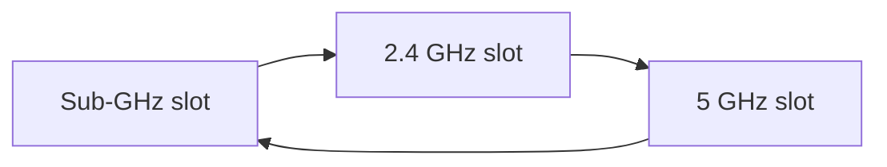
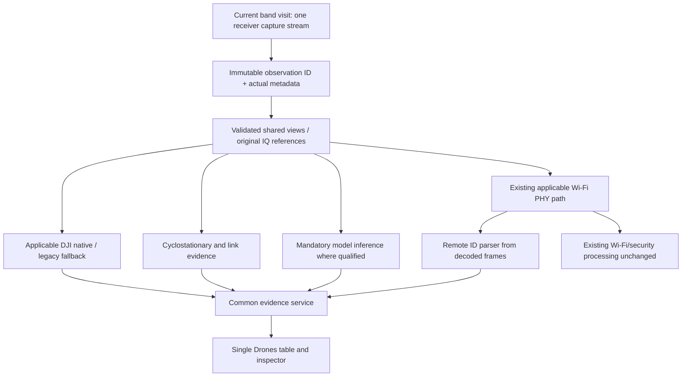

# Unified drone page and coordinated three-band detection plan

2 November 2026 · **Plan only — no application, model or radio changes**

This revision makes the requested operating experience explicit: **one Drones page, one combined entry list, and one coordinated repeating schedule: sub-GHz → 2.4 GHz → 5 GHz → repeat.** Applicable detectors and the mandatory classifier receive the same observation stream for each band. Results update asynchronously in the shared page.

This document takes precedence over [upgradedapproach.md](upgradedapproach.md) for the UI, scheduling and execution design. That document remains the wider capability/validation reference. [AI_MODEL_MAKING.md](AI_MODEL_MAKING.md) remains the detailed training plan, subject to the scheduling and input requirements here.

## 1. The proposed solution

Build a coordinated detection mode with four shared services:

1. **One acquisition scheduler:** owns the band sequence, frequency visits, dwell, tuning and continuity metadata through the existing receiver owner.
2. **One observation distributor:** supplies immutable, timestamped IQ and compatible derived views to every applicable module without acquiring the same RF again.
3. **One evidence/event service:** collects DJI decoding, Remote ID, link analysis and ML results; associates related observations conservatively and retains disagreements.
4. **One Drones page:** displays all detector entries, evidence, model inference, schedule, coverage and health in a common window.

“Together on that data” means **the same captured observation and its documented derivatives**, not that every algorithm must finish at the same instant. The receiver must not wait for the slowest module before visiting the next band. No module may analyze an old capture using the current band's metadata.

The model is mandatory for full-service operation and independent of decoder success. Valid DJI/Remote ID evidence appears immediately while inference is pending. Failed decoding cannot prevent ML analysis; model disagreement cannot erase a valid protocol observation.

## 2. Current behavior that must change

| Current implementation | Required upgrade |
|---|---|
| Separate band modes; both-Wi-Fi mode alternates 2.4/5 GHz | Add explicit coordinated sub-GHz/2.4/5 GHz mode while preserving existing modes |
| Drone native observer copies at most the first 160 ms of a capture | Process admitted contiguous chunks across the selected dwell; keep message-size bounds separate from total observation duration |
| Legacy DJI sees dispersed short windows | Keep as a bounded fallback on shared observations, with measured coverage and explicit context limits |
| Existing ML samples up to three disjoint 8 ms intervals | New qualified model uses continuous same-view temporal history on a scheduled analysis grid |
| Native wideband decoder favors the strongest channel | Add validated multi-view coverage so weaker signals get analysis opportunities |
| Individual detector/result views | A single combined table and integrated detail panel; no tab switching required to understand one event |
| Generic RF/link evidence and model candidates have different certainty levels | Preserve those levels visibly; a shared table must not turn all rows into confirmed drones |

The current scan configuration is a starting inventory, not a complete drone-band map: its sub-GHz profile covers a narrow region around 865.5 MHz, its 2.4 GHz plan uses Wi-Fi channel centers, and its 5 GHz list includes selected ranges with a large middle range absent. Do not label those lists “all sub-GHz” or “all 5 GHz.” A drone-oriented passive receive profile needs explicit configured frequency coverage, hardware support and review; it must not inherit Wi-Fi-centric exclusions without scrutiny. Historical sample-rate-cap comments must not be treated as the current 10 Gb system's measured capability. [Configuration](src/config.hpp).

## 3. One Drones page

### 3.1 Layout

```text
DRONES                                      [Start coordinated detection] [Stop]
Receiver | Model/version/qualification | Service health | Run ID

SCHEDULE: [Sub-GHz] --> [2.4 GHz: receiving] --> [5 GHz: next] --> repeat
Current center / usable bandwidth / actual rate / dwell left / cycle time
Band budgets + per-visit dwell + frequency coverage + next-visit estimates

ALL DETECTION ENTRIES
Event | State | Band/frequency | DJI/RID | Link evidence | ML result | Last seen
...

SELECTED ENTRY: DETAILS
Evidence timeline | Live/retained STFT | Model scores | Decoded fields
Source interval | Quality | Associations/conflicts | Export evidence

HEALTH & COVERAGE
Per-module processed coverage / pending work / drops / latency / stale results
```

This is one page with a resizable table and inspector, not separate mandatory DJI, link and model subtabs. The current Model Inference page may remain as a legacy diagnostic view, but its essential information and controls must also be available here. Both pages use the same underlying service, not two model workers.

### 3.2 Combined entry schema

| Field | Meaning |
|---|---|
| Event ID | Local observation/event identity; not a guaranteed physical-aircraft ID |
| Decision | Decoded drone-associated broadcast; known/unknown ML candidate; link candidate; unclassified RF; pending; stale |
| Band / frequency extent | Actual acquisition band and measured view/support, not the currently selected band |
| Source badges | DJI native, DJI fallback, Wi-Fi RID, later BLE RID, cyclostationary/link, ML |
| Protocol/report | Supported packet/envelope and reported identity, with authentication/qualification status |
| Link evidence | Named family only if qualified; otherwise compatible structure or unresolved link |
| Model | Presence state, candidate model, identity eligibility, unknown/rejection reason and score semantics |
| Time | First/last acquisition time, age, processing delay and last observed cycle |
| Coverage / quality | Complete/partial view, gaps, clipping/passband concerns, pending or omitted analysis |
| Association | Supported relationship between observations, ambiguity or conflicting identities |

An entry can begin from **any** detector. Do not wait for all modules to agree. Add later evidence to that entry only when source interval/frequency/association rules support it; otherwise retain a separate entry and show a possible relationship.

Deduplicate repeated processing of the same capture/packet using observation lineage and packet identity. Do not merge different transmitters merely because both are labelled “Mini 2,” share a channel, have similar RSSI or report the same identifier. Do not use row count as the number of physical drones.

All DJI, Remote ID, link and model entries appear in the common table, with filters for evidence/state/band. Raw invalid observations and every FFT tile belong in health diagnostics rather than creating thousands of “drone” rows. Filters must not silently hide unvalidated drone candidates; their status must be explicit.

### 3.3 Freshness during scanning

- **Receiving now:** this band/frequency is currently being observed.
- **Recently observed, band currently unobserved:** prior evidence retained while the receiver visits other bands.
- **Not reacquired on next visit:** no corresponding evidence recovered during a later valid revisit; this is not proof of departure.
- **Historical/expired:** retention/freshness policy elapsed; keep the reason and last acquisition time.
- **Insufficient coverage:** relevant revisit failed or analysis was omitted; do not report disappearance or no-drone from this state.

Use configurable, validated freshness rules tied to expected revisit time and evidence type. Do not apply one fixed short timeout that marks every sub-GHz entry lost while processing 2.4/5 GHz. Each reported telemetry field retains its own age; new ML evidence must not refresh old location or identity claims.

## 4. Three-band scheduler: two levels, one receiver owner

### 4.1 Band slots and frequency visits

The top-level sequence is fixed by default:



Inside each band slot, visit a configured list of center-frequency/passband profiles. A **band budget** is the total valid observation time allocated to that band per cycle. A **frequency dwell** is the valid observation duration at one tuned center. Settling, pre-roll and hardware/host overhead are accounted separately.

If a band needs more visits than fit in one slot, maintain a rotating cursor into its frequency list. Resume at the next unvisited center on the next cycle. Show **full-list sweep time**, not only the faster three-band cycle time. Unvisited centers remain explicitly uncovered.

Frequency profiles must specify actual center, desired/actual rate, usable passband, guard/overlap, applicable algorithms and calibration status. Use wideband acquisition where supported, then derive matching subchannels in software. A larger sample rate may reduce tuning visits only if useful passband, algorithms and throughput are qualified.

### 4.2 Proposed initial dwell profile — for benchmarking, not a validated optimum

| Band slot | Initial valid-time budget | Initial visit allocation | Why begin here |
|---|---:|---:|---|
| Sub-GHz | 1.024 s | 2 × 512 ms | Gives two configured frequency visits or repeated coverage when only one profile is configured |
| 2.4 GHz | 2.048 s | 4 × 512 ms | More frequent opportunities across overlapping local views and supported channels |
| 5 GHz | 3.072 s | 6 × 512 ms | More visit budget for the broader configured frequency list |
| Total | **6.144 s valid acquisition per cycle** | 12 visits | Actual cycle is longer once tuning/pre-roll/overhead is included |

These values are an explicit starting experiment. They do not establish detection probability, full-band coverage or that 512 ms contains an ID broadcast. A slow-burst sub-GHz link may need a longer dwell; increasing it worsens the revisit time of the other bands. Compare profiles on recorded/controlled scenes before selecting defaults.

For the present causal ML representation, budget a real 8 ms pre-roll on a newly initialized frequency view before its scored interval. With 12 freshly initialized visits, that adds 96 ms, plus actual tune/settling/transport overhead. Other algorithms may require different startup support; use the maximum required valid support for the applicable set, and record it. Preserve state instead of adding artificial pre-roll when two consecutive visits are genuinely continuous at the same configuration.

Let `n_b` be visit count, `d_bj` valid dwell, `p_bj` required pre-roll, and `s_bj` tune/settling/other acquisition overhead. Then:

`cycle_time = sum over bands/visits (d_bj + p_bj + s_bj) + actual scheduling overhead`

Inference time is **not** a receiver wait term. Insufficient inference throughput produces visible degraded analysis coverage; it must not silently lengthen every band visit.

For a band with `N_b` configured centers and `n_b` visits per cycle, a rough full-list sweep time is `ceil(N_b / n_b) × cycle_time` under fixed round-robin operation. Log actual revisit times because extensions, errors and unequal dwell invalidate a simple estimate. A signal can occur entirely between visits; no scheduling profile can guarantee detection on a single time-shared receiver.

### 4.3 User controls

The Drones page should offer editable band order (default fixed as requested), enable state, valid-time budget, frequency list/profile, per-visit dwell, actual requested/readback rate, and maximum permitted revisit time. Show the estimated cycle and full sweep consequences before applying a profile.

Validate that each configured visit has sufficient real support for its applicable algorithms. Reject impossible configurations or mark the affected module unsupported; do not round metadata into a supported rate or create padding to meet history length.

Apply scheduling changes at a documented safe boundary, version the configuration and reset affected temporal state. Do not let a model prediction directly rewrite receiver parameters.

### 4.4 Adaptive dwell without starvation

Begin with fixed deterministic scheduling for reproducible tests. Later, test bounded follow-up for a truncated packet or unresolved candidate:

- Prefer a retry using already retained parent samples.
- If extra acquisition is justified, allow a limited extension only within the configured cycle/revisit budget.
- Record the extension and resulting coverage tradeoff for all other bands.
- Return to the fixed chain; a strong Wi-Fi interferer or repeated false candidate cannot hold the receiver indefinitely.
- Ordinary inference backlog is never a reason to stay on a band longer.

No extension policy should be enabled until it improves independently measured event recall at acceptable false-alarm and revisit costs.

## 5. Shared data distribution within a band



All branches reference the same source observation. They may require different sample extents, rates or normalization; matching source data does not mean forcing every algorithm to consume one identical cropped tensor. Every derivative records its transform, delay, frequency offset and original sample coordinates.

Reuse decoded Wi-Fi frames for RID instead of running a duplicate PHY path unnecessarily. Native and fallback DJI decoding may be scheduled differently for cost/parity, but their coverage/pending state must remain visible. No branch may require another branch's success before receiving its baseline workload.

### Applicable module matrix

| Module | Sub-GHz slot | 2.4 GHz slot | 5 GHz slot |
|---|---|---|---|
| RF activity and coverage | Yes, within receiver profile | Yes | Yes |
| Generic cyclic/link measurements | Only supported rate/passband/hypotheses | Supported measurements | Supported measurements |
| LoRa/other existing sub-GHz analysis | Eligible configured channels/profiles | Only if a separately supported profile exists; do not assume | Only if a separately supported profile exists; do not assume |
| DJI native/O4 and legacy fallback | Not applicable unless explicitly implemented/qualified | Applicable supported input profiles | Applicable supported input profiles |
| Wi-Fi PHY and Wi-Fi RID | Not applicable to current implementation | Existing supported PHY/frame path | Existing supported PHY/frame path |
| ML presence/identity | **Currently unsupported by the new 20 MSps research-view contract for the default 5 MSps sub-GHz stream; needs a separate qualified representation/model or rate-capable adapter with supporting data** | Planned continuous-context model; still untrained/unqualified | Planned continuous-context model; still untrained/unqualified |
| Shared evidence/UI | Yes | Yes | Yes |

Do not upsample a narrow sub-GHz capture and feed it into the 2.4/5 GHz checkpoint as if it were equivalent evidence. Decide whether to train a domain-aware shared model or a dedicated sub-GHz presence/identity head/model using actual sub-GHz data and comparisons. The common inference engine may route to multiple versioned models while remaining one mandatory service.

Until sub-GHz inference is qualified, the page must show **sub-GHz DSP/protocol coverage; ML unqualified/unsupported**, and overall three-band capability must disclose that limitation. “Classifier ready” at process level is not proof of qualification on every band.

## 6. Observation and result ownership

Every observation needs:

`run_id, cycle_id, band_slot_id, visit_id, observation_id, receiver_id, continuity_epoch, configuration_hash, band, center_hz, actual_rate_hz, usable_passband, first_sample_time, sample_range, quality/gap metadata`

Every result additionally needs:

`module/version, observation_id, original source span, derivative/view ID, processing start/end, model/policy hashes if applicable, evidence level, candidate/decision, reason, freshness and coverage`

Continuity is per receiver/source/frequency view/configuration. Retune, gain/configuration changes affecting preprocessing, overflow, missing samples or queue loss reset the corresponding state. Never concatenate the end of sub-GHz with the beginning of 2.4 GHz, or two disconnected visits to the same frequency.

At a band change, mark that acquisition epoch closed. Workers may finish already-admitted old-epoch jobs using immutable buffered data. Their results attach to the old observation and can update its retained event, with the original acquisition age. They cannot become current-band evidence or refresh its acquisition timestamp.

Cancel jobs at explicit deadlines only when their late result is no longer useful under policy. Log cancellation as unprocessed analysis coverage. Releasing buffers requires reference-counted ownership or an equivalent safe lifetime contract; no worker may access a buffer that acquisition has reused.

## 7. How model inference changes the schedule and results

### 7.1 Context is local to each frequency visit

Use the proposed qualified model contract, initially 8 ms STFT tiles with 256 ms of real contiguous context. Dwell and inference hop are separate controls. An initial inference hop of 64 ms is a benchmark candidate, not a proven alert optimum.

For a scored 512 ms visit with sufficient pre-roll and no gaps, 256 ms context at 64 ms hops gives output endpoints at 256, 320, 384, 448 and 512 ms: **five opportunities per frequency view**. Adjacent outputs overlap and are correlated. The first decision also incurs pre-roll and actual preprocessing/compute delay.

Short or invalid visits must use a separately validated shorter-context mode or return insufficient evidence. Do not borrow samples from another band to fill a tensor. Longer 512/1,024 ms model variants require matching real context and an explicit dwell/latency comparison; the current 512 ms example cannot supply a 1,024 ms history at a newly tuned center.

### 7.2 Inference must not stall acquisition

Keep model weights resident. Preprocess and infer asynchronously using bounded per-band/view queues and validated batching. Avoid starving sub-GHz or 5 GHz merely because one band's data are easier to process. Prioritize baseline coverage and useful deadlines, with explicit accounting for any skipped view.

Reuse tile embeddings or causal state only after demonstrating equivalence to the offline reference, including gap/reset handling. Do not repeatedly compute the same overlap unnecessarily, but do not assume the current batched research model is already a correct stateful engine.

For visit `j`, let `V_j` be scheduled frequency views and `K_j` inference endpoints. Approximate model demand per cycle is `sum(V_j × K_j)` decisions before any deduplication/caching benefit. Budget channelization, STFT, DSP, model and evidence processing separately.

Example: seven views × five endpoints = 35 context evaluations per 512 ms visit in a naive implementation. At roughly 200 ms per full context from the earlier CPU compatibility run, that would be around seven seconds of sequential model work alone. This is illustrative arithmetic, **not a production benchmark**; that timing used random weights and excluded preprocessing. It demonstrates why exhaustive overlapped evaluation cannot simply be switched on and called real time. [Measured timing limits](docs/DRONE_IQ_REPLAY_AND_MODEL_INPUTS_2026-11-02.md).

Benchmark GPU batching, cached encodings and actual load before deciding the live view count/hop. If compute is insufficient, expose degraded analyzed coverage; do not silently sample three tiles and describe the whole band as analyzed. Changing the trained preprocessing, view width or temporal stride requires validation, not just a UI adjustment.

### 7.3 Effect on unified entries

| Incoming evidence | Immediate page behavior | Later model behavior |
|---|---|---|
| Valid supported DJI/RID packet | Show decoded broadcast/claimed fields and ML pending | Add presence/identity evidence; retain conflicts instead of erasing packet evidence |
| Link-compatible DSP result only | Show unvalidated link candidate/structure and ML pending | Qualify drone relevance only if the model/policy supports it; no automatic drone label |
| ML-supported activity without decode | Show known candidate or unknown drone according to qualified policy | Continue protocol attempts independently on suitable retained/new samples |
| Model rejects known identities but presence is uncertain | Unclassified RF / insufficient evidence | Do not call it an unknown drone |
| Qualified negative inference | Store interval-level no-detection evidence | Do not delete a recent decoded event or declare other bands clear |
| Model unavailable, unsupported or late | Show module status and partial/degraded service | No stale model result substituted for a fresh answer |

“No drones detected” can only summarize a defined set of recently **qualified** observations. Show per-band coverage and ages; do not make a scene-wide all-clear statement while two bands are unobserved or a band's model is unqualified.

## 8. Training and calibration implications

Train/evaluate on the same view definitions, causal timing, masks, frequency selection and context lengths that the coordinated service will use. Include retunes, short visits and gaps in replay tests, without training the network to identify classes from band/source scheduling artifacts.

Evaluate presence and identity separately for sub-GHz, 2.4 GHz and 5 GHz, as well as across the whole scan session. A class qualified in one band/mode is not automatically qualified in another. Model metadata must declare supported representations, bands/modes, contexts and class eligibility.

The immediate data requirements remain:

- Controlled scoped negative scenes with routers/phones/other ordinary RF and independent sessions.
- Reviewed drone-system positive regions/bags rather than inherited labels on every tile/subband.
- Real sub-GHz drone-related and non-drone examples before claiming sub-GHz ML coverage.
- Known-class calibration and withheld unknown-model groups, with final partitions protected.
- Later live Mini 2/controller tests to address the reported deployment confusion.

Thresholds, event persistence and freshness must be evaluated with the **actual scan schedule**, not only continuous single-band recordings. Repeated overlapping predictions within a dwell and detections across visits are not independent votes. A schedule can improve one band's recall while hurting another through longer revisit gaps; report that tradeoff.

## 9. Non-interference and configuration rules

Add coordinated drone survey as an explicit operating mode. Existing fixed-band, manual-channel and LoRa modes remain available with their existing semantics. A receiver cannot simultaneously obey a fixed-frequency lock and a conflicting three-band schedule; the UI must show the conflict and require an explicit mode selection rather than silently overriding it.

When coordinated mode is selected, existing applicable Wi-Fi/security/LoRa modules continue receiving the captured data for their band. Their intrinsic algorithms remain unchanged unless separately authorized. Their observation opportunities necessarily follow the new schedule, and the UI must explain that coverage change.

Use the existing receiver owner. No detector opens an independent competing UHD control connection. The current capture wrapper exposes one selected RX channel per instance; optional simultaneous multi-RX monitoring is a separate hardware/runtime qualification step, not assumed by this plan.

Keep module work outside acquisition and GUI threads. Bound queue size, age, buffer memory and recorder quotas. Preserve worker ownership on stop: the coordinated service stops only workers it started; independently owned services retain their own controls. A live schedule transition still needs one documented receiver-control owner and safe handover.

## 10. Validation and measurable acceptance

### Schedule and data isolation

- Replay a synthetic schedule with distinct observation markers for each band; verify no decoder/model/result receives the wrong band, timestamp or epoch.
- Validate acquired, submitted, processed, cancelled and dropped interval accounting without double-counting overlaps.
- Test band changes while all workers have pending work; late results must update only their original events.
- Verify scan order, valid dwell, pre-roll, actual overhead, rotating frequency cursor and full-list revisit times.
- Inject receiver errors and module failures; acquisition must continue under the declared degraded policy without inventing continuity.

### Detection and UI

- Exercise DJI-only, RID-only, link-only, ML-only and conflicting-evidence cases in the same table.
- Verify repeated processing deduplication and that similar model names do not merge unrelated emitters.
- Test busy background, weak target beside strong Wi-Fi, late/brief bursts, frequency edges, high-duty RF and unknown models.
- Verify no entry disappears merely because its band is temporarily not selected.
- Check model probabilities/scores, reported identity, link candidates and qualified decisions have distinct labels.

### Performance and end-to-end quality

Measure sustained cycle/revisit times; per-band acquired and analyzed coverage; per-module p50/p95/p99 latency; queue age and drops; CPU/GPU/RAM; GUI responsiveness; and existing-module regression results. Test long enough to expose accumulating backlog, not only one successful cycle.

Report event recall, false events per valid monitored hour, session availability, accepted identity precision, unknown false acceptance and time to detection **including scan revisit delay**. Include misses where a target transmitted outside observed visits when evaluating total scheduled-system performance; separately report conditional performance on actually observed valid samples.

Freeze acceptable false alarms, recall conditions, revisit bounds and application-impact targets before final qualification. Dwell values and model hop remain provisional until this evidence supports them. Detection must be easy to understand in the page, but cannot be promised for every RF condition.

## 11. Implementation milestones — future work, not changes made now

| Milestone | Deliverable | Exit condition |
|---|---|---|
| P1 — Schedule/evidence contracts | Versioned observation/result schema; configured band/frequency inventory; dwell semantics | No ambiguity between band budget, tuned dwell, inference hop or full sweep time |
| P2 — Single-page presentation | Combined table, source badges, schedule strip, inspector and health | Every detector's result can be inspected without switching tabs; evidence levels remain distinct |
| P3 — Offline schedule simulator | Replay the proposed chain with timing, late results and failures | Correct isolation, accounting, revisit and bounded backlog behavior |
| P4 — Shared observation distribution | Safe immutable buffers and applicable-module routing | Same-source provenance; no second radio owner; existing-function regressions pass |
| P5 — Coordinated receiver mode | Explicit sub-GHz → 2.4 → 5 GHz mode with editable budgets | Measured dwell/readback/settling and mode-conflict handling; no hidden retunes |
| P6 — Continuous model inputs | Same-view context, compatible feature alignment, qualified runtime/export | No cross-band history; reference parity and sustainable workload demonstrated |
| P7 — Trained/calibrated models | Presence/identity/rejection with per-band support declarations | Independent background/known/unknown evidence; sub-GHz limitation either resolved or displayed |
| P8 — Integrated prospective tests | Background sessions, Mini 2 when available, representative additional links | End-to-end event/identity/coverage/runtime targets met under the actual schedule |
| P9 — Explicit promotion | Versioned package, operating profile, report and rollback | User-reviewed qualified configuration; no automatic deployment |

P1–P4 preparation can proceed while new ground-truth sessions are pending. The GUI can show diagnostic entries before P7, but must not claim completed three-band drone classification. The classifier's process availability, per-band compatibility and actual qualification are separate health fields.

## 12. Final intended experience

The user starts coordinated detection from **one Drones page**. The receiver cycles through the three configured band slots. At each tuned visit, all applicable modules consume that visit's source data in parallel. DJI, RID, link and ML evidence appear in a single table as soon as available. Inference enriches the same observation without blocking the next band. The page always shows where the receiver is listening, what remains unobserved, and how certain each result is.

This provides a coherent operating workflow while preserving the distinction between RF activity, decoded claims, link compatibility and qualified learned identity. No code, training or hardware action was performed to create this plan.
